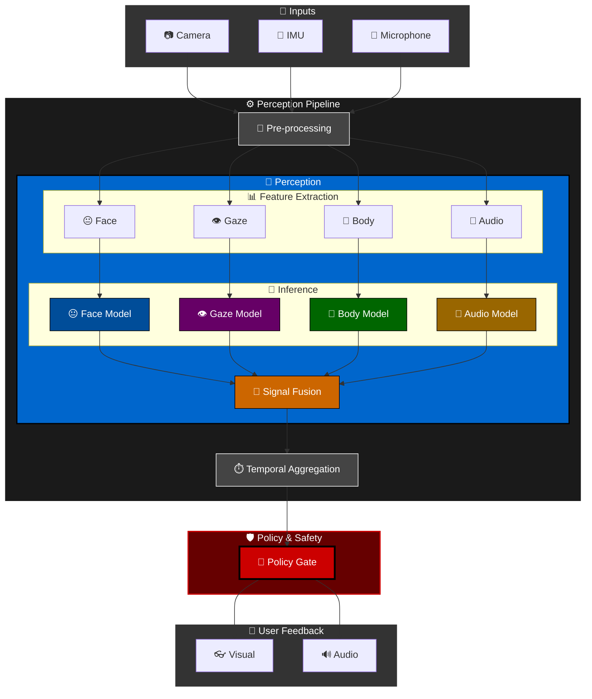
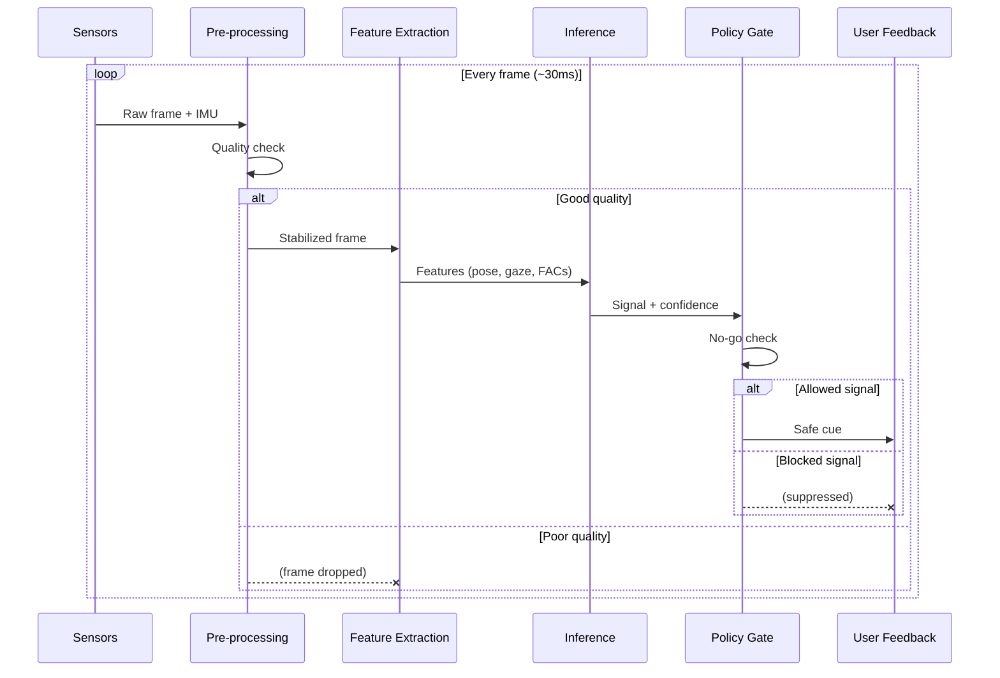
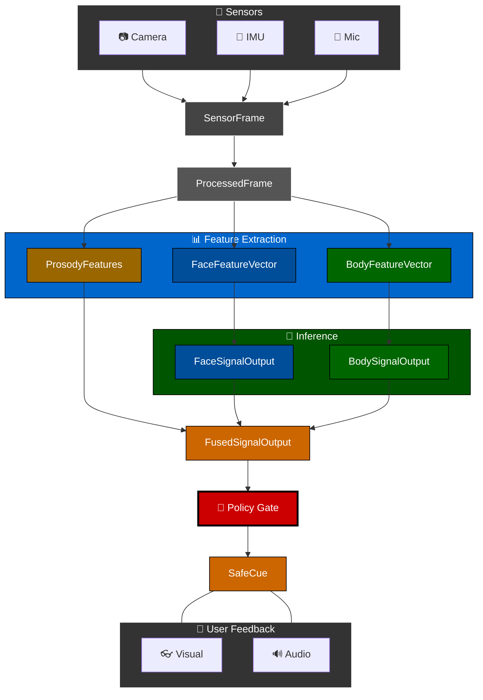
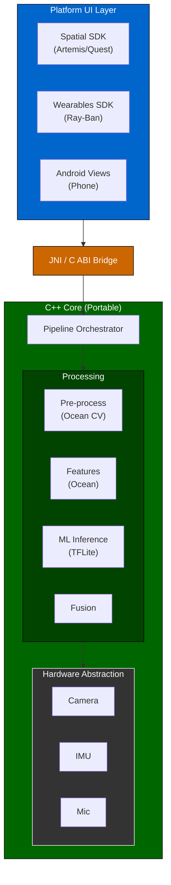

# SecondSight — System Design

---

## Table of Contents

- [Intro](#intro)
- [0. Documentation Style & Technical Writing Guidelines](#0-documentation-style--technical-writing-guidelines)
- [1. Problem & Project Scope](#1-problem--project-scope)
- [2. High-Level Design](#2-high-level-design)
- [3. Data Model](#3-data-model)
- [4. Low Level Design](#4-low-level-design)
  - [4.1 Device Compatibility & Hardware Abstraction](./low-level-design/4.1-device-compatibility.md)
  - [4.2 Pre-processing Pipeline](./low-level-design/4.2-pre-processing.md)
  - [4.3 Feature Extraction](./low-level-design/4.3-feature-extraction.md)
  - [4.4 Perception Models](./low-level-design/4.4-perception-models.md)
  - [4.5 Signal Fusion](./low-level-design/4.5-signal-fusion.md)
  - [4.6 Temporal Aggregation](./low-level-design/4.6-temporal-aggregation.md)
  - [4.7 Policy Gate](./low-level-design/4.7-policy-gate.md)
  - [4.8 User Feedback & Cue Rendering](./low-level-design/4.8-user-feedback.md)
  - [4.9 User Settings & Controls](./low-level-design/4.9-user-settings.md)
  - [4.10 Operating Modes](./low-level-design/4.10-operating-modes.md)
  - [4.11 Raw Data Storage (Mode-Gated)](./low-level-design/4.11-raw-data-storage.md)
  - [4.12 Privacy & Consent UX](./low-level-design/4.12-privacy-consent-ux.md)
  - [4.13 Performance & Latency Budgets](./low-level-design/4.13-performance-latency.md)
  - [4.14 Error Handling & Graceful Degradation](./low-level-design/4.14-error-handling.md)
- [Appendix A: Signal Vocabulary](#appendix-a-signal-vocabulary)
- [Appendix B: Facial Action Units (FAUs) Reference](#appendix-b-facial-action-units-faus-reference)
- [Appendix C: Terminology](#appendix-c-terminology)
- [Appendix D: Bibliography & Key Concepts](#appendix-d-bibliography--key-concepts)

---

<details id="intro">
<summary><strong>Intro</strong></summary>

SecondSight is an XR assistive perception application for devices such as Meta Quest, Ray-Ban Meta smart glasses, and Android smartphones. It augments a user's real-world interactions by detecting observable non-verbal signals such as gaze direction patterns, facial action cues, posture shifts, and turn-taking or voice prosody where available — and delivering subtle, non-authoritative hints through visual, audio, or multimodal feedback depending on device capabilities.

### Scope and Intent

**SecondSight is designed to:**

- Detect internal user states (emotions, intent, deception indicators) from observable cues
- Use movement detection (FAUs, body language, prosody) as intermediate signals for state inference
- Provide real-time feedback to improve situational awareness of non-verbal communication
- Operate in a way that prioritizes privacy, consent, and responsible use

**SecondSight is not designed to:**

- Identify people — no face recognition, no identity linking
- Record or store raw sensor streams by default
- Replace professional assessment (clinical, legal, security)

### Ethical and Legal Guardrails

- **Probabilistic outputs** — all state inferences include confidence levels; never absolute claims
- **Privacy first** — prefer on-device processing, no raw storage
- **Ephemeral inference** — real-time cues, no replay, no sharing
- **Transparency** — always communicate uncertainty and limitations
- **User control** — easy disable, adjustable sensitivity, clear feedback

</details>

---

<details id="0-documentation-style--technical-writing-guidelines">
<summary><strong>0. Documentation Style & Technical Writing Guidelines</strong></summary>

- Use **clear, concise, and unambiguous language**
- Prefer **bullet points** over long paragraphs
- Highlight **key terms** in **bold**
- Use **tables** for comparisons, trade-offs, and structured data
- Use **Mermaid** for architecture diagrams with high contrast colors and very short text in boxes. Add comments below the diagram if necessary.
- Keep diagrams **high-level first**, add detail in later sections
- Explicitly document **assumptions**, **constraints**, and **out-of-scope** items
- Mark open questions with **TBD**

</details>

---

<details id="1-problem--project-scope">
<summary><strong>1. Problem & Project Scope</strong></summary>

### Core Problem

Most of the inter-personal communication we do is non-verbal. We communicate through our facial expressions, body language, and tone of voice. We do this unconsciously, and often without realizing it. We use these non-verbal cues to understand others, to express ourselves, and to build relationships. But sometimes, we can't read the cues we're getting from others. We can't understand what they're feeling, what they're thinking, or what they're trying to communicate. This can lead to miscommunication, confusion, and even conflict.

**SecondSight** provides real-time, on-device detection of internal states (emotions, intent, deception indicators) from observable non-verbal signals.

### Functional Requirements

| ID | Requirement | Priority |
|----|-------------|----------|
| **F1** | No-go inference enforcement (hard block on recognition/identity) | P0 |
| **F2** | Privacy and consent UX (onboarding, explicit toggles) | P0 |
| **F3** | Real-time perception pipeline (camera, IMU, optional mic) | P0 |
| **F4** | Signal categorization and temporal aggregation with confidence bounds | P0 |
| **F5** | Subtle, non-authoritative user feedback with user controls | P0 |
| **F6** | Multi-device support (Quest, Ray-Ban Meta glasses, Android smartphones) with visual/audio/multimodal feedback | P0 |
| **F7** | Graceful degradation when sensors or compute are limited | P1 |
| **F8** | Operating modes: Assistive (default), Training/Reflection, Research (opt-in) | P2 |

**Priority Key:** P0 = Critical | P1 = High | P2 = Medium

### Non-Functional Requirements

| Category | Requirement |
|----------|-------------|
| **Latency** | < 250 ms lightweight cues, < 500 ms heavier perception |
| **Performance** | Dynamic quality scaling based on device thermal state |
| **Privacy** | On-device inference, no raw sensor storage, opt-in anonymized telemetry only |
| **Reliability** | Conservative behavior under poor signal quality; explicit "insufficient data" states |
| **Transparency** | Explainable cues; persistent reminder of probabilistic nature |
| **Safety** | Low salience defaults; immediate disable mechanism |
| **Compliance** | Documentation-ready data flows; DPIA-style review support |

### Scope Agreement

#### In Scope

- Real-time detection of **internal states**: emotions, intent indicators, deception cues
- **Observable signals as intermediary**: gaze proxy, facial action, pose, prosody
- On-device processing with privacy-first architecture
- Assistive, Training, and Research modes
- **1:1 interaction model** (UserA ↔ single UserB)

#### Out of Scope

- Face recognition or identity tracking
- Cloud-based inference or raw data upload
- Individual scoring, ranking, or profiling
- Clinical diagnosis or legal/security assessment
- **Multi-party tracking** (UserC, UserD, etc.) — future scope

### Ethical & Legal Guardrails

| Guardrail | Description |
|-----------|-------------|
| Probabilistic outputs | All inferences include confidence levels; never absolute claims |
| Privacy first | On-device processing, no raw storage |
| Ephemeral inference | Real-time cues only; no replay, no sharing |
| Transparency | Always communicate uncertainty and limitations |
| No identity tracking | Never identify individuals or link across sessions |

### 1.5 State of the Art: Real-Time Social Perception Applications

This section surveys existing applications for real-time non-verbal signal detection, covering both **facial analysis** and **body language** (pose, gesture, posture). Understanding this landscape is critical for positioning SecondSight.

### Facial Analysis — XR/VR

| Product | Platform | Claims | Status | Notes |
|---------|----------|--------|--------|-------|
| **Meta Quest Pro Face Tracking** | Quest Pro | Real-time facial expression tracking for avatar animation | Commercial (2022+) | FACS-based; focuses on animation, not emotion |
| **Emteq Pro** | Pico, HTC Vive (face mask) | EMG, PPG, eye tracking for emotional well-being | Commercial reference design | Research-oriented; limited consumer traction |
| **Floreo VR** | Various VR | VR learning tools for autism; social/communication skills | Commercial | Used by schools, therapy; NIH studies |

### Facial Analysis — Smart Glasses & Mobile

| Product | Platform | Claims | Status | Notes |
|---------|----------|--------|--------|-------|
| **Google Superpower Glass** | Google Glass | Emoji overlays for emotion recognition; autism assistance | Research prototype (Stanford) | Limited follow-up after initial research |
| **Brain Power (Empowered Brain)** | Google Glass | Autism emotional recognition via emojis | Commercial (limited) | Partnership with Affectiva |
| **Affectiva Emotion AI SDK** | iOS/Android | Facial expression recognition and emotion classification | Commercial SDK | Acquired by Smart Eye (2021); bias concerns |
| **Microsoft Azure Face API** | Cloud | Emotion detection from facial images | **Deprecated (2022)** | Removed citing scientific validity concerns |

### Body Language & Pose Estimation — XR/VR

| Product | Platform | Claims | Status | Notes |
|---------|----------|--------|--------|-------|
| **Meta Quest Body Tracking** | Quest 3, Quest Pro | Full-body pose estimation from headset cameras | Commercial (2023+) | Inside-out tracking; powers avatar animation |
| **Meta Hand Tracking** | Quest, Ray-Ban Meta | Real-time hand pose and gesture recognition | Commercial | Supports microgestures on smart glasses |
| **Apple Vision Pro** | visionOS | Hand and eye tracking for spatial input | Commercial (2024) | Gesture-based UI; no body tracking |
| **HTC Vive Full Body Trackers** | Vive | Additional trackers for legs/feet | Commercial | Requires external trackers |

### Body Language & Pose Estimation — Mobile/Desktop

| Product | Platform | Claims | Status | Notes |
|---------|----------|--------|--------|-------|
| **MediaPipe Holistic** | Cross-platform | Real-time face, hand, and body landmarks (540+ keypoints) | Open source (Google) | Runs on mobile; widely used in research |
| **OpenPose** | Desktop | Multi-person pose estimation | Open source (CMU) | Pioneering; GPU-intensive |
| **BlazePose GHUM** | Mobile | Real-time 3D body + hand landmarks | Research (Google) | Optimized for mobile devices |
| **MoveNet** | TensorFlow | Fast pose estimation for fitness/sports | Open source (Google) | Thunder/Lightning variants for speed/accuracy |

### Gesture Recognition

| Product | Platform | Claims | Status | Notes |
|---------|----------|--------|--------|-------|
| **Meta Ray-Ban Hand Gestures** | Ray-Ban Meta glasses | CV-based hand gestures for music, AI control | Prototype (2025) | Usability challenges noted in research |
| **Leap Motion Controller** | Desktop/VR | High-precision hand tracking | Commercial | Acquired by Ultraleap |
| **Manomotion** | Mobile | Gesture recognition SDK | Commercial | AR/VR applications |

### Presentation & Communication Coaching

| Product | Platform | Claims | Status | Notes |
|---------|----------|--------|--------|-------|
| **Orai** | iOS/Android | AI speech coach; analyzes pace, filler words, energy | Commercial | Focus on public speaking |
| **Yoodli** | Web/Mobile | AI communication coach; body language feedback | Commercial | Analyzes posture, gestures, eye contact |
| **Poised** | Desktop | Real-time meeting coach | Commercial | Analyzes speech patterns, filler words |
| **Speeko** | iOS/Android | Speech and presentation training | Commercial | Gamified learning |

### Research Prototypes (Body/Pose)

| Project | Organization | Focus | Status |
|---------|--------------|-------|--------|
| **Stanford Autism Glass** | Stanford | Behavioral coaching via Google Glass | Published research (2016–2020) |
| **XR-Poser** | Meta/KAUST | Egocentric body tracking for AR/VR | Research (2025) |
| **LabGraph PosAI** | Meta (open source) | Real-time pose recognition tool | Research prototype |
| **DiffusionPoser** | Academic | Body pose from sparse IMU sensors | CVPR 2024 |
| **IMUPoser** | Academic | Full-body pose from phones/watches/earbuds | CHI 2023 |

### Lie Detection / Deception Products

| Finding |
|---------|
| **No credible consumer products identified.** Academic research confirms humans perform at chance level for lie detection. The scientific basis for automated deception detection remains unsupported. |

### Key Criticisms and Controversies

| Issue | Details |
|-------|---------|
| **Scientific validity** | Microsoft deprecated its emotion API (2022) citing concerns about inferring internal states from facial expressions. |
| **Demographic bias** | Facial and body models perform inconsistently across ethnicities, ages, genders, and body types. |
| **Privacy concerns** | Always-on sensing raises concerns for bystanders who haven't consented. |
| **Regulatory landscape** | EU AI Act (2024) classifies emotion recognition in certain contexts as high-risk or prohibited. |

### Lessons for SecondSight: Learning from Industry Approaches

| Industry Challenge | How SecondSight Addresses It |
|-------------------|------------------------------|
| **Scientific validity concerns** (Microsoft deprecated API) | **Probabilistic outputs with confidence levels.** All state inferences include uncertainty. Never absolute claims. |
| **Face-only analysis** (most emotion AI) | **Face + Body fusion.** Independent models for face and body, combined at fusion. Either can work alone (graceful degradation). |
| **Cloud processing** (Affectiva, Azure) | **100% on-device.** No raw data leaves the device. No cloud dependency. Privacy by architecture, not policy. |
| **Black-box outputs** (most commercial APIs) | **Transparent uncertainty.** Every inference includes reliability score. Clear communication of confidence levels. |
| **Poor demographic generalization** (bias in training data) | **Fine-tunable models.** Open-source approach enables retraining on diverse datasets for fairness. |
| **Always-on surveillance framing** | **Assistive framing.** Opt-in, user-controlled, ephemeral. Designed as a personal tool, not surveillance. |
| **No identity protection** | **No identity tracking.** Never identify individuals or link across sessions. Face detection, not recognition. |

---

### Apps to Try (Hands-On Research)

The following apps are recommended for hands-on exploration of the current state of the art.

#### Pose & Body Tracking

| App | Platform | What to Evaluate |
|-----|----------|------------------|
| **MediaPipe Holistic Demo** | Web | Body + hand + face landmark accuracy; latency |
| **Move.ai** | iOS | Markerless motion capture from phone |
| **Plask** | Web | AI motion capture from video |
| **Rokoko Video** | iOS/Android | Free motion capture from video |

#### Gesture Recognition Apps

| App | Platform | What to Evaluate |
|-----|----------|------------------|
| **Meta Quest Hand Tracking Demos** | Quest | Gesture recognition accuracy; latency |
| **Leap Motion Playground** | Desktop | High-precision hand tracking |
| **FingerPose** | Web (JS) | Custom gesture recognition |

#### Communication Coaching

| App | Platform | What to Evaluate |
|-----|----------|------------------|
| **Yoodli** | Web/iOS | Body language feedback quality |
| **Orai** | iOS/Android | Speech pattern analysis |
| **Poised** | Desktop | Real-time meeting feedback |
| **Speeko** | iOS/Android | Presentation training UX |

#### Autism/Social Skills

| App | Platform | What to Evaluate |
|-----|----------|------------------|
| **Floreo** | VR | Therapeutic VR for social skills |
| **Brain Power (Empowered Brain)** | Google Glass | Emoji-based emotion feedback |

#### Developer SDKs

| SDK | Platform | What to Evaluate |
|-----|----------|------------------|
| **MediaPipe** | Cross-platform | Pose, face, hand tracking APIs |
| **OpenPose** | Desktop | Multi-person pose estimation |
| **Meta Movement SDK** | Quest | Body and hand tracking APIs |
| **ARKit Body Tracking** | iOS | Apple's body tracking capabilities |
| **ARCore Augmented Faces** | Android | Google's face mesh tracking |

</details>

---

<details id="2-high-level-design">
<summary><strong>2. High-Level Design</strong></summary>

### Core Idea

SecondSight is a real-time perception pipeline with a **mandatory policy gate** between inference and user feedback. All processing happens on-device. No raw sensor data is stored.

The system uses **four independent perception paths**:

- **Face signals** — Facial Action Units (FAUs), expression dynamics
- **Eye signals** — Gaze direction, attention patterns
- **Body signals** — Pose, gestures, posture shifts, orientation
- **Audio signals** — Prosody, tempo, turn-taking cues

Each path has its own dedicated model. Results are combined at the Signal Fusion stage before the Policy Gate.

### Architecture Diagram



### Key Design Decisions

| Decision | Rationale | Alternatives Rejected |
|----------|-----------|----------------------|
| On-device processing | Privacy first, no cloud dependency, low latency | Cloud inference (privacy risk, latency) |
| Policy gate as hard requirement | Prevents forbidden inferences (identity, absolute claims) from reaching user | Soft filtering (risk of leakage) |
| Probabilistic outputs with confidence | Acknowledges inherent uncertainty in state detection | Absolute claims (scientifically unsound) |
| Temporal smoothing | Reduces noise, prevents jittery feedback | Raw frame-by-frame (too noisy) |
| Graceful degradation | Works across device capabilities | Fail-hard (poor UX) |

> **Design note:** ML models are **independent** — each can run, fail, or degrade separately. Signal Fusion combines their outputs but does not require both. This enables graceful degradation (e.g., body-only when face is occluded).

### Optional Modules

| Module | Description | Privacy Note |
|--------|-------------|--------------|
| Local Summaries | Post-session reflection for training mode | No raw media stored |
| Telemetry | Performance metrics | Opt-in, aggregated, anonymized only |
| **Raw Data Storage** | Dev/eval only — stores sensor frames and pipeline outputs | ⚠️ **DEV ONLY** — disabled in production builds |

### Sequence Diagram — Real-Time Perception Flow



### Assumptions

- Device has sufficient compute for on-device ML inference
- User has completed onboarding and consented to processing

#### User Controls

Users interact with the system through `UserSettings` (persistent preferences) and `UserControls` (runtime actions). Key capabilities:

- **Master toggle** — Enable/disable all processing
- **Mode selection** — Assistive, training, or research mode
- **Feedback intensity** — Adjust cue salience
- **Emergency disable** — Immediate, persistent off

</details>

---

<details id="3-data-model">
<summary><strong>3. Data Model</strong></summary>

This section defines all data types and contracts for the SecondSight perception pipeline. All communication is on-device; there is no external network API. See **Appendix C** for terminology (UserA, UserB).

> ⚠️ **Critical Clarification:** All perception (face tracking, body tracking, hand tracking, gaze estimation) refers to **UserB** — the person being observed. UserA (the device wearer) is the consumer of the feedback, not the subject of perception. The only data from UserA used in the pipeline is IMU data for motion compensation/stabilization.

### Pipeline Data Flow



### Quality & Reliability Flow

All feature vectors and signals include quality/reliability scores (0.0–1.0) that propagate through the pipeline:

| Stage | Metric | Description |
|-------|--------|-------------|
| Sensor | `signal_quality` | Composite quality (lighting, occlusion, blur) |
| Features | `face_quality` / `body_quality` | Modality-specific quality (visibility, angle, truncation) |
| Inference | `reliability` | Model confidence × input quality |
| Output | `salience` | Presentation weight (strength × reliability) |

---

### Core Data Types

#### Input Types

**SensorFrame** — Raw sensor data captured at each frame interval, observing UserB.

| Attribute | Type | Description |
|-----------|------|-------------|
| `timestamp_ns` | int64 | Device monotonic clock in nanoseconds (boot time reference) |
| `camera_frames` | CameraFrame[] | Array of camera images (1 for mono, 2 for stereo) |
| `depth_frame` | DepthFrame? | Optional depth map (available on Quest, some phones) |
| `imu_data` | IMUReading | Accelerometer + gyroscope for UserA head motion |
| `audio_chunk` | AudioBuffer? | Optional audio buffer (UserB speech, if mic enabled) |

**CameraFrame** — A single camera image with associated metadata.

| Attribute | Type | Description |
|-----------|------|-------------|
| `image` | RGBFrame | Raw RGB pixel data |
| `camera_id` | CameraPosition | Which camera: `left`, `right`, or `center` |
| `width` | int32 | Image width in pixels |
| `height` | int32 | Image height in pixels |
| `intrinsics` | CameraIntrinsics | Focal length, principal point, distortion coefficients |
| `extrinsics` | CameraPose? | Position and orientation relative to device origin |

**CameraIntrinsics** — Camera calibration parameters (pinhole + distortion model).

| Attribute | Type | Description |
|-----------|------|-------------|
| `fx` | float | Focal length in pixels (x-axis) |
| `fy` | float | Focal length in pixels (y-axis) |
| `cx` | float | Principal point x-coordinate |
| `cy` | float | Principal point y-coordinate |
| `distortion_model` | DistortionModel | Model type: `none`, `radial`, `fisheye` |
| `distortion_coeffs` | float[] | Distortion coefficients (model-dependent) |

**CameraPose** — 6-DoF camera pose relative to device origin.

| Attribute | Type | Description |
|-----------|------|-------------|
| `position` | Vec3 | Translation [x, y, z] in meters |
| `orientation` | Quaternion | Rotation as [w, x, y, z] quaternion |

**DepthFrame** — Depth map with per-pixel distance values.

| Attribute | Type | Description |
|-----------|------|-------------|
| `depth_data` | float[] | Per-pixel depth values in meters (row-major) |
| `width` | int32 | Depth map width in pixels |
| `height` | int32 | Depth map height in pixels |
| `min_depth` | float | Minimum valid depth in meters |
| `max_depth` | float | Maximum valid depth in meters |
| `depth_type` | DepthType | Source: `stereo_computed`, `tof`, `lidar`, `structured_light` |
| `confidence_map` | float[]? | Optional per-pixel confidence (0.0–1.0) |
| `intrinsics` | CameraIntrinsics | Depth sensor intrinsics (for 3D unprojection) |

#### Processing Types

**ProcessedFrame** — Cleaned and stabilized frame of UserB, ready for feature extraction.

| Attribute | Type | Description |
|-----------|------|-------------|
| `timestamp_ns` | int64 | Preserved from source SensorFrame |
| `stabilized_frame` | RGBFrame | Motion-compensated image of UserB |
| `signal_quality` | float (0.0–1.0) | Composite quality score (lighting, occlusion, blur) |

#### Feature Types

**FaceFeatureVector** — Extracted facial features from UserB's face (independent of body).

| Attribute | Type | Description |
|-----------|------|-------------|
| `timestamp_ns` | int64 | Preserved from source frame |
| `facial_actions` | FAUVector | Facial Action Units from UserB (see Appendix B) |
| `gaze_proxy` | GazeEstimate | UserB head orientation + eye region cues |
| `face_quality` | float (0.0–1.0) | Face-specific quality (visibility, occlusion, angle) |

**BodyFeatureVector** — Extracted body features from UserB (independent of face).

| Attribute | Type | Description |
|-----------|------|-------------|
| `timestamp_ns` | int64 | Preserved from source frame |
| `pose` | PoseKeypoints | UserB body keypoints (17+ joints: shoulders, elbows, wrists, hips, etc.) |
| `hand_pose` | HandKeypoints? | UserB hand keypoints (21 per hand, if visible) |
| `head_orientation` | HeadPose | UserB head position and rotation (yaw, pitch, roll) |
| `gestures` | GestureVector? | Detected gesture primitives from UserB (hand movements, arm positions) |
| `body_quality` | float (0.0–1.0) | Body-specific quality (visibility, truncation, occlusion) |

**ProsodyFeatures** — Audio-derived features from UserB's speech (optional, if mic enabled).

| Attribute | Type | Description |
|-----------|------|-------------|
| `timestamp_ns` | int64 | Preserved from source audio chunk |
| `pitch` | float | Fundamental frequency (F0) of UserB's voice |
| `tempo` | float | Speech rate (syllables/sec) |
| `energy` | float | Volume/intensity |
| `voice_quality` | float (0.0–1.0) | Audio signal quality (SNR, clipping) |

#### Inference Types

**SignalOutput** — Raw inference from any perception model. Used for face, gaze, body, and audio signals.

| Attribute | Type | Description |
|-----------|------|-------------|
| `timestamp_ns` | int64 | Preserved from source features |
| `modality` | SignalModality | Source modality: `face`, `gaze`, `body`, `audio` |
| `signal_type` | SignalType | Detected signal category (see Appendix A) |
| `intensity` | float (0.0–1.0) | Magnitude of the detected signal |
| `reliability` | float (0.0–1.0) | Model confidence × input quality |

> **Note:** Each perception model produces `SignalOutput` instances. The `modality` field identifies the source (face, gaze, body, audio), while `signal_type` specifies the detected signal within that modality's vocabulary.

**FusedSignalOutput** — Combined signals from multiple modalities, ready for policy filtering.

| Attribute | Type | Description |
|-----------|------|-------------|
| `timestamp_ns` | int64 | Preserved from source signals |
| `signal_type` | SignalType | Unified signal category (see Appendix A) |
| `intensity` | float (0.0–1.0) | Fused magnitude (weighted by reliability) |
| `reliability` | float (0.0–1.0) | Combined reliability across contributing modalities |
| `contributing_sources` | SignalModality[] | Which modalities contributed to this fused signal |
| `source_weights` | SourceWeights | Per-modality contribution weights used in fusion |

**SourceWeights** — Per-modality weights used in signal fusion.

| Attribute | Type | Description |
|-----------|------|-------------|
| `face_weight` | float (0.0–1.0) | Weight applied to face signal (0.0 if unavailable) |
| `gaze_weight` | float (0.0–1.0) | Weight applied to gaze signal (0.0 if unavailable) |
| `body_weight` | float (0.0–1.0) | Weight applied to body signal (0.0 if unavailable) |
| `audio_weight` | float (0.0–1.0) | Weight applied to audio signal (0.0 if unavailable) |

#### Output Types

**SafeCue** — Policy-approved cue about UserB, safe to present to UserA.

| Attribute | Type | Description |
|-----------|------|-------------|
| `timestamp_ns` | int64 | Preserved from source signal |
| `cue_type` | CueType | Mapped to allowed vocabulary only (see Appendix A) |
| `salience` | float (0.0–1.0) | Combined strength × reliability for presentation |
| `modality` | enum | Output channel: `visual`, `audio`, or `both` |

### Configuration Types

**UserSettings** — Persistent preferences for UserA's feedback experience.

| Attribute | Type | Description |
|-----------|------|-------------|
| `enabled` | bool | Master on/off toggle for all processing |
| `mode` | enum | Operating mode: `assistive`, `training`, or `research` |
| `feedback_intensity` | float (0.0–1.0) | Global multiplier for cue salience |
| `feedback_modality` | enum | Preferred output: `visual`, `audio`, or `both` |
| `mute_until_ns` | int64? | Timestamp until which feedback is suppressed |

**UserControls** — Runtime actions available to UserA.

| Method | Description |
|--------|-------------|
| `toggle_enabled()` | Switch processing on or off |
| `set_mode(mode)` | Change operating mode |
| `adjust_intensity(delta)` | Increase or decrease feedback salience |
| `mute_for(duration_ns)` | Temporarily suppress all cues |
| `emergency_disable()` | Immediate, persistent off — requires explicit re-enable |

### Enumeration Types

| Enum | Values | Description |
|------|--------|-------------|
| `SignalModality` | `face`, `gaze`, `body`, `audio` | Source modality that produced the signal |
| `SignalType` | See Appendix A | Unified signal vocabulary across all modalities |
| `CueType` | See Appendix A | Allowed output vocabulary for user feedback |
| `OperatingMode` | `assistive`, `training`, `research` | System operating modes |
| `FeedbackModality` | `visual`, `audio`, `both` | Output channel preference |
| `CameraPosition` | `left`, `right`, `center` | Which camera in a multi-camera setup |
| `DistortionModel` | `none`, `radial`, `fisheye` | Lens distortion model type |
| `DepthType` | `stereo_computed`, `tof`, `lidar`, `structured_light` | Depth sensor technology |

</details>

---

<details id="4-low-level-design">
<summary><strong>4. Low Level Design</strong></summary>

This section provides detailed technical design, including class diagrams, interface definitions, and technology choices.

### Open Questions (TBD)

- Exact latency budgets per pipeline stage

---

## Tech Stack

### Device × Component Matrix

| Component | Artemis (P0) | Ray-Ban (P1) | Quest (P2) | Android (P3) |
|-----------|:------------:|:------------:|:----------:|:------------:|
| **C++ Core** | ✅ | ✅ | ✅ | ✅ |
| **Ocean CV** | ✅ | ✅ | ✅ | ✅ |
| **TFLite / ONNX** | ✅ | ✅ | ✅ | ✅ |
| **Platform SDK** | Spatial SDK | Wearables SDK | Spatial SDK | NDK |
| **UI Layer** | Spatial SDK (Kotlin) | Wearables SDK (C++) | Spatial SDK (Kotlin) | Android Views |
| **Audio** | Oboe | Oboe | Oboe | Oboe |
| **Bridge** | JNI | C ABI | JNI | JNI |
| **IDE** | Android Studio | VS Code / Xcode | Android Studio | Android Studio |
| **Build** | Gradle + CMake | CMake | Gradle + CMake | Gradle + CMake |
| **Status** | 🔮 Future (2027) | ✅ Available | ✅ Available | ✅ Available |

> **Note:** Using Spatial SDK for both Quest and Artemis enables UI code reuse. Ray-Ban requires separate Wearables SDK (no Spatial SDK support). For Quest, **Ocean OpenXR** is an alternative if a pure C++ solution is preferred (no Kotlin layer).

### Architecture Overview



### Bridge Interface (C ABI)

```cpp
extern "C" {
    int secondsight_poll_cues(SafeCueC* out_cues, int max_cues);
    void secondsight_set_enabled(bool enabled);
    void secondsight_set_mode(int mode);
    void secondsight_set_feedback_intensity(float intensity);
    void secondsight_emergency_disable(void);
    int secondsight_init(const char* config_path);
    void secondsight_shutdown(void);
}

typedef struct {
    int64_t timestamp_ns;
    int cue_type;
    float salience;
    int modality;
} SafeCueC;
```

### Migration Path

| Phase | Timeline | Focus |
|-------|----------|-------|
| **Phase 1** | Now | C++ core + Ocean + TFLite, Quest via OpenXR |
| **Phase 2** | +3 months | Ray-Ban via Wearables SDK |
| **Phase 3** | 2027+ | Artemis via Meta Spatial SDK |

---

<details id="41-device-compatibility--hardware-abstraction">
<summary><strong>4.1 Device Compatibility & Hardware Abstraction</strong></summary>

📄 **See dedicated document:** [4.1-device-compatibility.md](./low-level-design/4.1-device-compatibility.md)

</details>

<details id="42-pre-processing-pipeline">
<summary><strong>4.2 Pre-processing Pipeline</strong></summary>

📄 **See dedicated document:** [4.2-pre-processing.md](./low-level-design/4.2-pre-processing.md)

</details>

<details id="43-feature-extraction">
<summary><strong>4.3 Feature Extraction</strong></summary>

📄 **See dedicated document:** [4.3-feature-extraction.md](./low-level-design/4.3-feature-extraction.md)

</details>

<details id="44-perception-models">
<summary><strong>4.4 Perception Models</strong></summary>

📄 **See dedicated document:** [4.4-perception-models.md](./low-level-design/4.4-perception-models.md)

</details>

<details id="45-signal-fusion">
<summary><strong>4.5 Signal Fusion</strong></summary>

📄 **See dedicated document:** [4.5-signal-fusion.md](./low-level-design/4.5-signal-fusion.md)

</details>

<details id="46-temporal-aggregation">
<summary><strong>4.6 Temporal Aggregation</strong></summary>

📄 **See dedicated document:** [4.6-temporal-aggregation.md](./low-level-design/4.6-temporal-aggregation.md)

</details>

<details id="47-policy-gate">
<summary><strong>4.7 Policy Gate</strong></summary>

📄 **See dedicated document:** [4.7-policy-gate.md](./low-level-design/4.7-policy-gate.md)

</details>

<details id="48-user-feedback-cue-rendering">
<summary><strong>4.8 User Feedback & Cue Rendering</strong></summary>

📄 **See dedicated document:** [4.8-user-feedback.md](./low-level-design/4.8-user-feedback.md)

</details>

<details id="49-user-settings-controls">
<summary><strong>4.9 User Settings & Controls</strong></summary>

📄 **See dedicated document:** [4.9-user-settings.md](./low-level-design/4.9-user-settings.md)

</details>

<details id="410-operating-modes">
<summary><strong>4.10 Operating Modes</strong></summary>

📄 **See dedicated document:** [4.10-operating-modes.md](./low-level-design/4.10-operating-modes.md)

</details>

<details id="411-raw-data-storage-mode-gated">
<summary><strong>4.11 Raw Data Storage (Mode-Gated)</strong></summary>

📄 **See dedicated document:** [4.11-raw-data-storage.md](./low-level-design/4.11-raw-data-storage.md)

</details>

<details id="412-privacy-consent-ux">
<summary><strong>4.12 Privacy & Consent UX</strong></summary>

📄 **See dedicated document:** [4.12-privacy-consent-ux.md](./low-level-design/4.12-privacy-consent-ux.md)

</details>

<details id="413-performance-latency-budgets">
<summary><strong>4.13 Performance & Latency Budgets</strong></summary>

📄 **See dedicated document:** [4.13-performance-latency.md](./low-level-design/4.13-performance-latency.md)

</details>

<details id="414-error-handling-graceful-degradation">
<summary><strong>4.14 Error Handling & Graceful Degradation</strong></summary>

📄 **See dedicated document:** [4.14-error-handling.md](./low-level-design/4.14-error-handling.md)

</details>

</details>

---

<details id="appendix-a-signal-vocabulary">
<summary><strong>Appendix A: Signal Vocabulary</strong></summary>

### Allowed Outputs

| Signal Type | Description | Example Cue |
|-------------|-------------|-------------|
| `engagement_shift` | Change in attention indicators | "Attention shifted" |
| `turn_taking_cue` | Pause or floor-yielding signal | "Opening to speak" |
| `tempo_change` | Speech rate variation | "Pace quickening" |
| `posture_shift` | Body orientation change | "Leaning away" |
| `gaze_aversion` | Eye contact pattern change | "Gaze shifted" |
| `expression_intensity` | Facial expressiveness level | "Expression intensified" |
| `emotional_state` | Detected emotion indicator | "Frustration detected (72%)" |
| `deception_indicator` | Behavioral inconsistency cue | "Possible deception (65%)" |
| `intent_signal` | Goal-directed behavior cue | "Hesitation detected" |

### Blocked Vocabulary (Never Output)

| Blocked Category | Examples | Rationale |
|------------------|----------|-----------|
| **Identity** | "Person X", face ID, tracking across sessions | No face recognition |
| **Absolute Claims** | "definitely lying", "100% angry", "is deceptive" | Always probabilistic |
| **Clinical Diagnosis** | "has anxiety disorder", "is depressed", "PTSD" | Not a clinical tool |
| **Character Judgments** | "untrustworthy person", "bad character", "manipulative personality" | Observe behavior, not traits |

> ⚠️ **Note:** All state inferences include confidence levels. The system outputs probabilistic indicators (e.g., "Frustration detected (72%)"), never absolute claims (e.g., "Is angry").

</details>

---

<details id="appendix-b-facial-action-units-faus-reference">
<summary><strong>Appendix B: Facial Action Units (FAUs) Reference</strong></summary>

### Overview

The **Facial Action Coding System (FACS)** is a taxonomy of human facial movements based on muscle activation, developed by Paul Ekman and Wallace Friesen (1978). SecondSight uses a subset of Action Units (AUs) relevant to non-verbal signal detection.

FACS describes **what the face is doing** — the observable movements that serve as intermediate signals for detecting internal states.

### Action Units Used

| AU | Name | Muscle | Observable Signal |
|----|------|--------|-------------------|
| AU1 | Inner Brow Raiser | Frontalis (pars medialis) | Surprise, concern indicators |
| AU2 | Outer Brow Raiser | Frontalis (pars lateralis) | Surprise indicators |
| AU4 | Brow Lowerer | Corrugator supercilii | Concentration, confusion indicators |
| AU5 | Upper Lid Raiser | Levator palpebrae | Attention, alertness |
| AU6 | Cheek Raiser | Orbicularis oculi | Expression intensity |
| AU7 | Lid Tightener | Orbicularis oculi | Engagement, focus |
| AU9 | Nose Wrinkler | Levator labii superioris | Discomfort indicator |
| AU10 | Upper Lip Raiser | Levator labii superioris | Expression intensity |
| AU12 | Lip Corner Puller | Zygomaticus major | Positive expression indicator |
| AU14 | Dimpler | Buccinator | Expression asymmetry |
| AU15 | Lip Corner Depressor | Depressor anguli oris | Expression shift |
| AU17 | Chin Raiser | Mentalis | Expression intensity |
| AU20 | Lip Stretcher | Risorius | Expression shift |
| AU23 | Lip Tightener | Orbicularis oris | Tension indicator |
| AU24 | Lip Pressor | Orbicularis oris | Suppression indicator |
| AU25 | Lips Part | Depressor labii | Speaking readiness |
| AU26 | Jaw Drop | Masseter (relaxed) | Speech, surprise |
| AU45 | Blink | Orbicularis oculi | Attention patterns |

### Intensity Coding

FACS uses a 5-point intensity scale:

| Code | Intensity | Description |
|------|-----------|-------------|
| A | Trace | Barely visible |
| B | Slight | Clearly present |
| C | Marked | Pronounced |
| D | Severe | Strong |
| E | Maximum | Extreme |

SecondSight normalizes these to a 0.0–1.0 float for `intensity` in SignalOutput.

### References

1. Ekman, P., & Friesen, W. V. (1978). *Facial Action Coding System: A Technique for the Measurement of Facial Movement*. Consulting Psychologists Press.
2. Ekman, P., Friesen, W. V., & Hager, J. C. (2002). *Facial Action Coding System: The Manual* (2nd ed.). Research Nexus.
3. Facial Action Coding System — Wikipedia: <https://en.wikipedia.org/wiki/Facial_Action_Coding_System>

</details>

---

<details id="appendix-c-terminology">
<summary><strong>Appendix C: Terminology</strong></summary>

| Term | Definition | Relevance to SecondSight |
|------|------------|--------------------------|
| **Affective Computing** | The study and development of systems that recognize, interpret, and simulate human emotions. | Domain foundation; SecondSight applies real-time, on-device affective inference with uncertainty. |
| **Cue** | A user-facing hint derived from one or more signals. Presented via visual/audio feedback. | Output presented to UserA after passing the Policy Gate; includes salience and uncertainty. |
| **Deception Detection** | Detection of behavioral cues associated with deception. | Provided as probabilistic indicators only; confidence and limitations are surfaced. |
| **Emotion Recognition** | Automated detection of emotional states from facial expressions, voice, and body language. | Core capability with probabilistic outputs and policy gate enforcement to prevent overreach. |
| **FAU** | Facial Action Unit — a FACS-based descriptor of facial muscle movement (see Appendix B). | Intermediate features for face signals; enable explainable, movement-based inference. |
| **FACS** | Facial Action Coding System — a taxonomy of human facial movements based on muscle activation. Developed by Ekman & Friesen (1978). | SecondSight uses FACS-based features (FAUs) as intermediate signals for detecting internal states. See Appendix B. |
| **Non-verbal Communication** | The transmission of messages without words — throxugh facial expressions, gestures, posture, gaze, and vocal tone. | Core domain; multimodal signals drive state inference and assistive cues. |
| **Physiognomy** | The pseudoscientific practice of judging character or personality from facial features (not expressions). Discredited. | Explicitly avoided; SecondSight detects dynamic signals, not static traits. |
| **Policy Gate** | The mandatory filtering layer that blocks forbidden inferences before they reach UserA. | Enforces ethical/legal guardrails (no identity, no absolute claims); hard block in pipeline. |
| **Reliability** | A composite score of model confidence and input data quality. | Propagates through pipeline; used to modulate cue salience and transparency. |
| **Salience** | How prominently a cue is presented; a function of signal strength and reliability. | Drives presentation intensity; user-adjustable and quality-weighted. |
| **Signal** | An observable, measurable non-verbal behavior (e.g., gaze shift, posture change). | Core input units for inference; fused across modalities before policy gating. |
| **UserA** | The person wearing the SecondSight device. Receives feedback cues. | Primary user receiving assistive feedback; controls settings and modes. |
| **UserB** | The interlocutor being observed by UserA. Source of non-verbal signals. | Source of observable signals; never identified; signals are processed with privacy safeguards. |

</details>

---
<details id="appendix-d-bibliography--key-concepts">
<summary><strong>Appendix D: Bibliography</strong></summary>


### Bibliography

1. Ekman, P., & Friesen, W. V. (1978). *Facial Action Coding System: A Technique for the Measurement of Facial Movement*. Consulting Psychologists Press.
2. Ekman, P., Friesen, W. V., & Hager, J. C. (2002). *Facial Action Coding System: The Manual* (2nd ed.). Research Nexus.
3. Picard, R. W. (1997). *Affective Computing*. MIT Press.
4. Todorov, A., Olivola, C. Y., Dotsch, R., & Mende-Siedlecki, P. (2015). Social attributions from faces: Determinants, consequences, accuracy, and functional significance. *Annual Review of Psychology*, 66, 519–545.
5. Bond, C. F., & DePaulo, B. M. (2006). Accuracy of deception judgments. *Personality and Social Psychology Review*, 10(3), 214–234.
6. Crawford, K., & Paglen, T. (2019). Excavating AI: The politics of training sets for machine learning. *AI Now Institute*.
