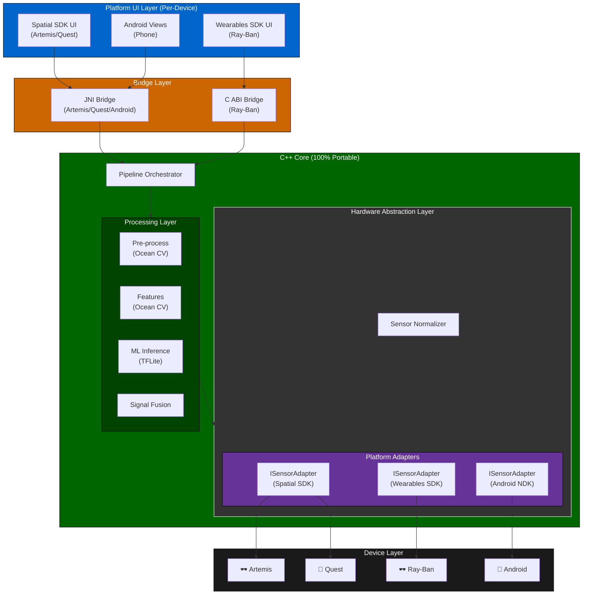
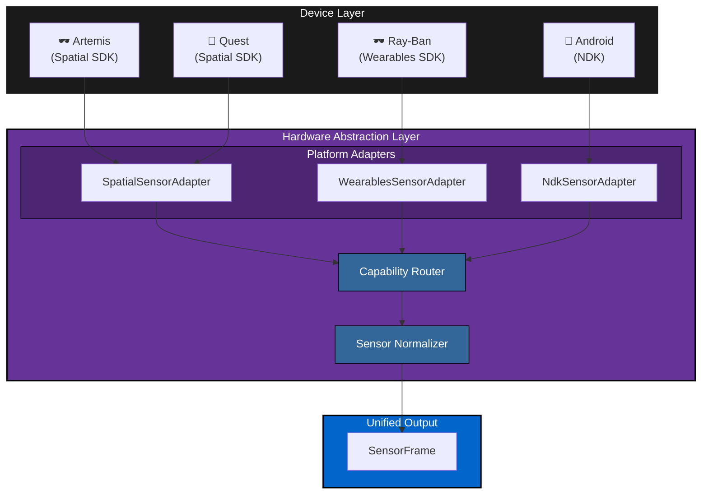
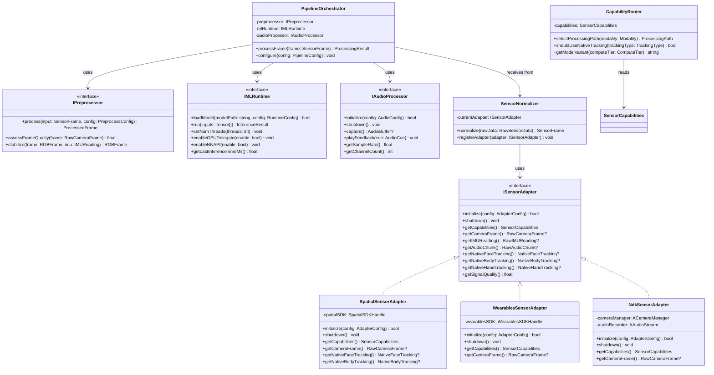
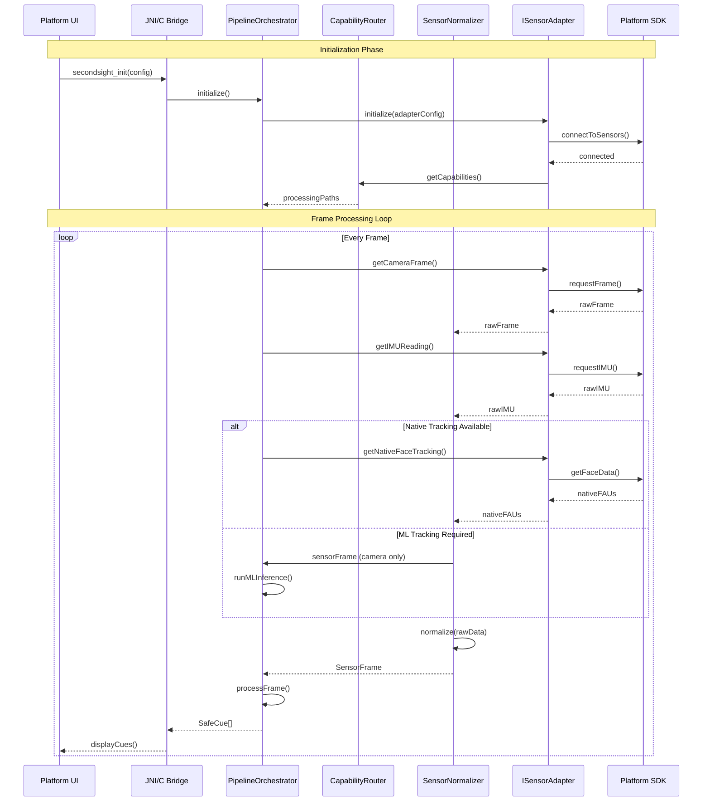
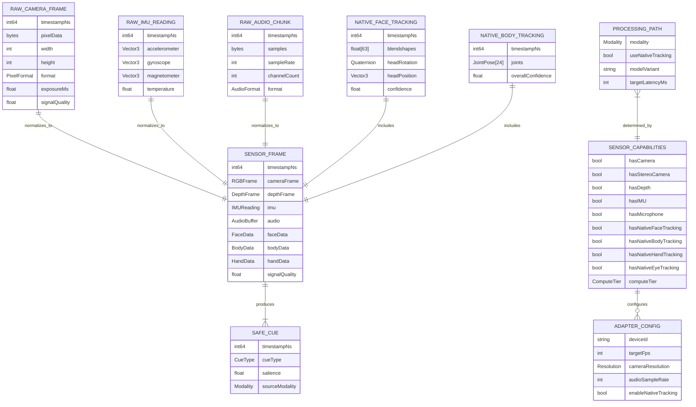

# 4.1 Device Compatibility & Hardware Abstraction

---

## Supported Devices

| Device Class | Examples | Platform SDK | Priority | Primary Use Case |
|--------------|----------|--------------|----------|------------------|
| **XR Glasses** | Artemis (future) | Spatial SDK | P0 | Next-gen XR assistive experience |
| **Smart Glasses** | Ray-Ban Meta | Wearables SDK | P1 | Everyday assistive use |
| **VR Headsets** | Meta Quest 3, Quest Pro | Spatial SDK | P2 | Immersive training, research mode |
| **Smartphones** | Android devices | Android NDK | P3 | Accessible entry point, training mode |

---

## Layered Architecture for Maximum Reuse

SecondSight uses a **layered architecture** that maximizes code reuse across all devices. The **C++ Core** is 100% portable; only the **Platform Adapter Layer** varies by device.

### Component Reuse Matrix

| Component | Artemis | Ray-Ban | Quest | Android | Shared? |
|-----------|:-------:|:-------:|:-----:|:-------:|:-------:|
| **C++ Core** | ✅ | ✅ | ✅ | ✅ | 100% |
| **Ocean CV** | ✅ | ✅ | ✅ | ✅ | 100% |
| **TFLite Runtime** | ✅ | ✅ | ✅ | ✅ | 100% |
| **Oboe Audio** | ✅ | ✅ | ✅ | ✅ | 100% |
| **Pipeline Orchestrator** | ✅ | ✅ | ✅ | ✅ | 100% |
| **Sensor Normalizer** | ✅ | ✅ | ✅ | ✅ | 100% |
| **Platform Adapter** | Spatial | Wearables | Spatial | NDK | Per-platform |
| **UI Layer** | Kotlin | C++ | Kotlin | Views | Per-platform |
| **Bridge Type** | JNI | C ABI | JNI | JNI | Per-platform |

> **Note:** ~85% of codebase is shared across all devices. Only Platform Adapter and UI Layer are platform-specific.

---

## Abstraction Layers

The architecture defines three abstraction layers, each with clear interfaces that enable technology swapping:



---

## Abstract Interface Definitions

These interfaces enable technology swapping without modifying consumer code.

### ISensorAdapter Interface

All platform adapters implement this interface, enabling the Sensor Normalizer to work with any platform SDK.

```cpp
/**
 * Abstract interface for platform-specific sensor access.
 * Implement this interface for each platform SDK.
 */
class ISensorAdapter {
public:
    virtual ~ISensorAdapter() = default;

    // Lifecycle
    virtual bool initialize(const AdapterConfig& config) = 0;
    virtual void shutdown() = 0;

    // Capabilities discovery
    virtual SensorCapabilities getCapabilities() const = 0;

    // Data acquisition
    virtual std::optional<RawCameraFrame> getCameraFrame() = 0;
    virtual std::optional<RawIMUReading> getIMUReading() = 0;
    virtual std::optional<RawAudioChunk> getAudioChunk() = 0;

    // Native tracking (when available)
    virtual std::optional<NativeFaceTracking> getNativeFaceTracking() = 0;
    virtual std::optional<NativeBodyTracking> getNativeBodyTracking() = 0;
    virtual std::optional<NativeHandTracking> getNativeHandTracking() = 0;

    // Quality metrics
    virtual float getSignalQuality() const = 0;
};

/**
 * Describes what sensors/tracking a platform provides.
 */
struct SensorCapabilities {
    bool hasCamera = false;
    bool hasStereoCamera = false;
    bool hasDepth = false;
    bool hasIMU = false;
    bool hasMicrophone = false;

    // Native tracking (no ML required)
    bool hasNativeFaceTracking = false;
    bool hasNativeBodyTracking = false;
    bool hasNativeHandTracking = false;
    bool hasNativeEyeTracking = false;

    // Compute constraints
    ComputeTier computeTier = ComputeTier::Low;
};

enum class ComputeTier { Low, Medium, High };
```

### IPreprocessor Interface

Enables swapping preprocessing implementations (e.g., Ocean CV → custom GPU pipeline).

```cpp
/**
 * Abstract interface for frame preprocessing.
 * Default implementation uses Ocean CV.
 */
class IPreprocessor {
public:
    virtual ~IPreprocessor() = default;

    virtual ProcessedFrame process(
        const SensorFrame& input,
        const PreprocessConfig& config
    ) = 0;

    // Quality assessment
    virtual float assessFrameQuality(const RawCameraFrame& frame) = 0;

    // Motion compensation
    virtual RGBFrame stabilize(
        const RGBFrame& frame,
        const IMUReading& imu
    ) = 0;
};
```

### IMLRuntime Interface

Enables swapping ML runtime (e.g., TFLite → ONNX → custom accelerator).

```cpp
/**
 * Abstract interface for ML inference runtime.
 * Default implementation uses TFLite.
 */
class IMLRuntime {
public:
    virtual ~IMLRuntime() = default;

    virtual bool loadModel(
        const std::string& modelPath,
        const RuntimeConfig& config
    ) = 0;

    virtual InferenceResult run(
        const std::vector<Tensor>& inputs
    ) = 0;

    // Performance tuning
    virtual void setNumThreads(int threads) = 0;
    virtual void enableGPUDelegate(bool enable) = 0;
    virtual void enableNNAPI(bool enable) = 0;

    // Metrics
    virtual float getLastInferenceTimeMs() const = 0;
};
```

### IAudioProcessor Interface

Enables swapping audio library (e.g., Oboe → platform-native).

```cpp
/**
 * Abstract interface for audio processing.
 * Default implementation uses Oboe.
 */
class IAudioProcessor {
public:
    virtual ~IAudioProcessor() = default;

    virtual bool initialize(const AudioConfig& config) = 0;
    virtual void shutdown() = 0;

    virtual std::optional<AudioBuffer> capture() = 0;
    virtual void playFeedback(const AudioCue& cue) = 0;

    virtual float getSampleRate() const = 0;
    virtual int getChannelCount() const = 0;
};
```

---

## Platform Adapter Implementations

Each platform SDK has a concrete adapter implementation:

| Adapter Class | Platform SDK | Devices |
|---------------|--------------|---------|
| `SpatialSensorAdapter` | Meta Spatial SDK | Artemis, Quest 3, Quest Pro |
| `WearablesSensorAdapter` | Meta Wearables SDK | Ray-Ban Meta |
| `NdkSensorAdapter` | Android NDK | Android smartphones |

### Platform SDK Comparison

| Capability | Spatial SDK | Wearables SDK | Android NDK |
|------------|:-----------:|:-------------:|:-----------:|
| **Camera Access** | ✅ Passthrough | ✅ Front-facing | ✅ Front/Back |
| **Stereo Cameras** | ✅ Yes | ❌ No | ❌ No |
| **Depth Sensor** | ✅ Quest 3 | ❌ No | ⚠️ Some devices |
| **Native Face Tracking** | ✅ Quest Pro | ❌ No | ❌ No |
| **Native Body Tracking** | ✅ Quest 3+ | ❌ No | ❌ No |
| **Native Hand Tracking** | ✅ Yes | ⚠️ Limited | ❌ No |
| **Native Eye Tracking** | ✅ Quest Pro | ❌ No | ❌ No |
| **IMU** | ✅ 6-DoF | ✅ 3-DoF | ✅ 6-DoF |
| **Microphone** | ✅ Yes | ✅ Yes | ✅ Yes |
| **Compute Tier** | High | Low | Medium |

---

## Hardware Abstraction Layer (HAL)

The HAL ensures the **Processing Layer receives identical input** regardless of device. It consists of:

1. **Platform Adapters** — Implement `ISensorAdapter` for each SDK
2. **Sensor Normalizer** — Converts platform-specific data to unified `SensorFrame`
3. **Capability Router** — Routes processing based on available capabilities



---

## HAL Design Principles

| Principle | Description | Implementation |
|-----------|-------------|----------------|
| **Uniform Input Contract** | All adapters produce the same `SensorFrame` structure | `ISensorAdapter` interface |
| **Capability Discovery** | Adapters declare available sensors at runtime | `SensorCapabilities` struct |
| **Graceful Degradation** | Missing sensors represented as null/optional | `std::optional<>` return types |
| **Quality Metadata** | Each adapter reports sensor quality scores | `getSignalQuality()` method |
| **No Platform Leakage** | Processing layer has zero knowledge of SDK | Abstract interface only |
| **Technology Swappable** | Swap implementations without changing consumers | Dependency injection |

---

## Sensor Availability by Device

| Sensor | Artemis | Quest 3/Pro | Ray-Ban | Android | Fallback Strategy |
|--------|:-------:|:-----------:|:-------:|:-------:|-------------------|
| **RGB Camera** | ✅ | ✅ | ✅ Limited | ✅ | Required — graceful degrade quality |
| **Stereo Depth** | ✅ | ✅ Quest 3 | ❌ | ⚠️ | Optional — use monocular depth estimation |
| **Face Tracking** | ✅ Native | ✅ Quest Pro | ❌ ML | ❌ ML | ML inference when native unavailable |
| **Body Tracking** | ✅ Native | ✅ Native | ❌ ML | ❌ ML | ML inference when native unavailable |
| **Hand Tracking** | ✅ Native | ✅ Native | ⚠️ Limited | ❌ ML | ML inference when native unavailable |
| **Eye Tracking** | ✅ Native | ✅ Quest Pro | ❌ | ❌ | Head-based gaze proxy |
| **IMU** | ✅ 6-DoF | ✅ 6-DoF | ✅ 3-DoF | ✅ 6-DoF | Always available |
| **Microphone** | ✅ | ✅ | ✅ | ✅ | Always available |

> **Note:** When native tracking is unavailable (❌ ML), the Processing Layer runs on-device ML models (TFLite) on camera frames. This is more compute-intensive but produces equivalent `SensorFrame` data.

---

## Capability-Based Processing Routes

The Capability Router selects processing paths based on device capabilities:

| Scenario | Device | Processing Path |
|----------|--------|-----------------|
| **Native Face Tracking** | Quest Pro, Artemis | Adapter → FAUs → Skip ML face model |
| **ML Face Tracking** | Quest 3, Ray-Ban, Android | Adapter → Camera → TFLite face model → FAUs |
| **Native Body Tracking** | Quest 3+, Artemis | Adapter → Pose → Skip ML body model |
| **ML Body Tracking** | Ray-Ban, Android | Adapter → Camera → TFLite pose model → Pose |
| **Degraded Sensor** | Any | Adapter sets low quality → Higher uncertainty in output |
| **Missing Sensor** | Any | Adapter returns `std::nullopt` → Modality excluded from fusion |

---

## Bridge Interface (C ABI)

The C++ Core exposes a C ABI for maximum compatibility across platform bridges:

```cpp
extern "C" {
    // Lifecycle
    int secondsight_init(const char* config_path);
    void secondsight_shutdown(void);

    // Cue polling (UI calls this)
    int secondsight_poll_cues(SafeCueC* out_cues, int max_cues);

    // User controls
    void secondsight_set_enabled(bool enabled);
    void secondsight_set_mode(int mode);
    void secondsight_set_feedback_intensity(float intensity);
    void secondsight_emergency_disable(void);

    // Platform adapter registration (called once at startup)
    void secondsight_register_adapter(ISensorAdapterC* adapter);
}

// C-compatible output structure
typedef struct {
    int64_t timestamp_ns;
    int cue_type;
    float salience;
    int modality;
} SafeCueC;
```

---

## Technology Swap Examples

The abstraction layers enable easy technology changes:

| Layer | Current Technology | Future Swap | Required Changes |
|-------|-------------------|-------------|------------------|
| **Preprocessing** | Ocean CV | Custom GPU pipeline | New `IPreprocessor` impl |
| **ML Runtime** | TFLite | ONNX Runtime | New `IMLRuntime` impl |
| **Audio** | Oboe | AAudio direct | New `IAudioProcessor` impl |
| **Platform** | Wearables SDK | Future SDK | New `ISensorAdapter` impl |

> **Key Benefit:** Swapping any technology requires only implementing the relevant interface — no changes to consumer code.

---

## Migration Path

| Phase | Timeline | Focus | Platforms |
|-------|----------|-------|-----------|
| **Phase 1** | Now | C++ Core + Ocean CV + TFLite | Quest (Spatial SDK) |
| **Phase 2** | +3 months | Wearables SDK adapter | Ray-Ban |
| **Phase 3** | +6 months | Android NDK adapter | Android phones |
| **Phase 4** | 2027+ | Spatial SDK for next-gen | Artemis |

---

## Implications for Processing Layer

| Scenario | Behavior |
|----------|----------|
| Device with native face tracking | Adapter provides FAUs → Face Feature Extraction bypassed |
| Device without native tracking | Adapter provides camera frames → Full TFLite inference pipeline |
| Device with degraded sensor | Adapter sets low `signal_quality` → Higher uncertainty in output |
| Device missing a sensor | Adapter returns `nullopt` → Modality excluded from Signal Fusion |
| Low compute device (Ray-Ban) | Capability Router selects lighter model variants |

---

## Class Diagram



---

## Sequence Diagram



---

## Data Model



---

## References

- [4.2 Pre-processing](./4.2-pre-processing.md) — Frame preprocessing pipeline
- [4.3 Feature Extraction](./4.3-feature-extraction.md) — Feature extraction from normalized frames
- [4.4 Perception Models](./4.4-perception-models.md) — ML model inference
- [4.13 Performance & Latency](./4.13-performance-latency.md) — Device-specific latency targets
