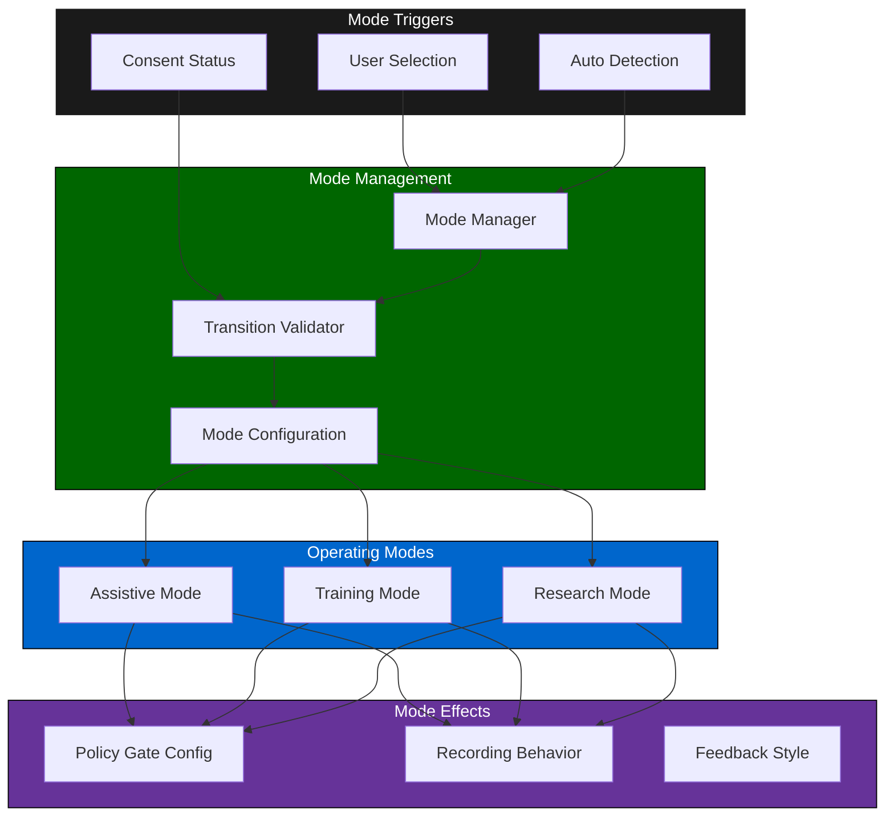
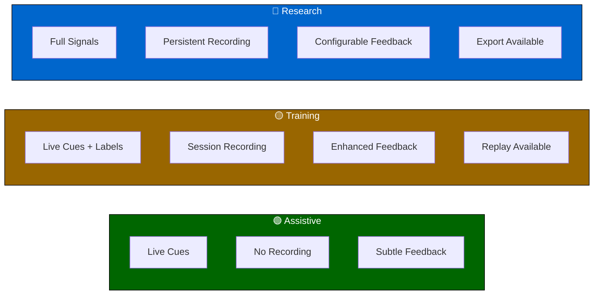
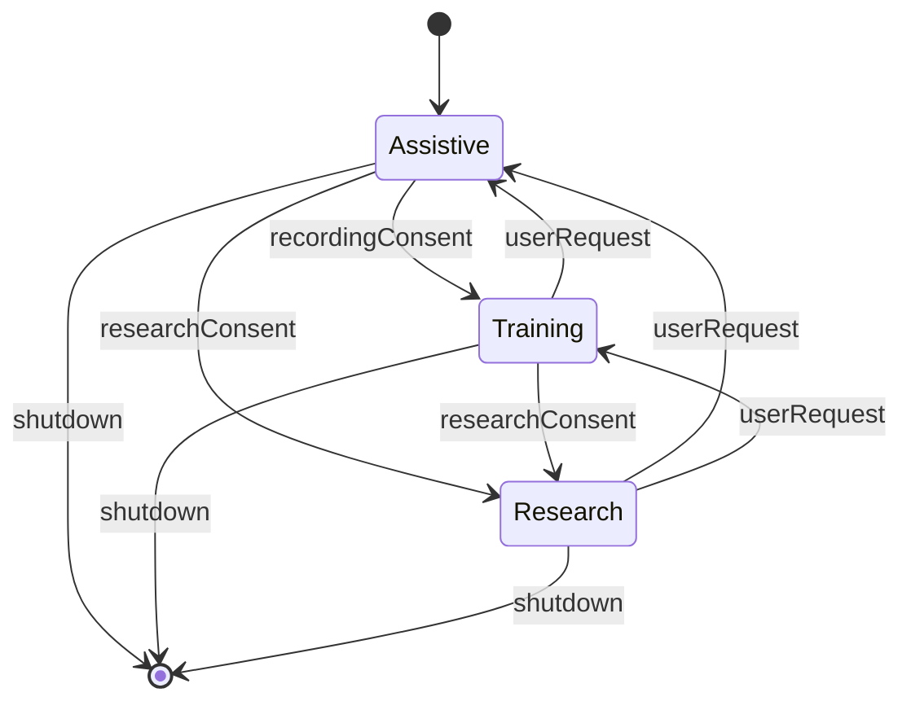
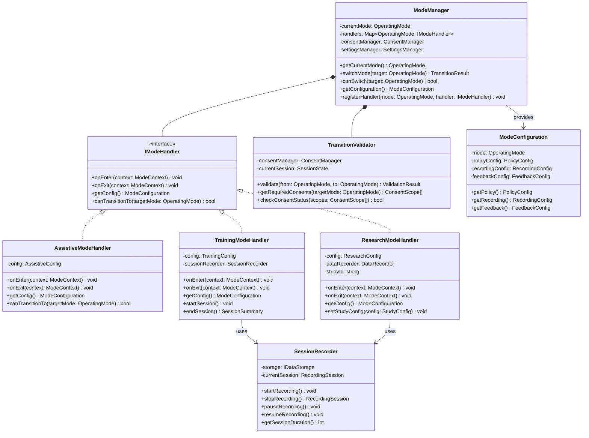
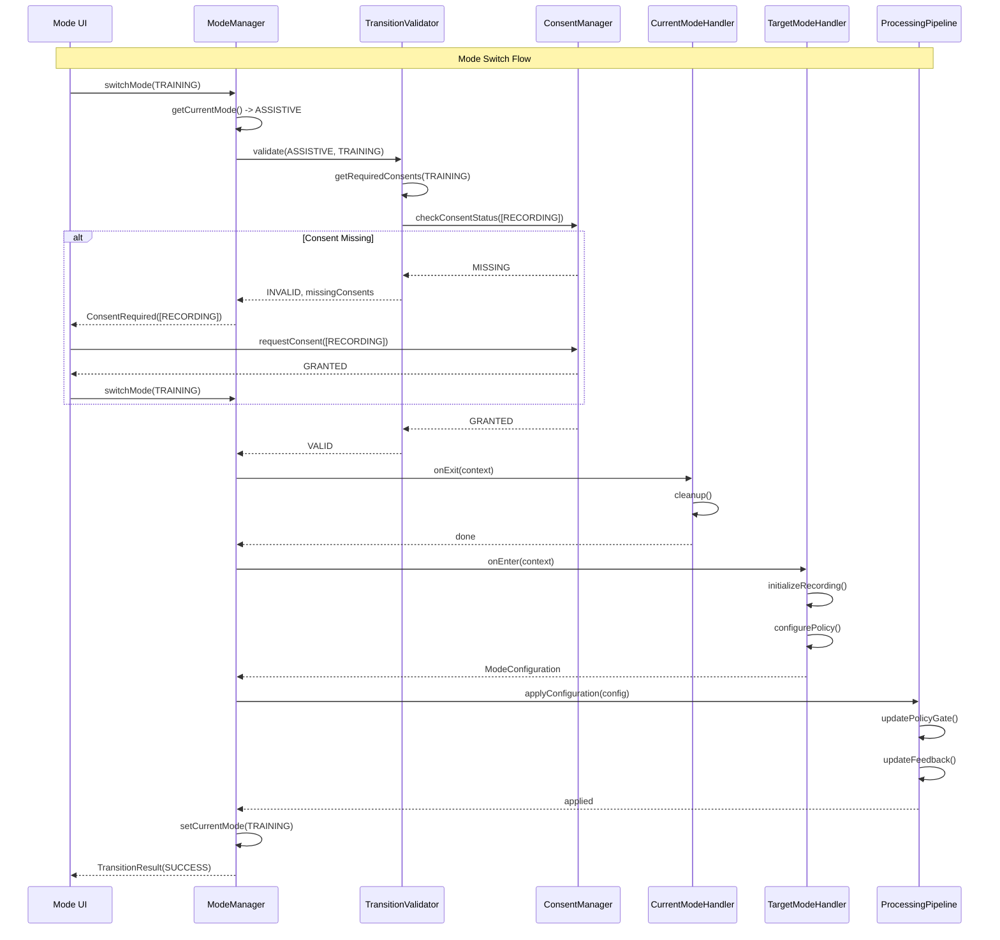
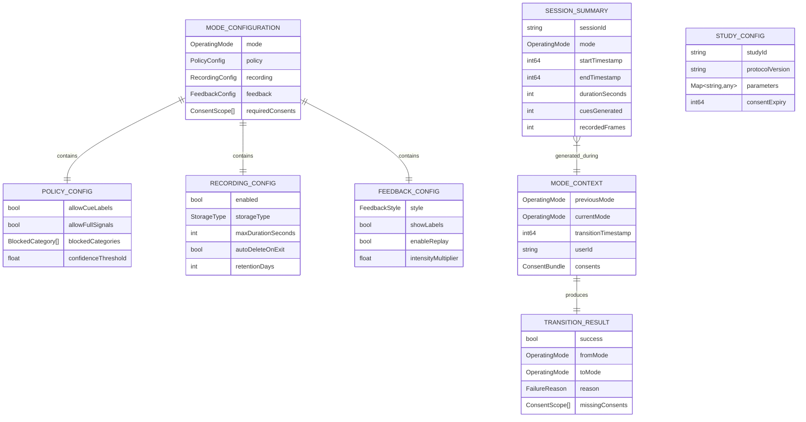

# 4.10 Operating Modes

## Overview

The operating modes module manages the three distinct operational states of SecondSight: Assistive (default), Training, and Research modes. Each mode has different behaviors regarding cue output, data recording, and privacy constraints.

---

## Architecture

---

## Mode Definitions

### Assistive Mode (Default)

| Property | Value | Description |
|----------|-------|-------------|
| Purpose | Real-time assistance | Live social cue support |
| Cue output | Safe cues only | Observable descriptions |
| Recording | Disabled | No data persisted |
| Feedback | Subtle | Non-intrusive presentation |
| Consent required | Basic | Face/voice analysis |

### Training Mode

| Property | Value | Description |
|----------|-------|-------------|
| Purpose | Practice sessions | Learn to recognize cues |
| Cue output | Safe cues + labels | Educational annotations |
| Recording | Session only | Auto-delete after review |
| Feedback | Enhanced | Replay with explanations |
| Consent required | Extended | Recording consent |

### Research Mode

| Property | Value | Description |
|----------|-------|-------------|
| Purpose | Data collection | IRB-approved studies |
| Cue output | Full signals | Research-grade data |
| Recording | Persistent | Long-term storage |
| Feedback | Configurable | Study-specific |
| Consent required | Full | Research consent |

---

## Mode Comparison

---

## Mode Transitions

### Valid Transitions

| From | To | Requirements |
|------|-----|--------------|
| Assistive | Training | Recording consent |
| Assistive | Research | Full research consent |
| Training | Assistive | None |
| Training | Research | Full research consent |
| Research | Assistive | None |
| Research | Training | None |

### Transition State Machine

---

## Consent Requirements by Mode

| Consent Type | Assistive | Training | Research |
|--------------|-----------|----------|----------|
| Face analysis | ✅ Required | ✅ Required | ✅ Required |
| Voice analysis | ✅ Required | ✅ Required | ✅ Required |
| Data recording | ❌ N/A | ✅ Required | ✅ Required |
| Research sharing | ❌ N/A | ❌ N/A | ✅ Required |
| Training contribution | ❌ N/A | ⚪ Optional | ⚪ Optional |

---

## Latency Budget

| Operation | Target | Maximum |
|-----------|--------|---------|
| Mode switch | 50ms | 100ms |
| Config reload | 10ms | 25ms |
| Consent check | 1ms | 5ms |
| Transition validation | 5ms | 10ms |

---

## Class Diagram

---

## Sequence Diagram

---

## Data Model

---

## References

- [4.9 User Settings](./4.9-user-settings.md) — Mode selection settings
- [4.7 Policy Gate](./4.7-policy-gate.md) — Mode-specific policies
- [4.11 Raw Data Storage](./4.11-raw-data-storage.md) — Recording behavior
- [4.12 Privacy & Consent](./4.12-privacy-consent-ux.md) — Consent requirements
