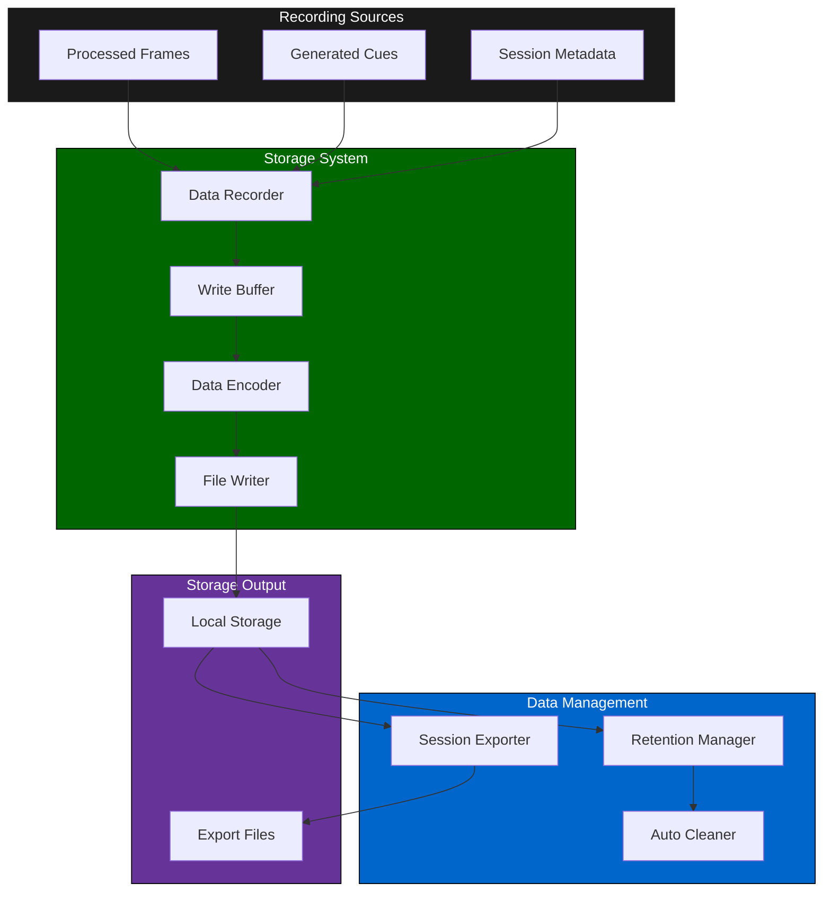
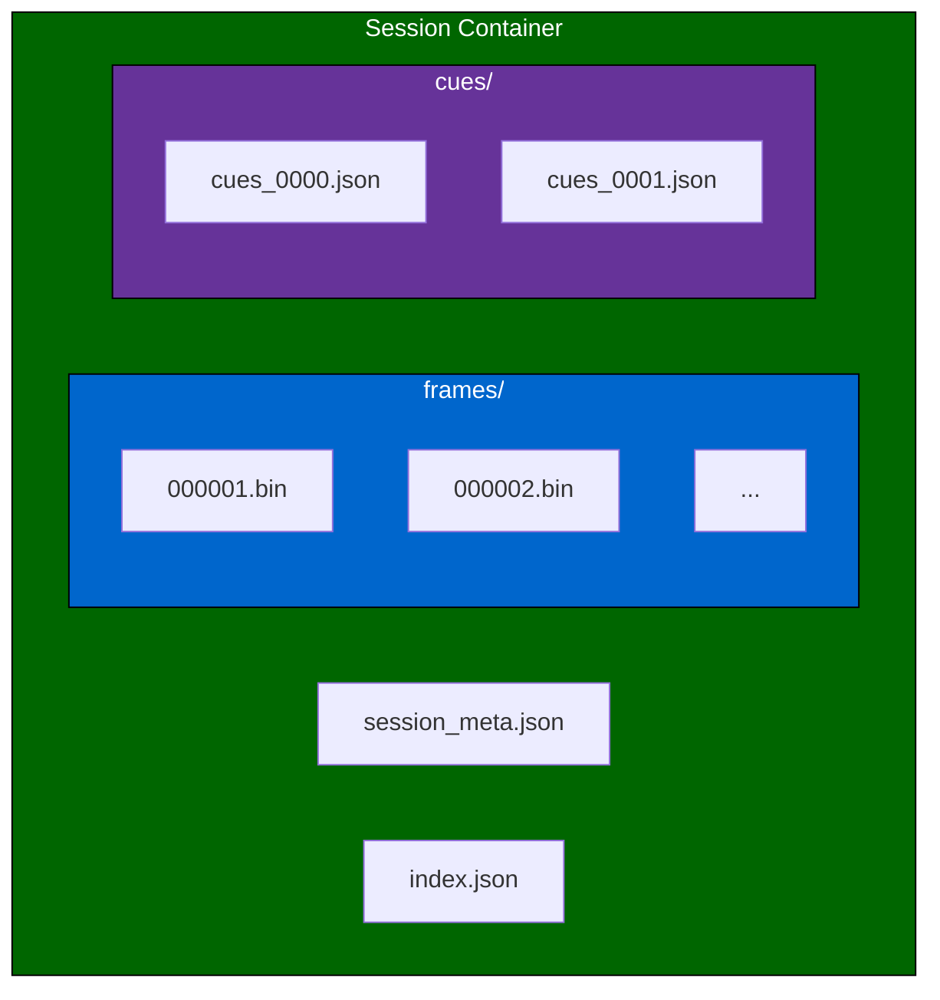
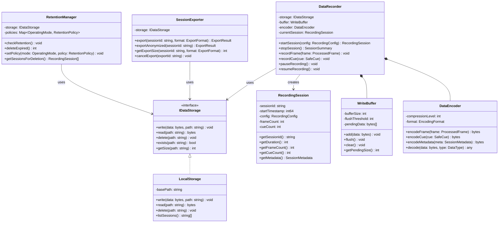
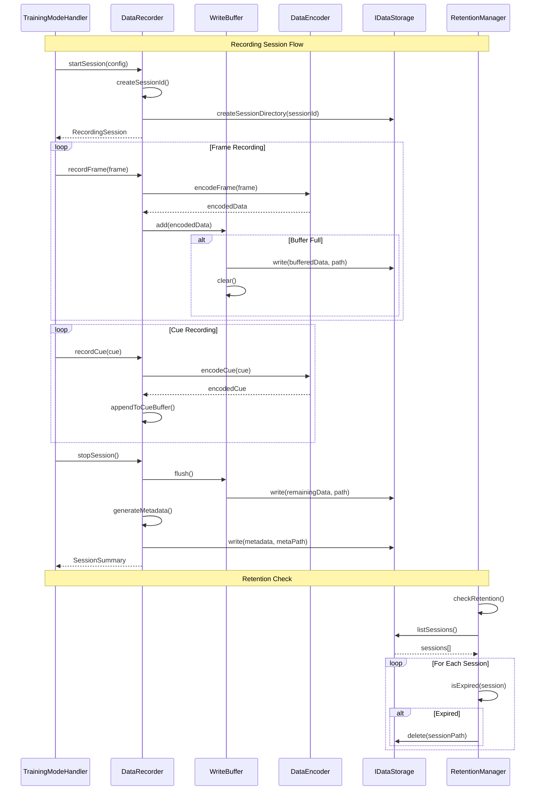
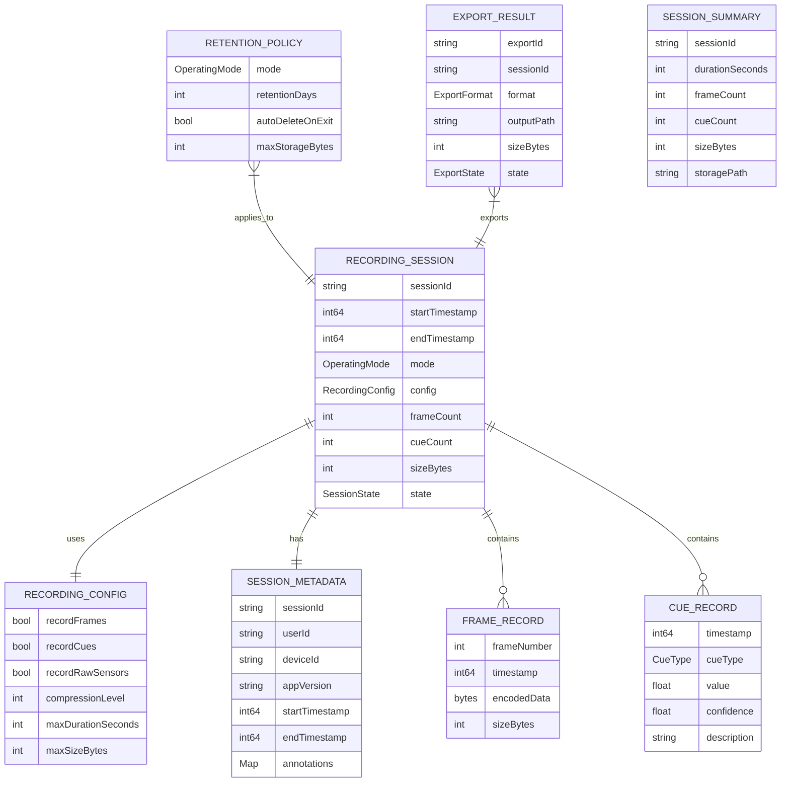

# 4.11 Raw Data Storage

## Overview

The raw data storage module manages session recording, data persistence, and export functionality for Training and Research modes. It ensures data integrity, enforces retention policies, and provides secure export mechanisms while respecting user privacy preferences.

---

## Architecture

---

## Recording Capabilities

### By Operating Mode

| Capability | Assistive | Training | Research |
|------------|-----------|----------|----------|
| Session recording | ❌ Disabled | ✅ Enabled | ✅ Enabled |
| Frame storage | ❌ | ⚪ Optional | ✅ Full |
| Cue logging | ❌ | ✅ Summary | ✅ Full |
| Metadata capture | ❌ | ✅ Session | ✅ Detailed |
| Export available | ❌ | ✅ Local | ✅ Full |

### Data Types Recorded

| Data Type | Training | Research | Format |
|-----------|----------|----------|--------|
| Processed frames | Optional | Yes | Compressed video |
| Raw sensor data | No | Optional | Binary |
| Feature vectors | Yes | Yes | Binary arrays |
| Cue signals | Yes | Yes | JSON/Binary |
| Session metadata | Yes | Yes | JSON |
| User annotations | Yes | Yes | JSON |

---

## Retention Policies

| Mode | Default Retention | User Override | Auto-Delete |
|------|-------------------|---------------|-------------|
| Training | 7 days | 1-30 days | On mode exit option |
| Research | 90 days | Study-defined | Never (manual only) |

---

## Storage Format

---

## Export Formats

| Format | Use Case | Contents |
|--------|----------|----------|
| Compact | User backup | Metadata + cues only |
| Full | Research export | All recorded data |
| Anonymized | Sharing | Stripped of identifiers |

---

## Latency Budget

| Operation | Target | Maximum |
|-----------|--------|---------|
| Frame buffering | 1ms | 3ms |
| Write to disk | 5ms | 20ms |
| Session finalization | 100ms | 500ms |
| Export generation | 1s/MB | 5s/MB |

---

## Class Diagram

---

## Sequence Diagram

---

## Data Model

---

## References

- [4.10 Operating Modes](./4.10-operating-modes.md) — Recording triggers
- [4.12 Privacy & Consent](./4.12-privacy-consent-ux.md) — Recording consent
- [4.9 User Settings](./4.9-user-settings.md) — Retention settings
