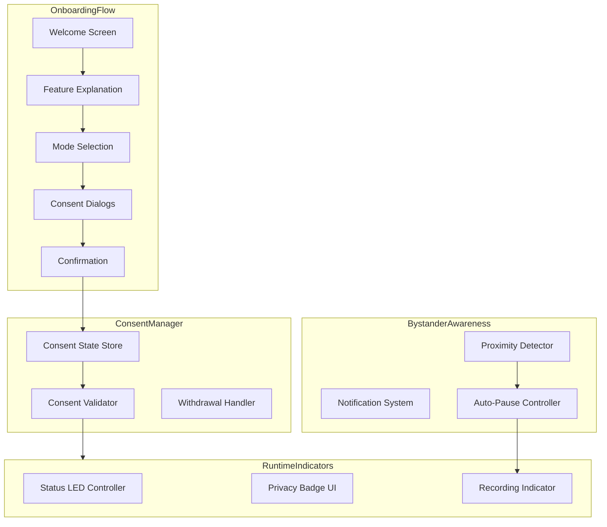
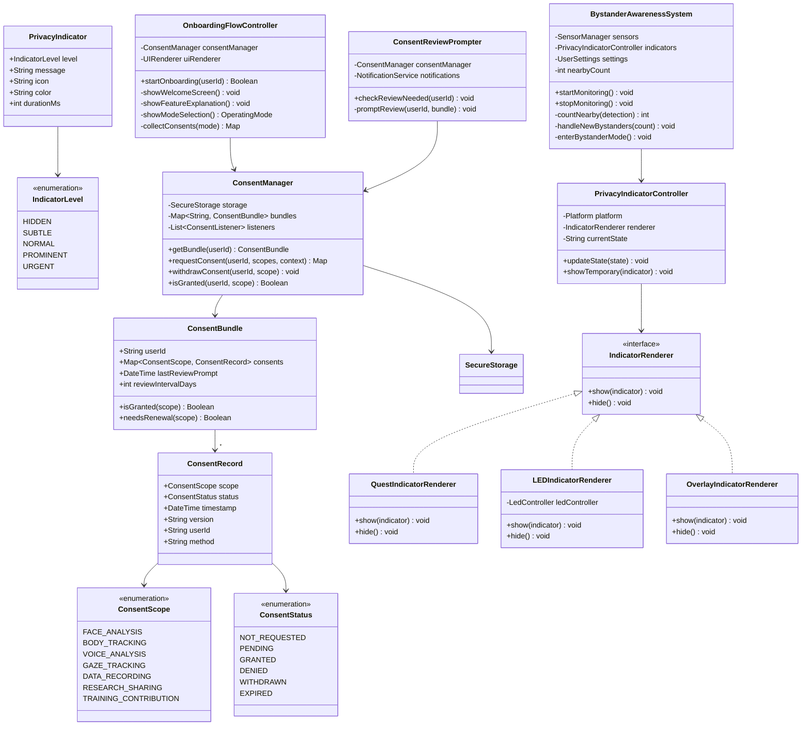
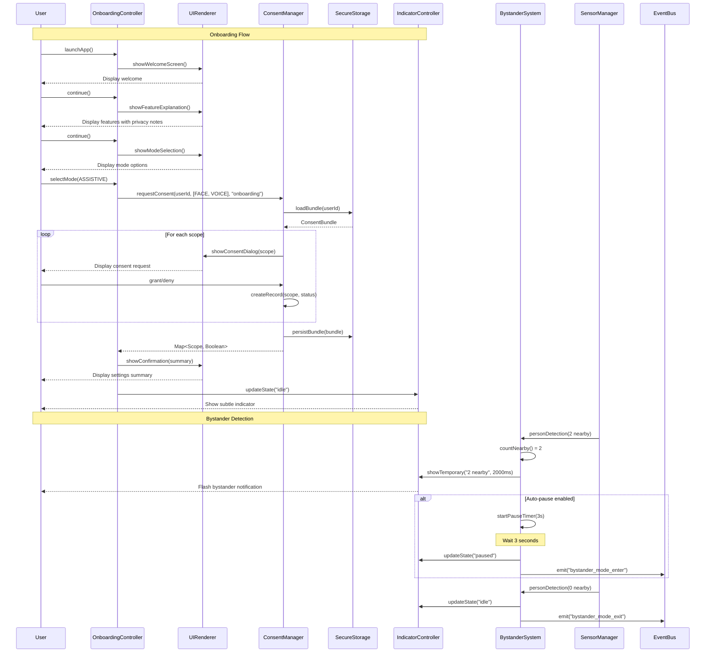
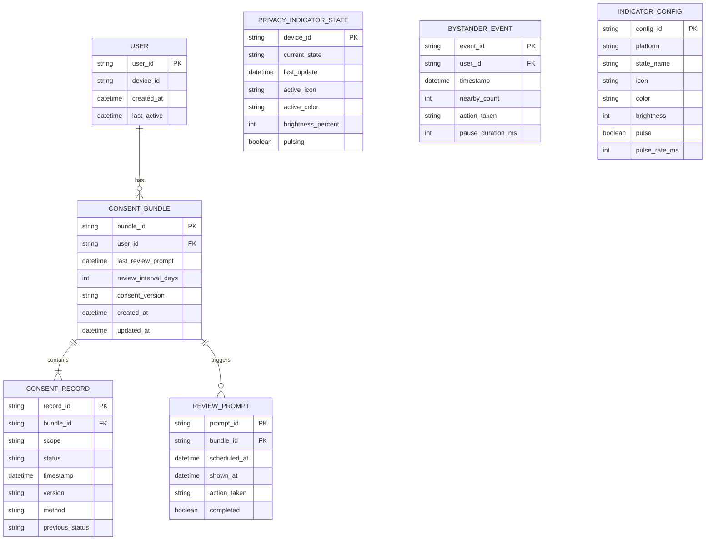

# 4.12 Privacy & Consent UX

## Overview

This module defines the user experience flows for privacy consent, transparency indicators, and bystander awareness. The design ensures users understand what data is being captured and how it's processed while maintaining unobtrusive operation during normal use.

## Architecture

## Consent Scopes

| Scope | Description | Default | Mode Requirement |
|-------|-------------|---------|------------------|
| FACE_ANALYSIS | Face landmark and expression analysis | Required | All modes |
| BODY_TRACKING | Body pose and gesture tracking | Required | All modes |
| VOICE_ANALYSIS | Audio prosody and tone analysis | Required | All modes |
| GAZE_TRACKING | Eye movement and attention tracking | Required | All modes |
| DATA_RECORDING | Session recording for playback | Optional | Training mode |
| RESEARCH_SHARING | Anonymous data contribution | Optional | Research mode |
| TRAINING_CONTRIBUTION | Model improvement contribution | Optional | Research mode |

## Consent States

| State | Description | Transitions |
|-------|-------------|-------------|
| NOT_REQUESTED | User hasn't been asked yet | → PENDING |
| PENDING | Dialog shown, awaiting response | → GRANTED, DENIED |
| GRANTED | User approved this scope | → WITHDRAWN, EXPIRED |
| DENIED | User declined this scope | → GRANTED (re-request) |
| WITHDRAWN | User revoked previous consent | → GRANTED (re-request) |
| EXPIRED | Consent passed expiration period | → GRANTED (renewal) |

## Privacy Indicator Levels

| Level | Use Case | Visual Behavior |
|-------|----------|-----------------|
| HIDDEN | System idle, app backgrounded | No indicator shown |
| SUBTLE | Idle but ready | Dim icon, 10% brightness |
| NORMAL | Active processing | Standard icon, 50% brightness |
| PROMINENT | Recording active | Bright red, pulsing at 1Hz |
| URGENT | Privacy event detected | Bright flash, fast pulse 2Hz |

## Components

### ConsentManager

Central consent state management and validation.

| Method | Input | Output | Description |
|--------|-------|--------|-------------|
| getBundle | userId | ConsentBundle | Retrieve user's consent state |
| requestConsent | userId, scopes[], context | Map<Scope, Boolean> | Show consent dialogs and collect responses |
| withdrawConsent | userId, scope | void | Handle consent withdrawal with data implications |
| isGranted | userId, scope | Boolean | Check if specific consent is active |
| needsRenewal | record | Boolean | Check if consent has expired |

### OnboardingFlowController

Manages first-time user onboarding experience.

| Step | Screen | Purpose |
|------|--------|---------|
| 1 | Welcome | Introduce SecondSight and its purpose |
| 2 | Feature Explanation | Explain capabilities with privacy notes |
| 3 | Mode Selection | Choose operating mode with consent implications |
| 4 | Consent Dialogs | Collect granular consent for required scopes |
| 5 | Confirmation | Summarize settings and provide change reminder |

### PrivacyIndicatorController

Manages runtime privacy indicators across platforms.

| State | Icon | Color | LED Pattern |
|-------|------|-------|-------------|
| idle | eye_outline | #808080 | Dim, steady |
| processing | eye_filled | #4CAF50 | Normal, steady |
| recording | record_circle | #F44336 | Bright, pulsing |
| paused | pause_circle | #FFC107 | Normal, steady |

### Platform-Specific Renderers

| Platform | Renderer | Indicator Type |
|----------|----------|----------------|
| Meta Quest | QuestIndicatorRenderer | Overlay in peripheral vision |
| RayBan Meta | LEDIndicatorRenderer | Physical LED on frame |
| Android/iOS | OverlayIndicatorRenderer | System notification badge |

### BystanderAwarenessSystem

Handles privacy considerations for bystanders.

| Parameter | Value | Description |
|-----------|-------|-------------|
| PROXIMITY_THRESHOLD | 2.0m | Distance to trigger bystander detection |
| AUTO_PAUSE_DELAY | 3.0s | Delay before entering bystander mode |
| Bystander Mode Restrictions | no_recording, reduced_analysis | Limits applied when bystanders present |

### ConsentReviewPrompter

Periodically prompts users to review consent choices.

| Parameter | Value | Description |
|-----------|-------|-------------|
| DEFAULT_REVIEW_INTERVAL | 90 days | Time between review prompts |
| CONSENT_VERSION | 1.0.0 | Current consent document version |
| VERSION_RENEWAL | true | Require re-consent on version change |

## Latency Budget

| Operation | Target | Maximum |
|-----------|--------|---------|
| Consent dialog render | 100ms | 200ms |
| Consent state lookup | 1ms | 5ms |
| Indicator state update | 16ms | 33ms |
| Bystander detection | 100ms | 200ms |
| LED control signal | 5ms | 10ms |

---

## Class Diagram

---

## Sequence Diagram

---

## Data Model

---

## References

- [4.9 User Settings](./4.9-user-settings.md) - Settings integration
- [4.10 Operating Modes](./4.10-operating-modes.md) - Mode-specific consent
- [4.11 Raw Data Storage](./4.11-raw-data-storage.md) - Data recording consent
- [4.8 User Feedback](./4.8-user-feedback.md) - Indicator rendering
