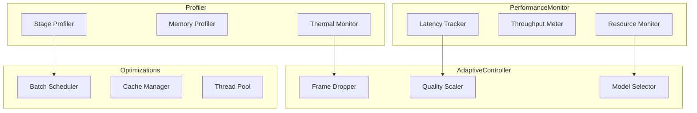
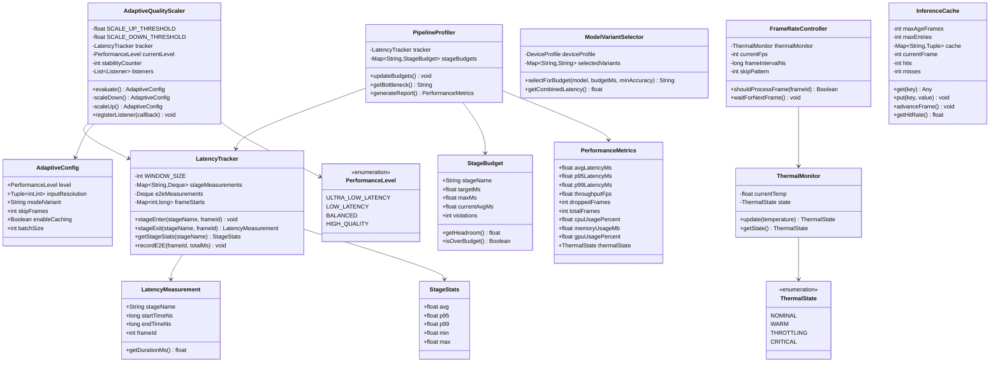
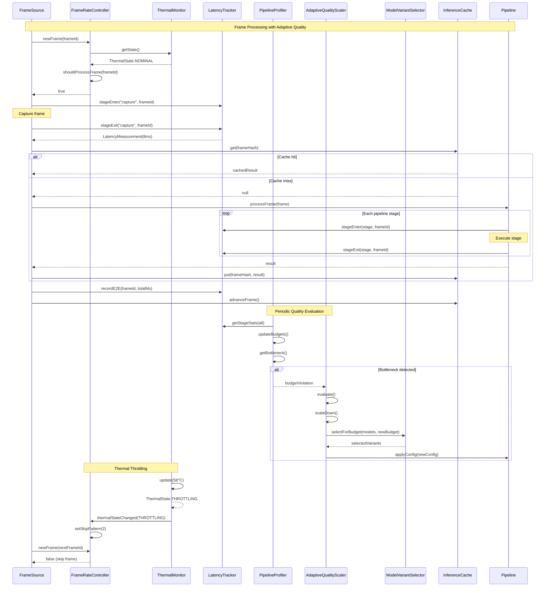
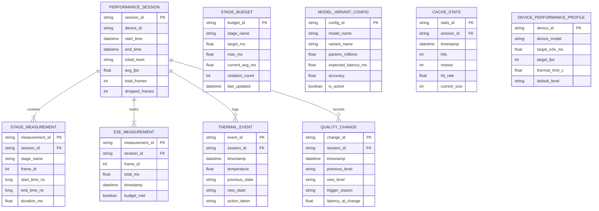

# 4.13 Performance & Latency

## Overview

This module defines the performance requirements, latency budgets, and optimization strategies for real-time social cue processing. The design targets end-to-end latency under 150ms to maintain natural conversation flow while balancing computational cost across heterogeneous devices.

## Architecture

## Latency Budget

### End-to-End Pipeline (150ms Target)

| Stage | Target | Max | Allocation | Cumulative |
|-------|--------|-----|------------|------------|
| Sensor Capture | 10ms | 15ms | 7% | 10ms |
| Pre-processing | 15ms | 25ms | 10% | 25ms |
| Feature Extraction | 30ms | 45ms | 20% | 55ms |
| Perception Models | 50ms | 70ms | 33% | 105ms |
| Signal Fusion | 5ms | 10ms | 3% | 110ms |
| Temporal Aggregation | 5ms | 10ms | 3% | 115ms |
| Policy Gate | 2ms | 5ms | 1% | 117ms |
| User Feedback Render | 20ms | 33ms | 13% | 137ms |
| Buffer/Overhead | 13ms | 13ms | 10% | 150ms |

## Performance Levels

| Level | Description | Resolution | Model Variant | Frame Skip |
|-------|-------------|------------|---------------|------------|
| ULTRA_LOW_LATENCY | Minimal processing | 320×240 | tiny | 2 frames |
| LOW_LATENCY | Reduced quality | 480×360 | small | 1 frame |
| BALANCED | Default trade-off | 640×480 | base | 0 frames |
| HIGH_QUALITY | Better accuracy | 1280×720 | large | 0 frames |

## Thermal States

| State | Temperature | Action |
|-------|-------------|--------|
| NOMINAL | < 45°C | Full performance |
| WARM | 45-55°C | Skip 1 in 2 frames |
| THROTTLING | 55-65°C | Skip 2 in 3 frames |
| CRITICAL | > 65°C | Skip 3 in 4 frames |

## Components

### LatencyTracker

Tracks per-stage and end-to-end latency with rolling windows.

| Attribute | Type | Description |
|-----------|------|-------------|
| WINDOW_SIZE | int | Rolling window size (default: 100) |
| stageMeasurements | Map<String, Deque> | Per-stage latency history |
| e2eMeasurements | Deque | End-to-end latency history |
| frameStarts | Map<int, long> | Active frame start timestamps |

| Method | Input | Output | Description |
|--------|-------|--------|-------------|
| stageEnter | stageName, frameId | void | Record stage entry timestamp |
| stageExit | stageName, frameId | LatencyMeasurement | Record exit and return measurement |
| getStageStats | stageName | StageStats | Get avg, p95, p99, min, max |
| recordE2E | frameId, totalMs | void | Record full pipeline latency |

### AdaptiveQualityScaler

Dynamically adjusts quality based on latency performance.

| Parameter | Value | Description |
|-----------|-------|-------------|
| SCALE_UP_THRESHOLD | 100ms | Scale up if consistently under |
| SCALE_DOWN_THRESHOLD | 140ms | Scale down if exceeds |
| STABILITY_REQUIRED | 30 frames | Frames stable before scaling up |

| Method | Input | Output | Description |
|--------|-------|--------|-------------|
| evaluate | - | AdaptiveConfig? | Check if adjustment needed |
| scaleDown | - | AdaptiveConfig? | Reduce quality level |
| scaleUp | - | AdaptiveConfig? | Increase quality level |
| registerListener | callback | void | Subscribe to config changes |

### FrameRateController

Controls frame processing rate based on thermal state.

| Parameter | Value | Description |
|-----------|-------|-------------|
| TARGET_FPS | 30 | Target processing rate |
| MIN_FPS | 10 | Minimum acceptable rate |

| Method | Input | Output | Description |
|--------|-------|--------|-------------|
| shouldProcessFrame | frameId | Boolean | Check if frame should be processed |
| waitForNextFrame | - | void | Block until next frame slot |
| adjustForThermal | state | void | Apply thermal-based frame skipping |

### ThermalMonitor

Monitors device thermal conditions.

| Threshold | Temperature | Description |
|-----------|-------------|-------------|
| TEMP_NOMINAL | 45°C | Normal operation |
| TEMP_WARM | 55°C | Initial throttling |
| TEMP_THROTTLE | 65°C | Significant throttling |
| TEMP_CRITICAL | 75°C | Emergency throttling |

| Method | Input | Output | Description |
|--------|-------|--------|-------------|
| update | temperature | ThermalState | Update and classify thermal state |
| getState | - | ThermalState | Get current thermal classification |
| subscribe | callback | void | Register for thermal change events |

### ModelVariantSelector

Selects appropriate model variants within latency budget.

| Model | Variant | Params | Latency | Accuracy |
|-------|---------|--------|---------|----------|
| mediapipe_face | tiny | 0.5M | 8ms | 85% |
| mediapipe_face | small | 1.0M | 15ms | 90% |
| mediapipe_face | base | 2.5M | 25ms | 94% |
| mediapipe_face | large | 5.0M | 45ms | 97% |
| au_detector | tiny | 0.8M | 10ms | 80% |
| au_detector | small | 2.0M | 20ms | 86% |
| au_detector | base | 4.0M | 35ms | 91% |
| pose_estimator | tiny | 1.0M | 12ms | 82% |
| pose_estimator | small | 2.5M | 22ms | 88% |
| pose_estimator | base | 5.0M | 40ms | 93% |

| Method | Input | Output | Description |
|--------|-------|--------|-------------|
| selectForBudget | modelName, budgetMs, minAccuracy | String | Best variant within budget |
| getCombinedLatency | - | float | Sum of selected model latencies |
| getSelectedVariants | - | Map<String, String> | Current variant selections |

### PipelineProfiler

Profiles pipeline performance and identifies bottlenecks.

| Method | Input | Output | Description |
|--------|-------|--------|-------------|
| updateBudgets | - | void | Sync budget tracking with measurements |
| getBottleneck | - | String? | Stage most over budget |
| generateReport | - | PerformanceMetrics | Comprehensive performance summary |
| getStageBudget | stageName | StageBudget | Budget info for specific stage |

### InferenceCache

Caches inference results for temporal coherence.

| Parameter | Value | Description |
|-----------|-------|-------------|
| MAX_AGE_FRAMES | 3 | Maximum cache entry age |
| MAX_ENTRIES | 100 | Maximum cache size |

| Method | Input | Output | Description |
|--------|-------|--------|-------------|
| get | key | Any? | Retrieve cached value if valid |
| put | key, value | void | Store value with current frame |
| advanceFrame | - | void | Increment frame counter |
| getHitRate | - | float | Cache hit percentage |

## Device Validation Plan

The latency and frame-rate budgets in this document are proposed targets, not measurements. Thermal thresholds must come from supported public platform APIs and device testing.

| Validation | Evidence to collect |
|------------|---------------------|
| **End-to-end latency** | Timestamped sensor-to-cue distributions |
| **Sustained throughput** | Frame rate, dropped frames, and inference timings |
| **Thermal behavior** | Platform thermal state and throttling during sustained use |
| **Degradation** | Cue quality and latency with missing sensors or lower-quality models |

No device-specific performance or temperature limits are asserted here.

---

## Class Diagram

---

## Sequence Diagram

---

## Data Model

---

## References

- [4.1 Device Compatibility](./4.1-device-compatibility.md) - Device profiles
- [4.4 Perception Models](./4.4-perception-models.md) - Model variants
- [4.2 Pre-processing](./4.2-pre-processing.md) - Input optimization
- [4.14 Error Handling](./4.14-error-handling.md) - Performance degradation handling
