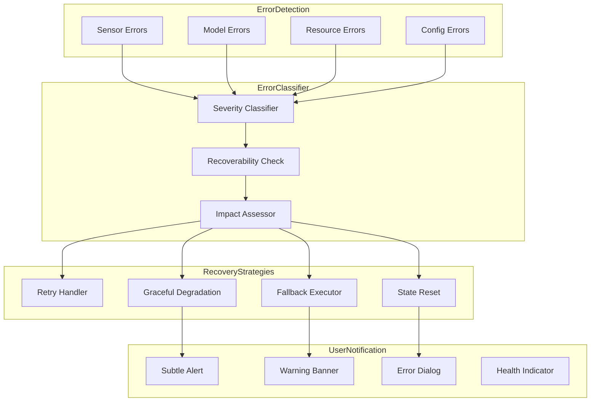
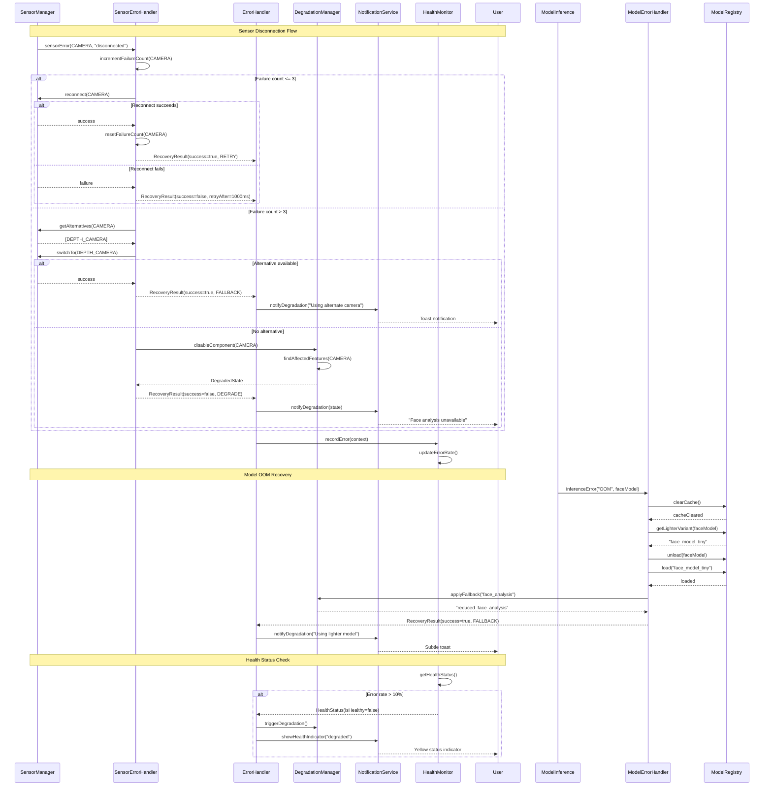
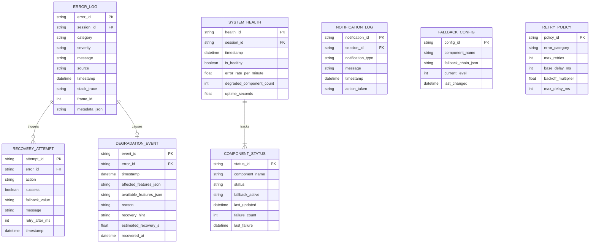

# 4.14 Error Handling

## Overview

This module defines comprehensive error handling strategies for the SecondSight pipeline, including graceful degradation, recovery mechanisms, and user notification patterns. The design prioritizes maintaining partial functionality over complete failure and ensures users are never left without feedback during error conditions.

## Architecture

## Error Severity Levels

| Severity | Description | User Impact | Response |
|----------|-------------|-------------|----------|
| DEBUG | Logged only, no action | None | Log and continue |
| INFO | Minor issue, tracking only | None | Log and continue |
| WARNING | Degraded functionality | Reduced accuracy | Notify subtly, apply fallback |
| ERROR | Feature unavailable | Feature loss | Notify user, disable feature |
| CRITICAL | System-wide impact | Session affected | Alert user, recovery required |

## Error Categories

| Category | Examples | Recovery Strategy |
|----------|----------|-------------------|
| SENSOR | Camera disconnect, mic failure | Reconnect, alternative sensor |
| MODEL | Inference timeout, OOM | Skip frame, lighter model |
| RESOURCE | Low memory, storage full | Clear cache, reduce quality |
| NETWORK | Sync failure, timeout | Retry with backoff |
| PERMISSION | Camera denied, storage blocked | Guide user to settings |
| CONFIGURATION | Invalid settings, corrupt config | Reset to defaults |
| USER_INPUT | Invalid preference | Validate and prompt correction |

## Recovery Actions

| Action | When Used | User Visibility |
|--------|-----------|-----------------|
| RETRY | Transient errors | Hidden (< 3 retries) |
| FALLBACK | Alternative available | Toast notification |
| SKIP | Non-critical frame loss | Hidden |
| DEGRADE | Partial capability loss | Subtle indicator |
| RESTART | Component reset needed | Brief interruption |
| NOTIFY_USER | User action required | Dialog or banner |
| ABORT | Unrecoverable error | Full error dialog |

## Components

### ErrorHandler

Central error handling and recovery coordinator.

| Attribute | Type | Description |
|-----------|------|-------------|
| MAX_RETRIES | int | Maximum retry attempts (default: 3) |
| RETRY_BACKOFF_MS | int[] | Exponential backoff delays [100, 500, 2000] |
| errorCounts | Map<String, int> | Error frequency tracking |
| recoveryHandlers | Map<Category, List> | Registered recovery handlers |

| Method | Input | Output | Description |
|--------|-------|--------|-------------|
| handle | errorContext | RecoveryResult | Process error and attempt recovery |
| registerRecovery | category, handler | void | Add recovery handler for category |
| getErrorRate | - | float | Errors per minute |
| reset | - | void | Clear error counts and state |

### DegradationManager

Manages graceful degradation of functionality.

| Feature | Dependencies | Description |
|---------|--------------|-------------|
| emotional_cues | face_analysis, voice_analysis | Requires either modality |
| gesture_cues | body_tracking | Requires pose estimation |
| attention_cues | gaze_tracking, face_analysis | Requires either modality |
| training_mode | recording, all_analysis | Requires full capability |

| Fallback Chain | Level 0 | Level 1 | Level 2 | Level 3 |
|----------------|---------|---------|---------|---------|
| face_analysis | full | reduced | detection_only | disabled |
| voice_analysis | full | reduced | volume_only | disabled |
| body_tracking | full | pose_only | disabled | - |
| gaze_tracking | full | head_only | disabled | - |

| Method | Input | Output | Description |
|--------|-------|--------|-------------|
| disableComponent | componentName | DegradedState | Disable component and compute impact |
| applyFallback | componentName | String? | Apply next fallback level |
| getComponentStatus | componentName | String | Get current component state |
| findAffectedFeatures | componentName | List<String> | List features impacted |
| findAvailableFeatures | - | List<String> | List features still working |

### RetryHandler

Handles retry logic with exponential backoff.

| Parameter | Value | Description |
|-----------|-------|-------------|
| maxRetries | 3 | Maximum retry attempts |
| baseDelayMs | 100 | Initial backoff delay |
| maxDelayMs | 5000 | Maximum backoff delay |
| backoffMultiplier | 2.0 | Exponential factor |

| Method | Input | Output | Description |
|--------|-------|--------|-------------|
| executeWithRetry | operation, context | RecoveryResult | Execute with automatic retries |
| calculateDelay | attemptNumber | int | Compute backoff delay |
| shouldRetry | exception | Boolean | Check if exception is retryable |

### SensorErrorHandler

Handles sensor-specific errors.

| Error Type | Threshold | First Action | Final Action |
|------------|-----------|--------------|--------------|
| Disconnect | 3 failures | Reconnect | Alternative sensor |
| Timeout | 5 failures | Increase timeout | Disable sensor |
| Quality | 10 frames | Log warning | Reduce resolution |
| Permission | 1 failure | Request again | Disable feature |

| Method | Input | Output | Description |
|--------|-------|--------|-------------|
| handleSensorError | sensorType, error | RecoveryResult | Process sensor error |
| attemptReconnect | sensorType | RecoveryResult | Try to reconnect |
| attemptAlternative | sensorType | RecoveryResult | Switch to alternative |
| disableSensor | sensorType | RecoveryResult | Disable with degradation |

### ModelErrorHandler

Handles ML model inference errors.

| Error Type | Detection | Recovery |
|------------|-----------|----------|
| OOM | Memory exception | Clear cache, lighter model |
| Timeout | Inference > budget | Skip frame, reduce quality |
| Corruption | Invalid output | Reload model |
| Version | Model mismatch | Fallback version |

| Method | Input | Output | Description |
|--------|-------|--------|-------------|
| handleInferenceError | modelName, error | RecoveryResult | Process model error |
| handleOOM | modelName | RecoveryResult | Handle out-of-memory |
| switchToLighter | modelName | RecoveryResult | Load smaller variant |
| reloadModel | modelName | RecoveryResult | Reload model weights |

### UserNotificationService

Manages error notifications to users.

| Notification Type | Use Case | Cooldown |
|-------------------|----------|----------|
| Toast | Temporary degradation | 30s |
| Banner | Persistent issue | 60s |
| Dialog | User action required | 120s |
| Health | System status | Always visible |

| Method | Input | Output | Description |
|--------|-------|--------|-------------|
| notifyDegradation | state | void | Show degradation toast |
| notifyRecovery | component | void | Show recovery toast |
| showCritical | title, message, code | void | Display critical dialog |
| shouldNotify | type | Boolean | Check notification cooldown |

### HealthMonitor

Monitors overall system health.

| Metric | Threshold | Action |
|--------|-----------|--------|
| Error Rate | > 10% | Trigger degradation |
| Latency P95 | > 200ms | Reduce quality |
| Memory | > 80% | Clear caches |
| Thermal | > 65°C | Skip frames |

| Method | Input | Output | Description |
|--------|-------|--------|-------------|
| recordSuccess | - | void | Log successful frame |
| recordError | error | void | Log error occurrence |
| getHealthStatus | - | HealthStatus | Get current health |
| isHealthy | - | Boolean | Quick health check |

## Error Recovery Matrix

| Error Type | First Attempt | Second Attempt | Final Action |
|------------|---------------|----------------|--------------|
| Sensor disconnect | Reconnect | Alternative sensor | Disable + notify |
| Model OOM | Clear cache | Lighter model | Disable feature |
| Inference timeout | Skip frame | Reduce quality | Fallback model |
| Config error | Default values | Prompt user | Limited mode |
| Permission denied | Request again | Guide user | Disable feature |
| Network error | Retry x3 | Offline mode | Notify user |

## Latency Budget

| Operation | Target | Maximum |
|-----------|--------|---------|
| Error classification | 0.1ms | 0.5ms |
| Recovery attempt | 5ms | 50ms |
| Fallback switch | 10ms | 100ms |
| User notification | 16ms | 50ms |

---

## Class Diagram

```mermaid
classDiagram
    class ErrorSeverity {
        <<enumeration>>
        DEBUG
        INFO
        WARNING
        ERROR
        CRITICAL
    }

    class ErrorCategory {
        <<enumeration>>
        SENSOR
        MODEL
        RESOURCE
        NETWORK
        PERMISSION
        CONFIGURATION
        USER_INPUT
        UNKNOWN
    }

    class RecoveryAction {
        <<enumeration>>
        RETRY
        FALLBACK
        SKIP
        DEGRADE
        RESTART
        NOTIFY_USER
        ABORT
    }

    class ErrorContext {
        +ErrorCategory category
        +ErrorSeverity severity
        +String message
        +String source
        +DateTime timestamp
        +String stackTrace
        +int frameId
        +Map~String,Any~ metadata
    }

    class RecoveryResult {
        +Boolean success
        +RecoveryAction actionTaken
        +Any fallbackValue
        +String message
        +int retryAfterMs
    }

    class DegradedState {
        +List~String~ affectedFeatures
        +List~String~ availableFeatures
        +String reason
        +String recoveryHint
        +float estimatedRecoveryTimeS
    }

    class HealthStatus {
        +Boolean isHealthy
        +List~String~ degradedComponents
        +float errorRatePerMinute
        +ErrorContext lastError
        +float uptimeSeconds
    }

    class ErrorHandler {
        -int MAX_RETRIES
        -int[] RETRY_BACKOFF_MS
        -NotificationService notifications
        -TelemetryService telemetry
        -Map~String,int~ errorCounts
        -DegradationManager degradationManager
        +handle(error) RecoveryResult
        +registerRecovery(category, handler) void
        -attemptRecovery(error) RecoveryResult
        -handleCritical(error) RecoveryResult
    }

    class RetryHandler {
        -int maxRetries
        -int baseDelayMs
        +executeWithRetry(operation, context) RecoveryResult
        -calculateDelay(attempt) int
    }

    class DegradationManager {
        -Set~String~ disabledComponents
        -Map~String,String~ activeFallbacks
        -DegradedState degradedState
        +disableComponent(component) DegradedState
        +applyFallback(component) String
        +getComponentStatus(component) String
        -findAffectedFeatures(component) List
        -findAvailableFeatures() List
    }

    class SensorErrorHandler {
        -DegradationManager degradation
        -SensorManager sensors
        -Map~String,int~ failureCounts
        +handleSensorError(type, error) RecoveryResult
        -attemptReconnect(type) RecoveryResult
        -attemptAlternative(type) RecoveryResult
        -disableSensor(type) RecoveryResult
    }

    class ModelErrorHandler {
        -ModelRegistry models
        -DegradationManager degradation
        -Map~String,int~ inferenceErrors
        +handleInferenceError(model, error) RecoveryResult
        -handleOOM(model) RecoveryResult
        -switchToLighter(model) RecoveryResult
    }

    class UserNotificationService {
        -UIRenderer ui
        -Map~String,DateTime~ lastNotifications
        -int COOLDOWN_S
        +notifyDegradation(state) void
        +notifyRecovery(component) void
        +showCritical(title, message, code) void
        -shouldNotify(type) Boolean
    }

    class HealthMonitor {
        -float ERROR_RATE_THRESHOLD
        -int WINDOW_SIZE_S
        -List~DateTime~ errorTimestamps
        -List~DateTime~ successTimestamps
        -Map~String,Boolean~ componentHealth
        -DateTime startTime
        +recordSuccess() void
        +recordError(error) void
        +getHealthStatus() HealthStatus
    }

    ErrorContext --> ErrorCategory
    ErrorContext --> ErrorSeverity
    RecoveryResult --> RecoveryAction
    ErrorHandler --> DegradationManager
    ErrorHandler --> UserNotificationService
    ErrorHandler --> RetryHandler
    SensorErrorHandler --> DegradationManager
    ModelErrorHandler --> DegradationManager
    HealthMonitor --> HealthStatus
    DegradationManager --> DegradedState
```

---

## Sequence Diagram

---

## Data Model

---

## References

- [4.13 Performance & Latency](./4.13-performance-latency.md) - Performance degradation
- [4.1 Device Compatibility](./4.1-device-compatibility.md) - Device-specific errors
- [4.4 Perception Models](./4.4-perception-models.md) - Model fallbacks
- [4.8 User Feedback](./4.8-user-feedback.md) - Error notification UI
