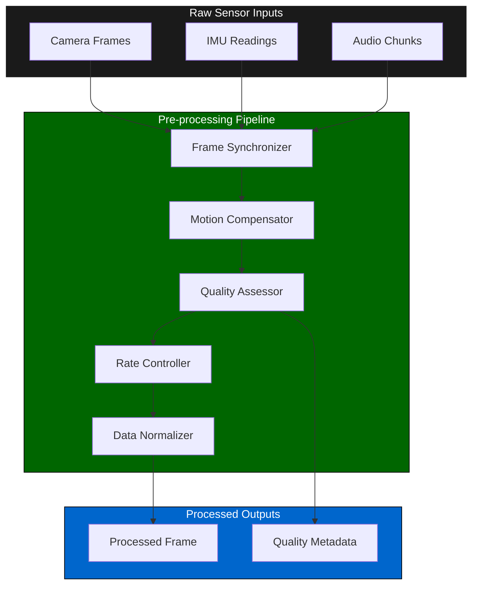
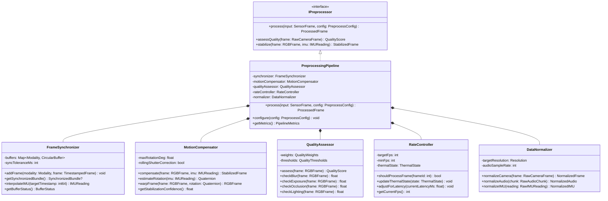
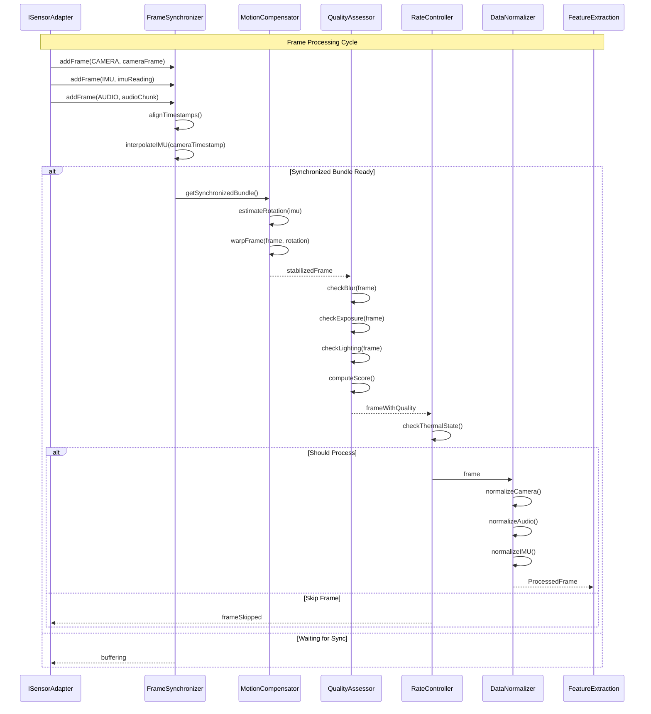
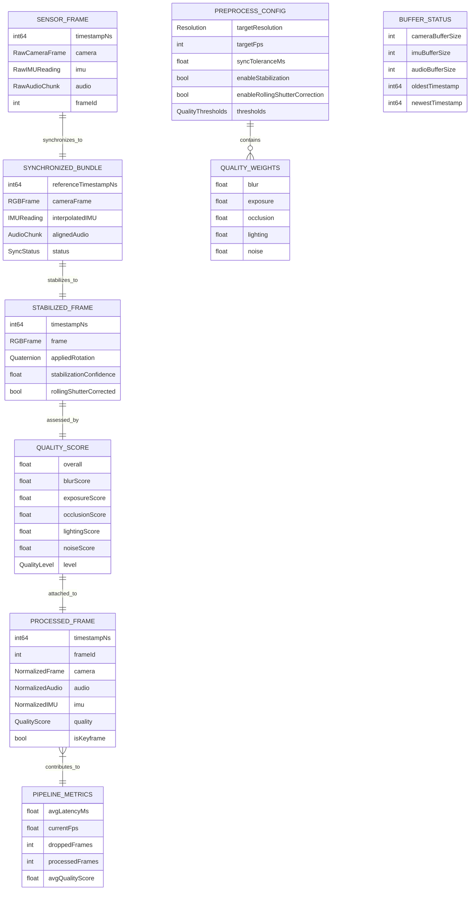

# 4.2 Pre-processing

## Overview

The pre-processing module prepares raw sensor data for feature extraction and ML inference. It handles frame synchronization across modalities, motion compensation using IMU data, quality assessment, and frame rate control. All processing targets sub-25ms latency to maintain the real-time pipeline budget.

---

## Architecture

---

## Components

### Frame Synchronizer

Aligns multi-modal sensor data to a common timeline using timestamps.

| Responsibility | Description |
|----------------|-------------|
| Timestamp alignment | Match frames from different sensors within tolerance window |
| Buffer management | Maintain sliding window of recent frames per modality |
| Interpolation | Interpolate IMU readings to match camera frame timestamps |
| Drop handling | Handle missing frames gracefully without pipeline stall |

**Configuration:**
- Sync tolerance: ±10ms
- Buffer depth: 5 frames per modality
- Interpolation method: Linear for IMU, nearest-neighbor for camera

---

### Motion Compensator

Stabilizes camera frames using IMU data to reduce motion blur effects.

| Responsibility | Description |
|----------------|-------------|
| Rotation estimation | Estimate camera rotation from gyroscope readings |
| Frame warping | Apply inverse rotation to stabilize frame |
| Rolling shutter correction | Compensate for rolling shutter distortion |
| Confidence scoring | Output stabilization confidence based on motion magnitude |

**Constraints:**
- Maximum rotation compensation: ±15°
- High-motion threshold: Angular velocity > 100°/s triggers quality degradation flag

---

### Quality Assessor

Evaluates frame quality to inform downstream processing confidence.

| Quality Factor | Assessment Method | Weight |
|----------------|-------------------|--------|
| Blur detection | Laplacian variance | 0.3 |
| Exposure | Histogram analysis | 0.2 |
| Occlusion | Face visibility check | 0.25 |
| Lighting | Luminance uniformity | 0.15 |
| Noise | High-frequency energy | 0.1 |

**Output:** Quality score ∈ [0.0, 1.0] attached to each processed frame.

---

### Rate Controller

Manages frame throughput based on system load and thermal state.

| Trigger | Action |
|---------|--------|
| Thermal throttling | Reduce to 15 FPS |
| High latency detected | Skip every 2nd frame |
| Low quality streak | Reduce processing intensity |
| Recovery | Gradually restore to target FPS |

**Target:** 30 FPS nominal, 10 FPS minimum

---

### Data Normalizer

Converts raw sensor data to standardized formats for downstream processing.

| Input Type | Normalization |
|------------|---------------|
| Camera RGB | Resize to 640×480, normalize to [0,1], convert to RGB |
| Camera depth | Convert to meters, clip to [0.2, 5.0]m range |
| Audio | Resample to 16kHz, normalize amplitude |
| IMU | Convert to SI units (m/s², rad/s) |

---

## Processing Flow

```mermaid
flowchart LR
    subgraph Input
        RAW[Raw Sensor Data]
    end

    subgraph Stage1[Synchronization]
        ALIGN[Align Timestamps]
        BUFFER[Buffer Management]
    end

    subgraph Stage2[Stabilization]
        GYRO[Read Gyroscope]
        WARP[Warp Frame]
    end

    subgraph Stage3[Assessment]
        BLUR[Blur Check]
        LIGHT[Lighting Check]
        SCORE[Compute Score]
    end

    subgraph Stage4[Control]
        THERMAL[Thermal Check]
        DECIDE[Frame Decision]
    end

    subgraph Output
        PROC[Processed Frame]
    end

    RAW --> ALIGN --> BUFFER
    BUFFER --> GYRO --> WARP
    WARP --> BLUR --> LIGHT --> SCORE
    SCORE --> THERMAL --> DECIDE --> PROC
```

---

## Latency Budget

| Stage | Target | Maximum |
|-------|--------|---------|
| Frame synchronization | 2ms | 5ms |
| Motion compensation | 5ms | 10ms |
| Quality assessment | 3ms | 5ms |
| Rate control decision | 0.5ms | 1ms |
| Data normalization | 4ms | 6ms |
| **Total** | **15ms** | **25ms** |

---

## Class Diagram

---

## Sequence Diagram

---

## Data Model

---

## References

- [4.1 Device Compatibility](./4.1-device-compatibility.md) — Sensor input sources
- [4.3 Feature Extraction](./4.3-feature-extraction.md) — Consumes processed frames
- [4.13 Performance & Latency](./4.13-performance-latency.md) — Latency budget allocation
