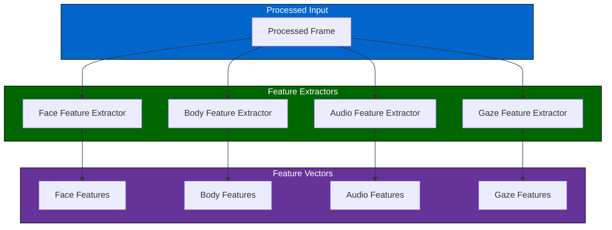
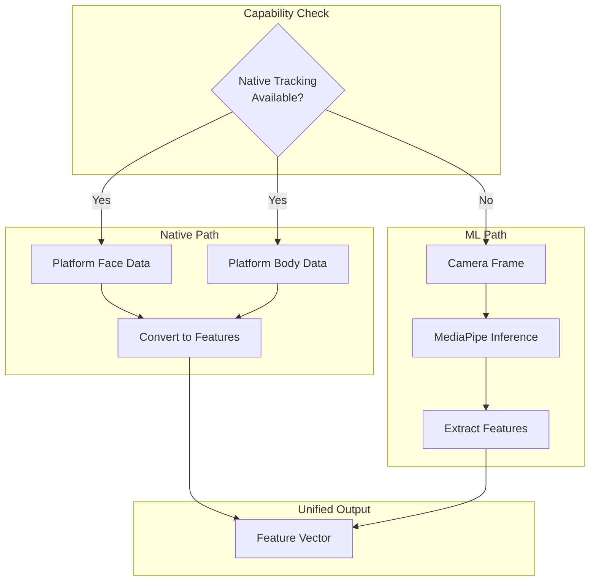
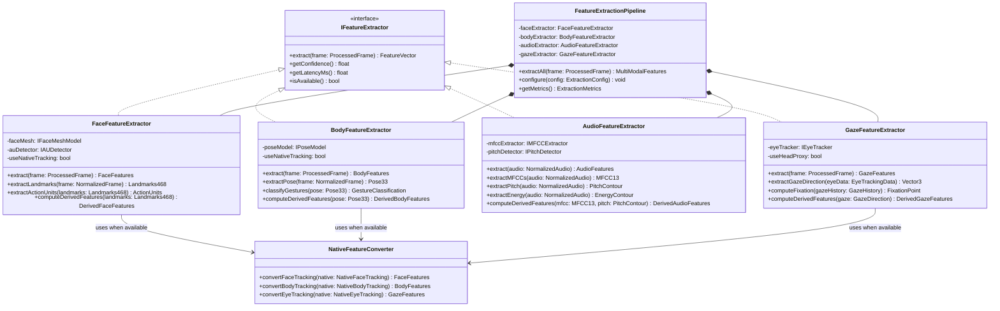
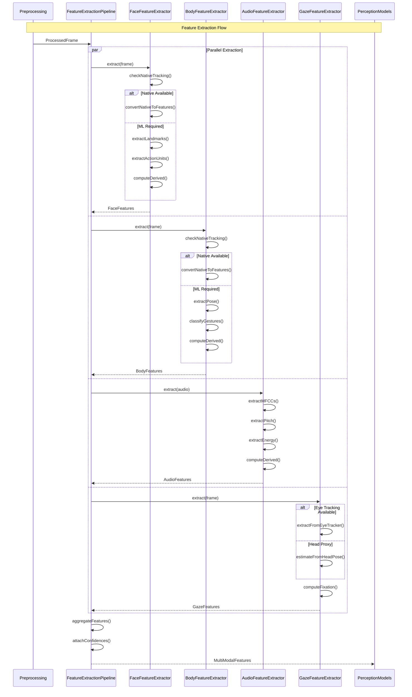
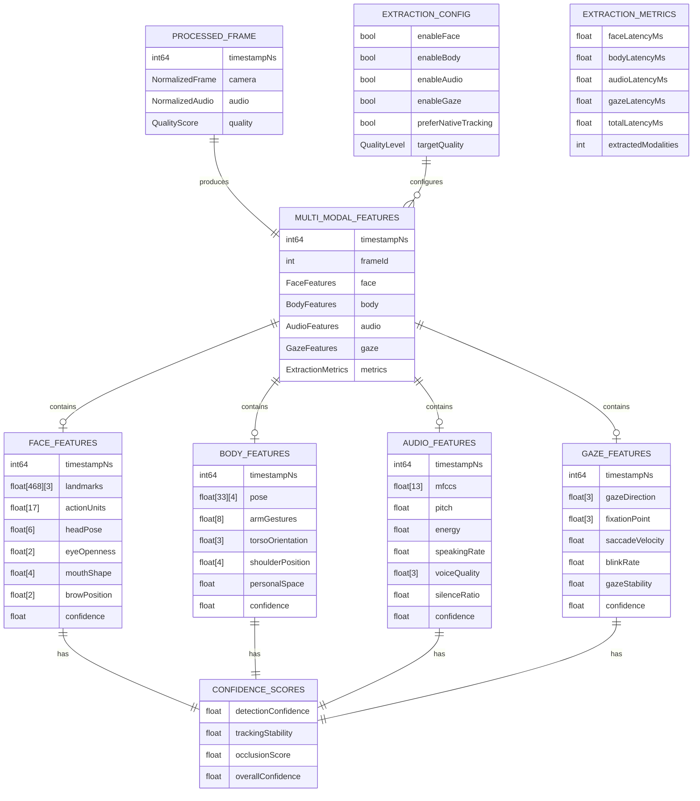

# 4.3 Feature Extraction

## Overview

The feature extraction module extracts meaningful signals from preprocessed sensor data. It produces structured feature vectors for face, body, and audio modalities that feed into perception models and signal fusion. This module leverages MediaPipe for visual features and audio processing libraries for vocal features.

---

## Architecture

---

## Feature Categories

### Face Features

Extracted using MediaPipe Face Mesh and Action Unit detection models.

| Feature | Source | Dimensions | Description |
|---------|--------|------------|-------------|
| Facial landmarks | MediaPipe | 468 × 3 | 3D face mesh coordinates |
| Action Units | AU Model | 17 | FACS-based muscle activations |
| Head pose | MediaPipe | 6 | Rotation (3) + Translation (3) |
| Eye openness | Derived | 2 | Left/right eye aperture ratio |
| Mouth shape | Derived | 4 | Width, height, openness, asymmetry |
| Brow position | Derived | 2 | Left/right brow raise amount |

---

### Body Features

Extracted using MediaPipe Holistic or native body tracking.

| Feature | Source | Dimensions | Description |
|---------|--------|------------|-------------|
| Body pose | MediaPipe | 33 × 4 | 3D joint positions + visibility |
| Arm gestures | Derived | 8 | Arm position classification features |
| Torso orientation | Derived | 3 | Upper body facing direction |
| Shoulder position | Derived | 4 | Shrug, asymmetry, tension indicators |
| Personal space | Derived | 1 | Estimated distance to camera/subject |

---

### Audio Features

Extracted using audio processing (Librosa-style algorithms).

| Feature | Source | Dimensions | Description |
|---------|--------|------------|-------------|
| MFCCs | Audio DSP | 13 | Mel-frequency cepstral coefficients |
| Pitch (F0) | Audio DSP | 1 | Fundamental frequency estimate |
| Energy | Audio DSP | 1 | Root-mean-square energy |
| Speaking rate | Derived | 1 | Syllables per second estimate |
| Voice quality | Derived | 3 | Jitter, shimmer, HNR |
| Silence ratio | Derived | 1 | Percentage of silent frames |

---

### Gaze Features

Extracted from eye tracking or head-direction proxy.

| Feature | Source | Dimensions | Description |
|---------|--------|------------|-------------|
| Gaze direction | Eye Tracker | 3 | 3D gaze vector |
| Fixation point | Derived | 3 | World-space gaze target |
| Saccade velocity | Derived | 1 | Eye movement speed |
| Blink rate | Derived | 1 | Blinks per minute |
| Gaze stability | Derived | 1 | Variance in gaze direction |

---

## Extraction Strategy

### Native vs. ML-Based Extraction

---

## Quality Indicators

Each feature extraction includes confidence metrics:

| Indicator | Description | Range |
|-----------|-------------|-------|
| Detection confidence | Likelihood target is correctly detected | [0, 1] |
| Tracking stability | Temporal consistency of tracking | [0, 1] |
| Occlusion score | Degree of target visibility | [0, 1] |
| Extraction latency | Time taken for extraction | ms |

---

## Latency Budget

| Extractor | Target | Maximum |
|-----------|--------|---------|
| Face feature extraction | 15ms | 25ms |
| Body feature extraction | 10ms | 20ms |
| Audio feature extraction | 5ms | 10ms |
| Gaze feature extraction | 3ms | 5ms |
| Feature aggregation | 2ms | 3ms |
| **Total** | **30ms** | **45ms** |

---

## Class Diagram

---

## Sequence Diagram

---

## Data Model

---

## References

- [4.2 Pre-processing](./4.2-pre-processing.md) — Provides processed frames
- [4.4 Perception Models](./4.4-perception-models.md) — Consumes feature vectors
- [4.1 Device Compatibility](./4.1-device-compatibility.md) — Native tracking availability
- [4.5 Signal Fusion](./4.5-signal-fusion.md) — Fuses extracted features
