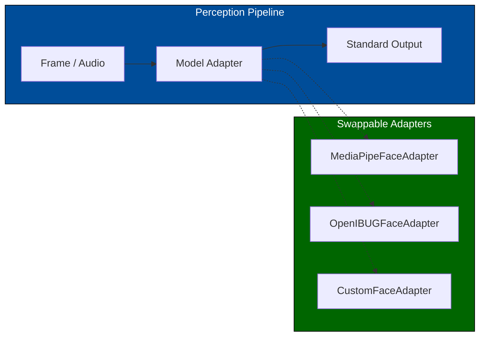
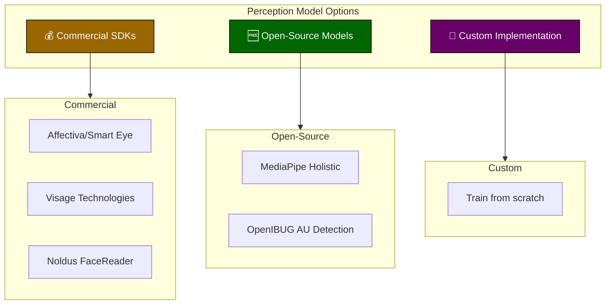
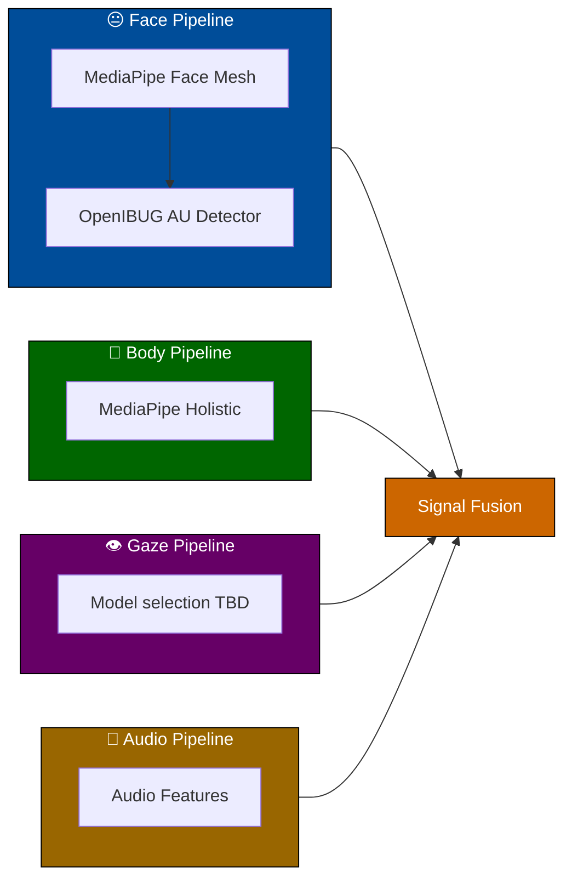
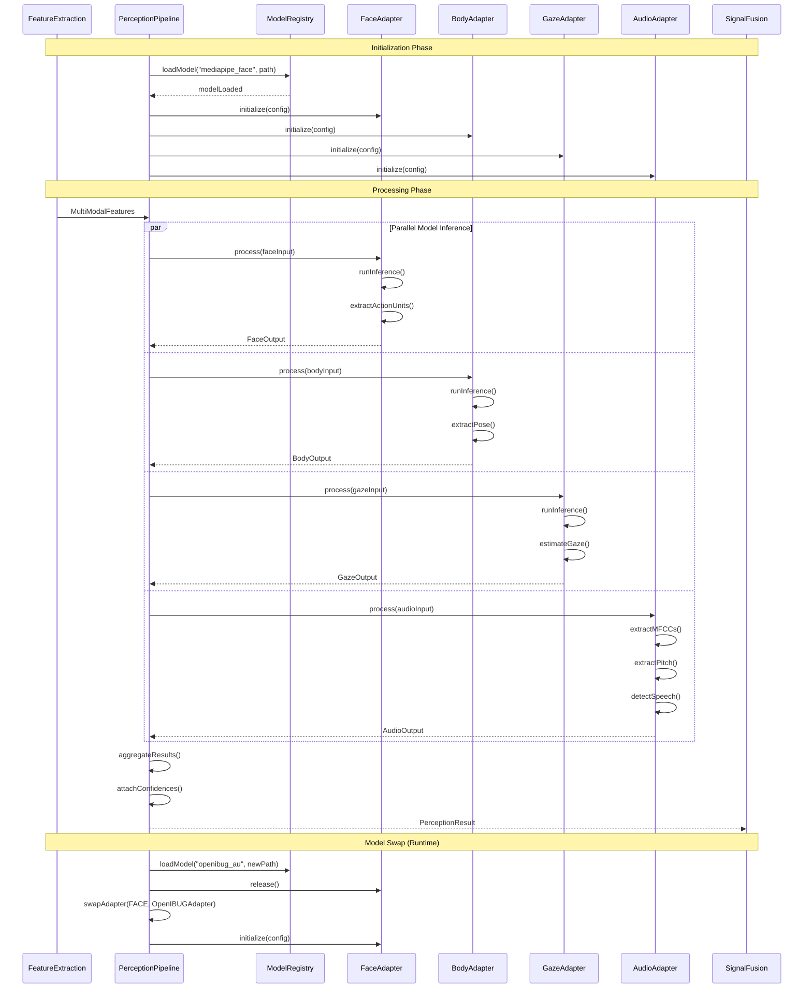
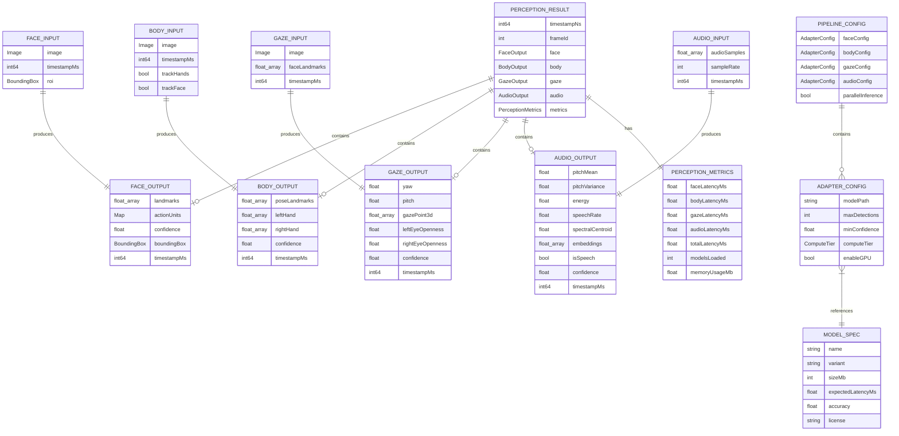

# 4.4 Perception Models

---

This section evaluates model options for the core perception pipeline. SecondSight requires on-device, real-time inference for facial action units, body pose, gaze estimation, and audio prosody.

---

## Design Principles

### ML Framework Strategy

**Development uses PyTorch; deployment uses ONNX/TFLite.** All perception models (OpenIBUG, Wav2Vec2) are developed and fine-tuned in PyTorch for research flexibility, then exported via ONNX for on-device inference using TFLite or ONNX Runtime. MediaPipe models run natively on TFLite.

### Flexible Architecture with Adapter Pattern

The perception system uses an **Adapter Pattern** to ensure models can be easily swapped in code without affecting the rest of the pipeline. Each model type has:

1. **Standard Interface** — Unified input/output structures
2. **Model Adapter** — Wraps model-specific logic, exposes standard interface

**To swap a model:** Simply change the adapter instantiation in one place. All downstream code remains unchanged.

---

## Evaluation Criteria

| Criterion | Weight | Description |
|-----------|--------|-------------|
| **On-Device Capability** | Critical | Must run locally; no cloud dependency |
| **Real-Time Performance** | Critical | ≥15 FPS on target devices (Quest, Ray-Ban Meta, Android) |
| **FAU/Signal Output** | Critical | Must output observable signals, not emotion labels |
| **Model Size** | High | <100MB preferred for mobile/XR deployment |
| **License** | High | Permissive (MIT, Apache 2.0); no GPL/AGPL |
| **Privacy** | High | No data exfiltration; inference-only |
| **Accuracy** | Medium | Good enough for assistive cues; not clinical-grade |
| **Fine-Tuning** | Medium | Ability to adapt to diverse populations |

---

## Solution Options Overview

---

## Open-Source Model Comparison

These are preliminary candidates. License, model size, conversion support, and throughput require verification for each exact model release; figures below are not project benchmarks.

| Model | License | Size | Speed | Platforms | Output | On-Device | Maintenance |
|-------|---------|------|-------|-----------|--------|-----------|-------------|
| **MediaPipe Holistic** | Apache 2.0 | ~15MB | 30-60 FPS | TFLite, ONNX, Web | 540+ keypoints | ✅ Yes | ✅ Active (Google) |
| **OpenIBUG AU Detection** | MIT | ~100MB | 25-30 FPS | PyTorch, ONNX | 12-18 Action Units | ✅ Yes | ✅ Active (academic) |
| **BlazePose GHUM** | Apache 2.0 | ~10MB | 30 FPS | TFLite | 33 body keypoints | ✅ Yes | ✅ Active (Google) |
| **MoveNet** | Apache 2.0 | ~5MB | 50+ FPS | TFLite | 17 body keypoints | ✅ Yes | ✅ Active (Google) |

---

## Full Solution Comparison

| Criterion | Commercial (Affectiva) | Open-Source (MediaPipe + OpenIBUG) | Custom Implementation |
|-----------|------------------------|-------------------------------------|----------------------|
| **Development Cost** | 🟩 Low | 🟨 Medium | 🟥 High |
| **Licensing Cost** | 🟥 High | 🟩 Free | 🟩 Free |
| **Time to MVP** | 🟩 Fast (weeks) | 🟨 Medium (1-2 months) | 🟥 Slow (6+ months) |
| **On-Device** | 🟩 Yes | 🟩 Yes | 🟩 Yes |
| **FAU Output** | 🟩 21 AUs | 🟩 12-18 AUs | 🟩 Customizable |
| **Body Tracking** | 🟥 No | 🟩 Yes | 🟩 Customizable |
| **Fine-Tuning** | 🟥 No | 🟩 Yes | 🟩 Full control |
| **Vendor Lock-in** | 🟥 High | 🟩 None | 🟩 None |

**Legend:** 🟩 Strong | 🟨 Acceptable | 🟥 Weak

---

## Recommended Architecture

Based on the comparison, the **hybrid open-source approach** is recommended:

| Component | Model | Size | License | Priority |
|-----------|-------|------|---------|----------|
| **Face Landmarks** | MediaPipe Face Mesh | 15MB | Apache 2.0 | P0 |
| **Facial Action Units** | OpenIBUG AU Detection | 100MB | MIT | P0 |
| **Body Pose** | MediaPipe Holistic | 10MB | Apache 2.0 | P0 |
| **Hand Tracking** | MediaPipe Hands | 5MB | Apache 2.0 | P1 |
| **Gaze Estimation** | Public model to evaluate | TBD | TBD | P0 |
| **Audio Features** | Librosa + MLP | 5MB | BSD | P1 |
| **Total** | — | **TBD after model selection** | — | — |

---

## Model Deployment Strategy

| Phase | Focus | Models |
|-------|-------|--------|
| **Phase 1 (MVP)** | Core signals | MediaPipe Holistic + OpenIBUG AU |
| **Phase 2 (Enhanced)** | Gaze + audio | Evaluate a public gaze model and audio features |
| **Phase 3 (Production)** | Optimization | Quantization (TFLite, ONNX), model pruning |
| **Phase 4 (Custom)** | Fine-tuning | Retrain on diverse datasets for fairness |

---

## Latency Budget

| Component | Target | Maximum |
|-----------|--------|---------|
| Face detection + landmarks | 15ms | 25ms |
| Action Unit inference | 20ms | 35ms |
| Body pose estimation | 15ms | 25ms |
| Gaze estimation | 10ms | 15ms |
| Audio feature extraction | 5ms | 10ms |
| **Total (parallel)** | **35ms** | **50ms** |

---

## Open Questions (TBD)

- [ ] Benchmark OpenIBUG AU vs MediaPipe Blendshapes for signal quality
- [ ] Test combined model size and latency on Ray-Ban Meta
- [ ] Assess demographic bias in selected models

---

## Class Diagram

```mermaid
classDiagram
    class IPerceptionAdapter {
        <<interface>>
        +initialize(config: AdapterConfig) void
        +process(input: PerceptionInput) PerceptionOutput?
        +release() void
        +getLatencyMs() float
        +isAvailable() bool
    }

    class FacePerceptionAdapter {
        <<abstract>>
        +initialize(config: AdapterConfig) void
        +process(input: FaceInput) FaceOutput?
        +release() void
        +getSupportedActionUnits() string[]
    }

    class BodyPerceptionAdapter {
        <<abstract>>
        +initialize(config: AdapterConfig) void
        +process(input: BodyInput) BodyOutput?
        +release() void
    }

    class GazePerceptionAdapter {
        <<abstract>>
        +initialize(config: AdapterConfig) void
        +process(input: GazeInput) GazeOutput?
        +release() void
    }

    class AudioPerceptionAdapter {
        <<abstract>>
        +initialize(config: AdapterConfig) void
        +process(input: AudioInput) AudioOutput?
        +release() void
    }

    class MediaPipeFaceAdapter {
        -faceMesh: FaceMeshHandle
        -blendshapeToAU: Map~string,string~
        +initialize(config: AdapterConfig) void
        +process(input: FaceInput) FaceOutput?
        +convertBlendshapes(blendshapes: Blendshapes) ActionUnits
    }

    class OpenIBUGFaceAdapter {
        -onnxSession: OnnxSessionHandle
        -inputSize: Resolution
        +initialize(config: AdapterConfig) void
        +process(input: FaceInput) FaceOutput?
        +preprocess(image: Image, roi: BoundingBox?) Tensor
    }

    class MediaPipeBodyAdapter {
        -holistic: HolisticHandle
        +initialize(config: AdapterConfig) void
        +process(input: BodyInput) BodyOutput?
    }

    class AriaGazeAdapter {
        -gazeModel: OnnxSessionHandle
        +initialize(config: AdapterConfig) void
        +process(input: GazeInput) GazeOutput?
    }

    class AudioFeatureAdapter {
        -sampleRate: int
        +initialize(config: AdapterConfig) void
        +process(input: AudioInput) AudioOutput?
        +extractMFCCs(audio: AudioBuffer) float[13]
        +extractPitch(audio: AudioBuffer) float
    }

    class PerceptionPipeline {
        -faceAdapter: FacePerceptionAdapter
        -bodyAdapter: BodyPerceptionAdapter
        -gazeAdapter: GazePerceptionAdapter
        -audioAdapter: AudioPerceptionAdapter
        +initialize(config: PipelineConfig) void
        +processFrame(frame: ProcessedFrame) PerceptionResult
        +swapAdapter(modality: Modality, adapter: IPerceptionAdapter) void
        +getMetrics() PerceptionMetrics
    }

    class ModelRegistry {
        -loadedModels: Map~string, ModelHandle~
        +loadModel(name: string, path: string) bool
        +unloadModel(name: string) void
        +getModel(name: string) ModelHandle?
        +getModelVariant(name: string, tier: ComputeTier) string
    }

    IPerceptionAdapter <|.. FacePerceptionAdapter
    IPerceptionAdapter <|.. BodyPerceptionAdapter
    IPerceptionAdapter <|.. GazePerceptionAdapter
    IPerceptionAdapter <|.. AudioPerceptionAdapter

    FacePerceptionAdapter <|-- MediaPipeFaceAdapter
    FacePerceptionAdapter <|-- OpenIBUGFaceAdapter
    BodyPerceptionAdapter <|-- MediaPipeBodyAdapter
    GazePerceptionAdapter <|-- AriaGazeAdapter
    AudioPerceptionAdapter <|-- AudioFeatureAdapter

    PerceptionPipeline *-- FacePerceptionAdapter
    PerceptionPipeline *-- BodyPerceptionAdapter
    PerceptionPipeline *-- GazePerceptionAdapter
    PerceptionPipeline *-- AudioPerceptionAdapter
    PerceptionPipeline --> ModelRegistry : uses
```

---

## Sequence Diagram

---

## Data Model

---

## References

- [4.3 Feature Extraction](./4.3-feature-extraction.md) — Provides feature inputs
- [4.5 Signal Fusion](./4.5-signal-fusion.md) — Consumes perception outputs
- [4.1 Device Compatibility](./4.1-device-compatibility.md) — ML runtime abstraction
- [4.13 Performance & Latency](./4.13-performance-latency.md) — Model variant selection
