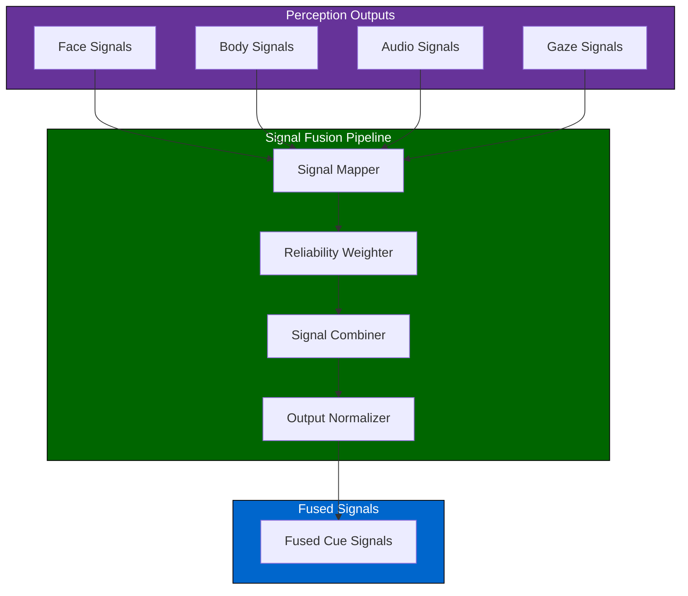
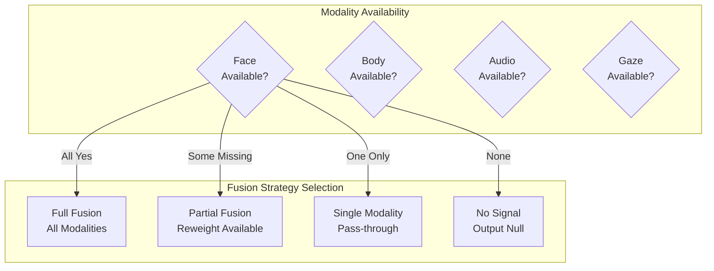
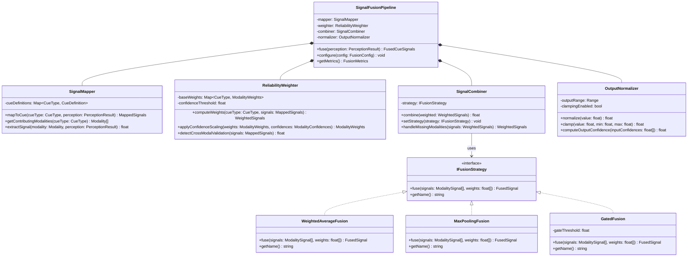
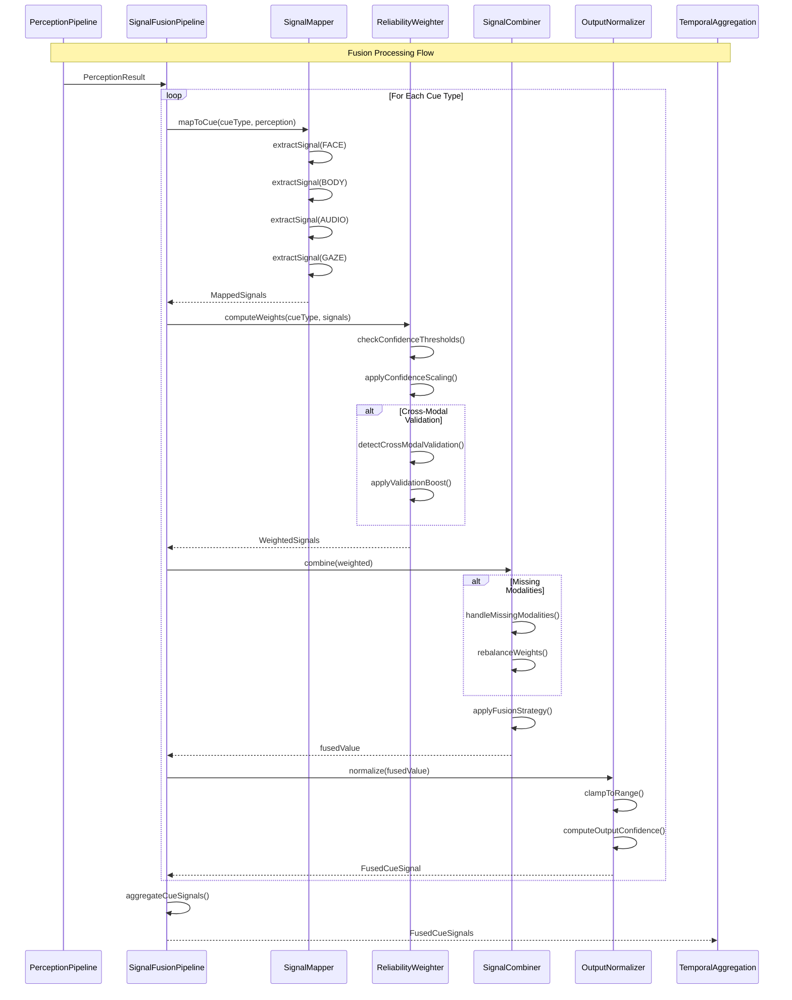
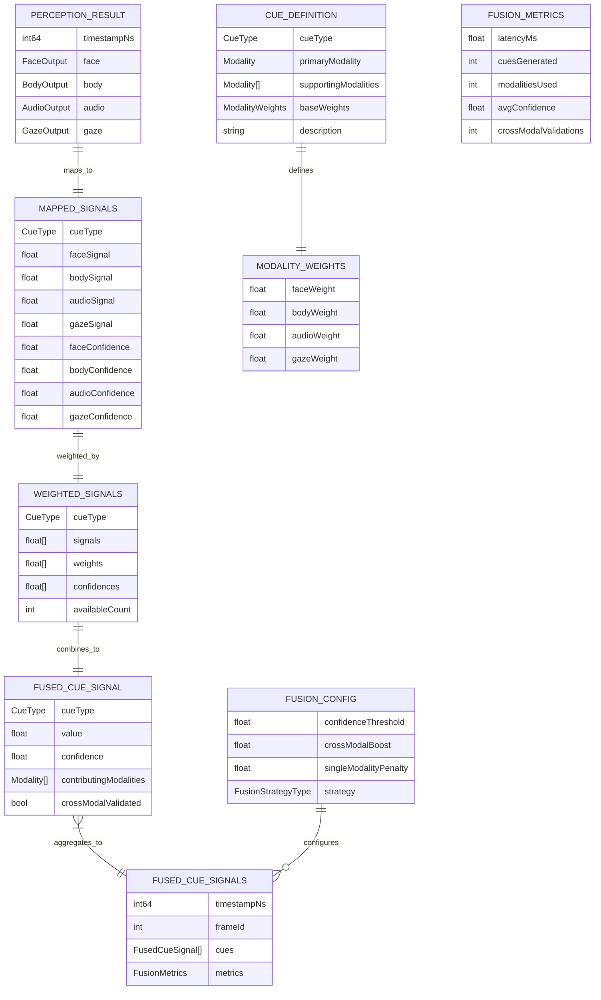

# 4.5 Signal Fusion

## Overview

The signal fusion module combines perception outputs from multiple modalities (face, body, audio, gaze) into unified social cue signals. It uses reliability-weighted fusion to handle missing or low-confidence inputs gracefully, ensuring robust cue generation even when individual modalities are degraded.

---

## Architecture



---

## Fusion Strategies

### Reliability-Weighted Average

The default fusion strategy weights each modality by its confidence score:

```
fused_signal = Σ(modality_signal × modality_confidence) / Σ(modality_confidence)
```

| Property | Description |
|----------|-------------|
| Method | Weighted arithmetic mean |
| Weight source | Per-modality confidence scores |
| Missing handling | Zero weight for absent modalities |
| Normalization | Output scaled to [0, 1] |

---

### Cross-Modal Validation

Signals that appear in multiple modalities receive boosted confidence:

| Signal | Face | Body | Audio | Validation Boost |
|--------|------|------|-------|------------------|
| Engagement | ✅ Eye contact | ✅ Lean forward | ✅ Response timing | +20% confidence |
| Discomfort | ✅ Frown | ✅ Crossed arms | ❌ — | +10% confidence |
| Agreement | ✅ Head nod | ❌ — | ✅ Vocal affirmation | +15% confidence |

---

## Signal Mappings

### Cue Type Definitions

| Cue Type | Primary Modality | Supporting Modalities | Description |
|----------|------------------|----------------------|-------------|
| Emotional Valence | Face (AUs) | Audio (pitch) | Positive/negative affect |
| Attention | Gaze | Face (orientation) | Focus on speaker |
| Engagement | Face + Gaze | Body | Active participation |
| Discomfort | Face (AUs) | Body | Unease indicators |
| Turn-taking | Audio | Gaze | Speaking opportunity |
| Emphasis | Audio | Body (gesture) | Important point markers |

---

### Signal Weights by Cue Type

| Cue Type | Face Weight | Body Weight | Audio Weight | Gaze Weight |
|----------|-------------|-------------|--------------|-------------|
| Emotional Valence | 0.5 | 0.1 | 0.3 | 0.1 |
| Attention | 0.2 | 0.1 | 0.1 | 0.6 |
| Engagement | 0.3 | 0.3 | 0.2 | 0.2 |
| Discomfort | 0.4 | 0.4 | 0.1 | 0.1 |
| Turn-taking | 0.1 | 0.1 | 0.7 | 0.1 |
| Emphasis | 0.1 | 0.3 | 0.5 | 0.1 |

---

## Graceful Degradation

### Missing Modality Handling



### Confidence Thresholds

| Condition | Threshold | Action |
|-----------|-----------|--------|
| Modality confidence | < 0.3 | Exclude from fusion |
| Fused signal confidence | < 0.4 | Mark as uncertain |
| No modalities available | — | Output null cue |
| Single modality only | — | Reduce output confidence by 30% |

---

## Latency Budget

| Stage | Target | Maximum |
|-------|--------|---------|
| Signal mapping | 1ms | 2ms |
| Weight computation | 0.5ms | 1ms |
| Signal combination | 2ms | 3ms |
| Normalization | 0.5ms | 1ms |
| **Total** | **5ms** | **10ms** |

---

## Class Diagram



---

## Sequence Diagram



---

## Data Model



---

## References

- [4.4 Perception Models](./4.4-perception-models.md) — Provides perception outputs
- [4.6 Temporal Aggregation](./4.6-temporal-aggregation.md) — Consumes fused signals
- [4.3 Feature Extraction](./4.3-feature-extraction.md) — Feature confidence sources
- [4.14 Error Handling](./4.14-error-handling.md) — Graceful degradation patterns
