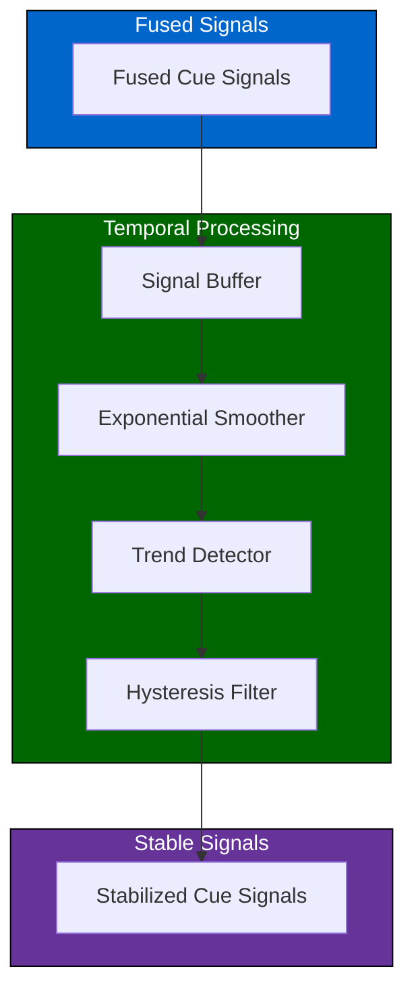
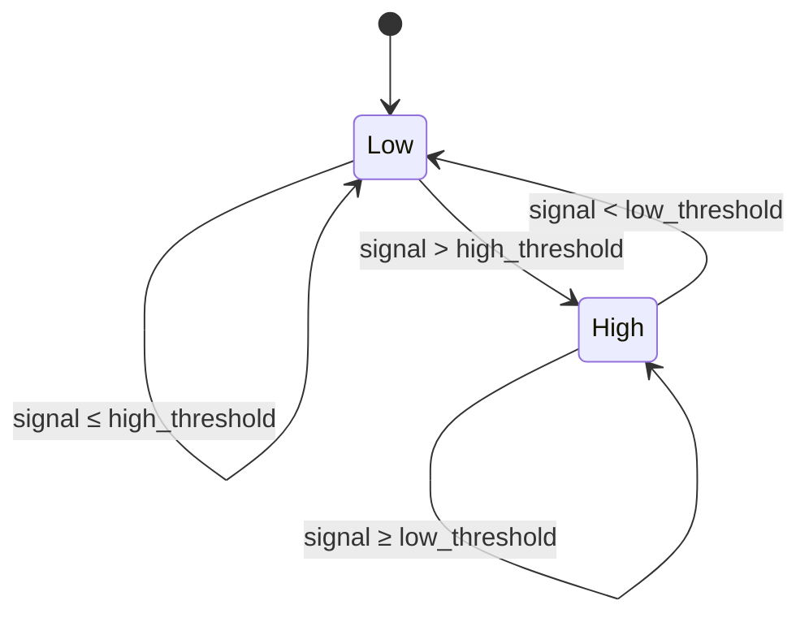
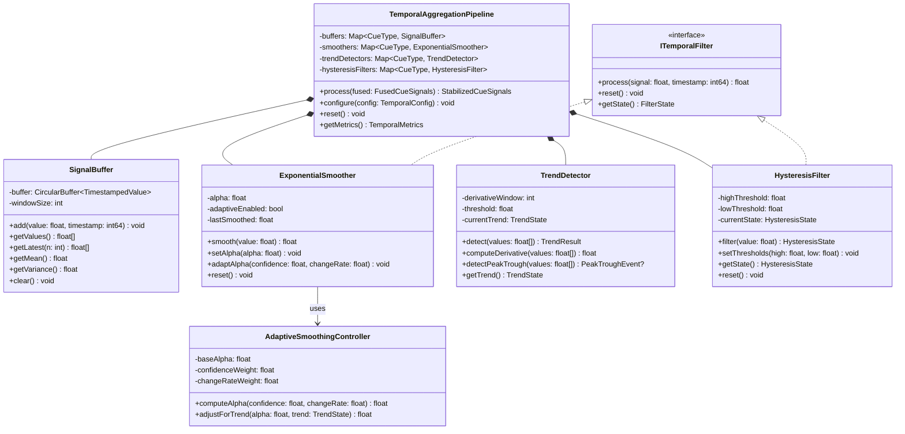
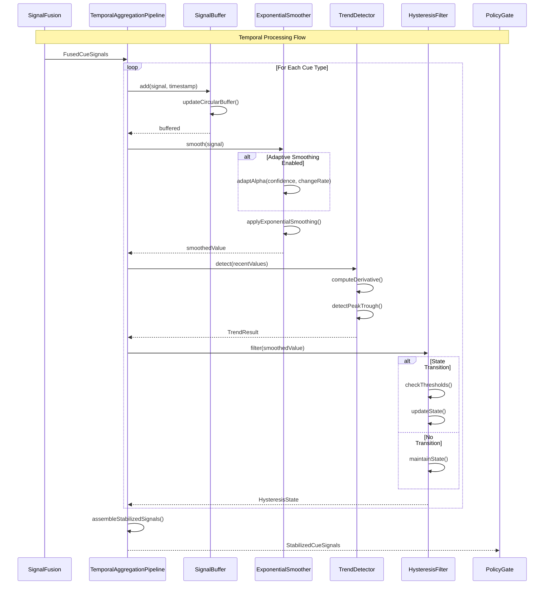
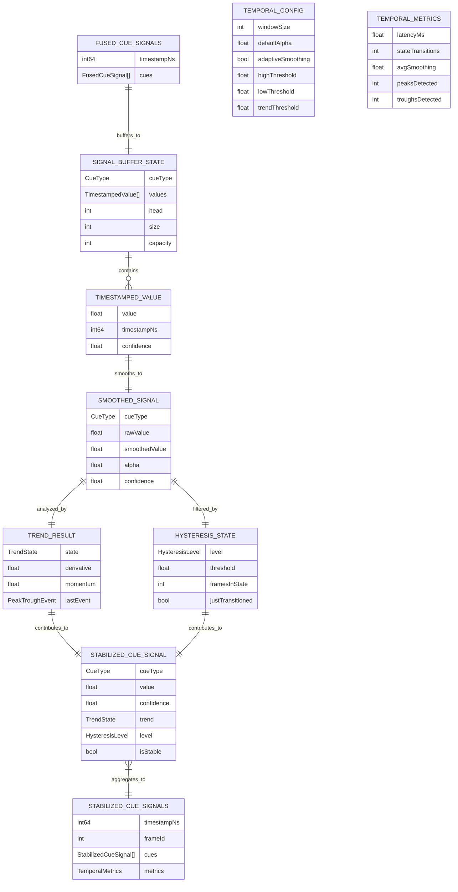

# 4.6 Temporal Aggregation

## Overview

The temporal aggregation module smooths fused signals over time to reduce noise and provide stable, consistent cue outputs. It applies exponential smoothing, trend detection, and hysteresis filtering to prevent rapid oscillations in user-facing feedback while maintaining responsiveness to genuine state changes.

---

## Architecture



---

## Processing Stages

### Signal Buffer

Maintains a sliding window of recent signal values for each cue type.

| Parameter | Default | Description |
|-----------|---------|-------------|
| Window size | 30 frames | ~1 second at 30 FPS |
| Storage | Ring buffer | Fixed memory, O(1) insert |
| Timestamps | Preserved | Enable variable-rate handling |

---

### Exponential Smoother

Applies exponential moving average to reduce high-frequency noise.

| Parameter | Default | Range | Description |
|-----------|---------|-------|-------------|
| Alpha (fast) | 0.3 | [0.2, 0.5] | Responsive to changes |
| Alpha (slow) | 0.1 | [0.05, 0.15] | Very stable output |
| Alpha (default) | 0.2 | [0.1, 0.3] | Balance response/stability |

**Formula:**
```
smoothed[t] = α × signal[t] + (1 - α) × smoothed[t-1]
```

---

### Trend Detector

Identifies signal direction and momentum to anticipate state transitions.

| Trend State | Condition | Description |
|-------------|-----------|-------------|
| Rising | Derivative > threshold | Signal increasing |
| Falling | Derivative < -threshold | Signal decreasing |
| Stable | Derivative ≈ 0 | No significant change |
| Peak | Rising → Falling | Local maximum detected |
| Trough | Falling → Rising | Local minimum detected |

---

### Hysteresis Filter

Prevents rapid state oscillations by requiring threshold crossing with margin.



| Parameter | Default | Description |
|-----------|---------|-------------|
| High threshold | 0.6 | Transition to HIGH state |
| Low threshold | 0.4 | Transition to LOW state |
| Dead zone | 0.2 | Gap prevents oscillation |

---

## Adaptive Smoothing

Adjusts smoothing parameters based on signal characteristics:

| Condition | Alpha Adjustment | Rationale |
|-----------|------------------|-----------|
| High confidence | Increase (faster) | Trust the signal more |
| Low confidence | Decrease (slower) | Be more conservative |
| Large change detected | Increase (faster) | Respond to genuine change |
| Stable period | Decrease (slower) | Smooth out micro-variations |

---

## Latency Budget

| Stage | Target | Maximum |
|-------|--------|---------|
| Buffer insert | 0.1ms | 0.5ms |
| Smoothing computation | 1ms | 2ms |
| Trend detection | 1ms | 2ms |
| Hysteresis evaluation | 0.5ms | 1ms |
| **Total** | **3ms** | **5ms** |

---

## Class Diagram



---

## Sequence Diagram



---

## Data Model



---

## References

- [4.5 Signal Fusion](./4.5-signal-fusion.md) — Provides fused signals
- [4.7 Policy Gate](./4.7-policy-gate.md) — Consumes stabilized signals
- [4.13 Performance & Latency](./4.13-performance-latency.md) — Latency budget
