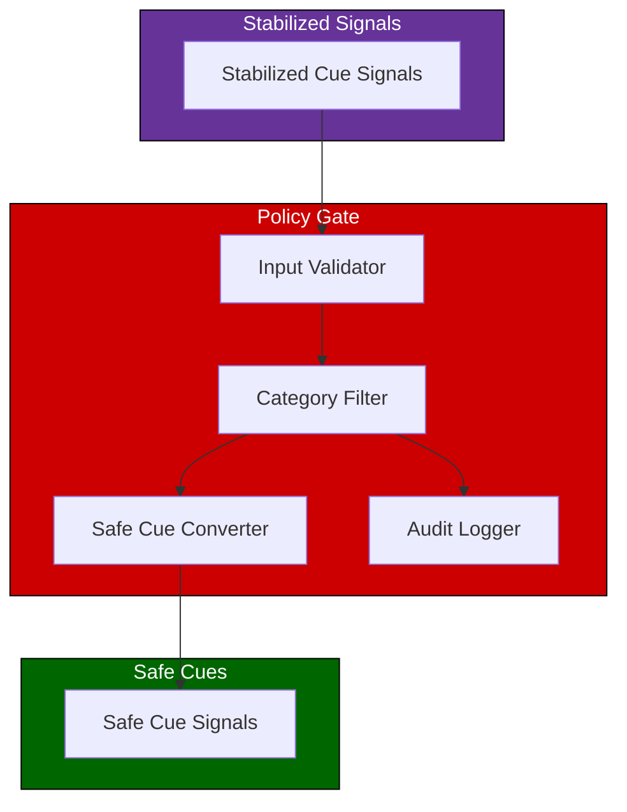
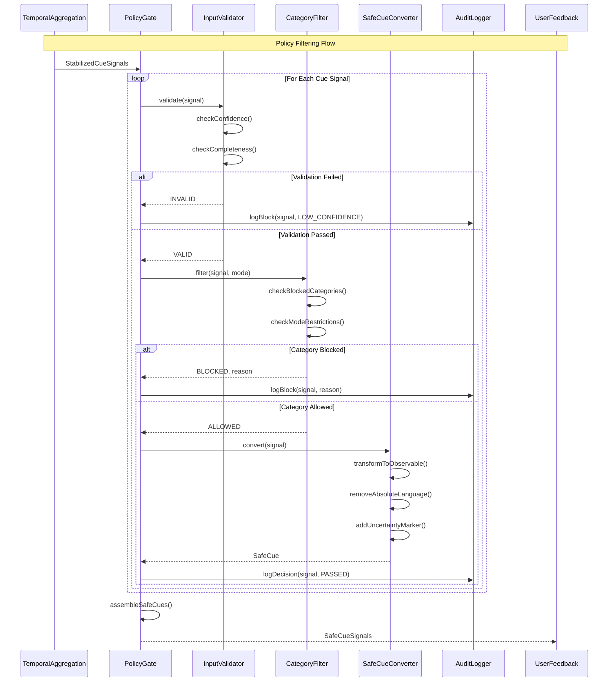
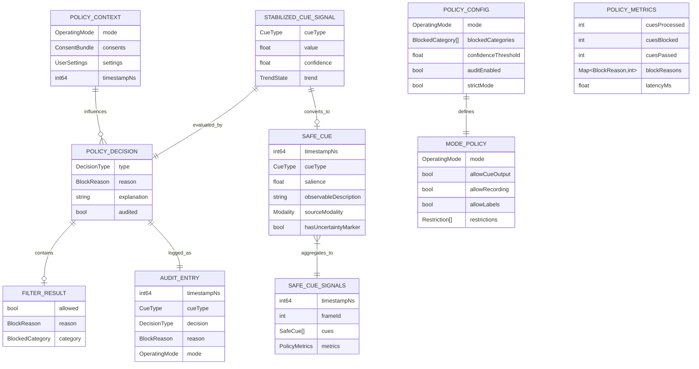

# 4.7 Policy Gate

## Overview

The Policy Gate is a mandatory filtering layer that ensures all output cues conform to ethical and safety constraints. It blocks identity claims, emotion labels, and other prohibited inferences, converting raw signals into safe, observable-only cues. The gate operates based on the current operating mode and user consent status.

---

## Architecture

---

## Blocked Categories

The Policy Gate blocks all inferences that fall into these categories:

| Category | Examples | Reason |
|----------|----------|--------|
| Identity claims | "This person is autistic" | Cannot infer identity from behavior |
| Emotion labels | "They are angry" | Emotions are internal states |
| Absolute statements | "They definitely feel..." | Certainty is inappropriate |
| Diagnostic claims | "Signs of depression" | Not a clinical tool |
| Comparative judgments | "More engaged than usual" | Requires baseline |
| Predictive claims | "They will become upset" | Cannot predict future states |

---

## Safe Cue Transformations

Raw signals are transformed into observable-only descriptions:

| Raw Signal | Blocked Output | Safe Output |
|------------|----------------|-------------|
| High AU4 + AU7 | "Angry expression" | "Furrowed brow observed" |
| Low engagement score | "Person is bored" | "Reduced eye contact pattern" |
| Vocal pitch increase | "Getting upset" | "Voice pitch rising" |
| Crossed arms | "Defensive posture" | "Arms crossed position" |
| Gaze away | "Lost interest" | "Gaze directed away" |

---

## Mode-Specific Policies

Different operating modes have different policy configurations:

| Mode | Cue Output | Recording | Identity Inference | Diagnostic Claims |
|------|------------|-----------|-------------------|-------------------|
| Assistive | Allowed | Blocked | Blocked | Blocked |
| Training | Allowed + Labels | Session only | Blocked | Blocked |
| Research | Full signals | With consent | Blocked | Blocked |

---

## Block Reasons

When a cue is blocked, the reason is logged:

| Block Reason | Description |
|--------------|-------------|
| IDENTITY_CLAIM | Attempted to infer identity characteristic |
| EMOTION_LABEL | Attempted to assign emotion state |
| ABSOLUTE_CLAIM | Used certainty language |
| LOW_CONFIDENCE | Signal confidence below threshold |
| USER_DISABLED | User has disabled this cue type |
| MODE_RESTRICTED | Current mode does not allow this cue |
| CONSENT_MISSING | Required consent not granted |

---

## Latency Budget

| Stage | Target | Maximum |
|-------|--------|---------|
| Input validation | 0.5ms | 1ms |
| Category filtering | 1ms | 2ms |
| Safe conversion | 0.5ms | 1ms |
| Audit logging | 0.1ms | 0.5ms |
| **Total** | **2ms** | **5ms** |

---

## Class Diagram

```mermaid
classDiagram
    class IPolicyRule {
        <<interface>>
        +evaluate(cue: CueSignal, context: PolicyContext) PolicyDecision
        +getName() string
        +getPriority() int
    }

    class PolicyGate {
        -rules: IPolicyRule[]
        -modePolicy: ModePolicy
        -consentManager: ConsentManager
        -auditLogger: AuditLogger
        +filter(signals: StabilizedCueSignals, context: PolicyContext) SafeCueSignals
        +addRule(rule: IPolicyRule) void
        +removeRule(ruleName: string) void
        +setMode(mode: OperatingMode) void
    }

    class InputValidator {
        -confidenceThreshold: float
        +validate(signal: StabilizedCueSignal) ValidationResult
        +checkConfidence(signal: StabilizedCueSignal) bool
        +checkCompleteness(signal: StabilizedCueSignal) bool
    }

    class CategoryFilter {
        -blockedCategories: BlockedCategory[]
        -modeRestrictions: Map~OperatingMode, BlockedCategory[]~
        +filter(signal: StabilizedCueSignal, mode: OperatingMode) FilterResult
        +isBlocked(category: BlockedCategory, mode: OperatingMode) bool
        +getBlockReason(signal: StabilizedCueSignal) BlockReason
    }

    class SafeCueConverter {
        -transformations: Map~CueType, Transformation~
        +convert(signal: StabilizedCueSignal) SafeCue
        +removeAbsoluteLanguage(text: string) string
        +addUncertaintyMarker(cue: SafeCue) SafeCue
    }

    class AuditLogger {
        -logBuffer: AuditEntry[]
        -flushInterval: int
        +logDecision(signal: StabilizedCueSignal, decision: PolicyDecision) void
        +logBlock(signal: StabilizedCueSignal, reason: BlockReason) void
        +flush() void
        +getRecentBlocks(count: int) AuditEntry[]
    }

    class ModePolicy {
        -currentMode: OperatingMode
        -policies: Map~OperatingMode, PolicyConfig~
        +getPolicy(mode: OperatingMode) PolicyConfig
        +isAllowed(cueType: CueType, mode: OperatingMode) bool
        +getRestrictions(mode: OperatingMode) Restriction[]
    }

    class IdentityBlockRule {
        +evaluate(cue: CueSignal, context: PolicyContext) PolicyDecision
        +getName() string
        +getPriority() int
    }

    class EmotionLabelBlockRule {
        +evaluate(cue: CueSignal, context: PolicyContext) PolicyDecision
        +getName() string
        +getPriority() int
    }

    class AbsoluteClaimBlockRule {
        +evaluate(cue: CueSignal, context: PolicyContext) PolicyDecision
        +getName() string
        +getPriority() int
    }

    IPolicyRule <|.. IdentityBlockRule
    IPolicyRule <|.. EmotionLabelBlockRule
    IPolicyRule <|.. AbsoluteClaimBlockRule

    PolicyGate *-- InputValidator
    PolicyGate *-- CategoryFilter
    PolicyGate *-- SafeCueConverter
    PolicyGate *-- AuditLogger
    PolicyGate *-- ModePolicy
    PolicyGate o-- IPolicyRule
```

---

## Sequence Diagram

---

## Data Model

---

## References

- [4.6 Temporal Aggregation](./4.6-temporal-aggregation.md) — Provides stabilized signals
- [4.8 User Feedback](./4.8-user-feedback.md) — Consumes safe cues
- [4.10 Operating Modes](./4.10-operating-modes.md) — Mode-specific policies
- [4.12 Privacy & Consent](./4.12-privacy-consent-ux.md) — Consent integration
