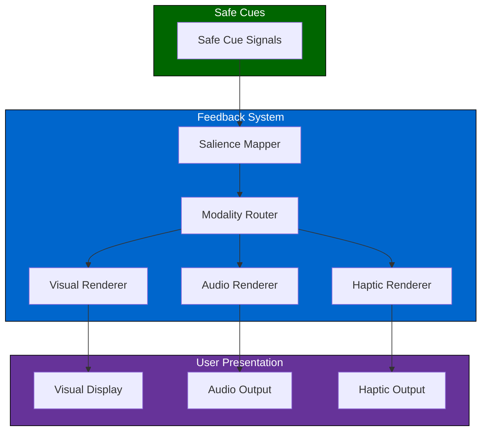
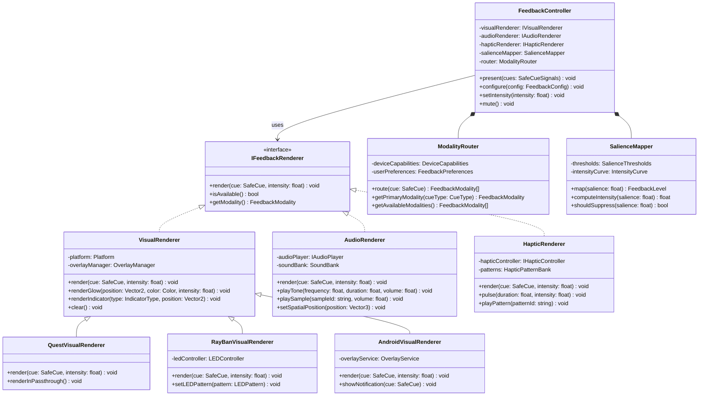
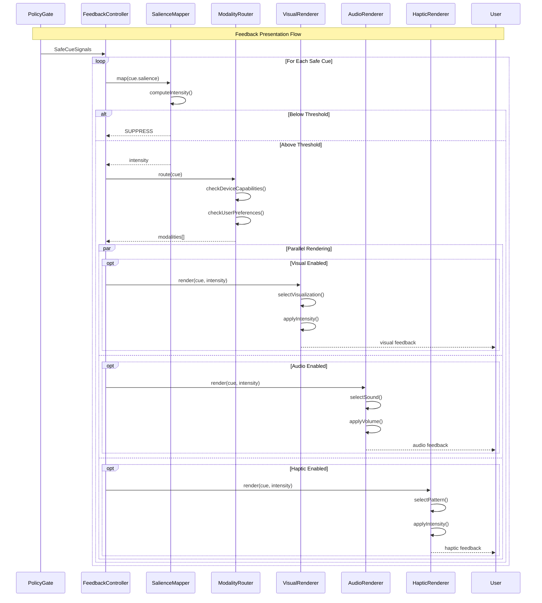
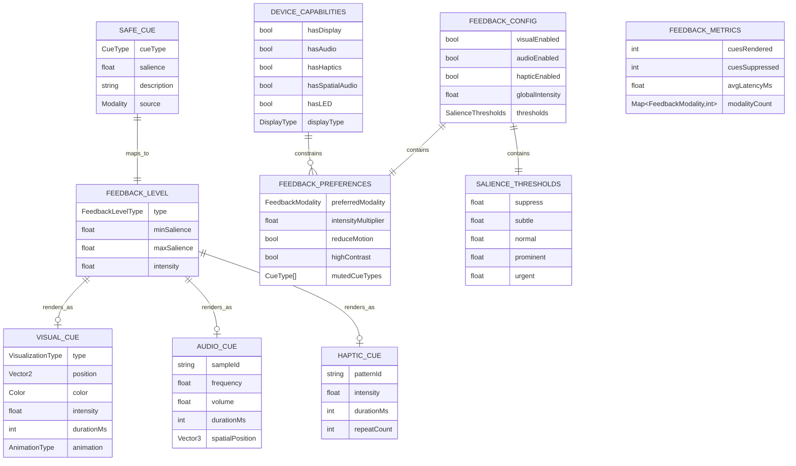

# 4.8 User Feedback

## Overview

The user feedback module renders safe cues to the user through appropriate modalities (visual, audio, haptic) based on the current device capabilities and user preferences. It maps cue salience to feedback intensity and ensures non-intrusive, contextually appropriate presentation.

---

## Architecture

---

## Feedback Modalities

### Visual Feedback

| Cue Type | Rendering | Placement | Duration |
|----------|-----------|-----------|----------|
| Attention shift | Subtle glow/arrow | Peripheral | 500ms fade |
| Emphasis detected | Pulse highlight | Near content | 300ms |
| Turn opportunity | Gentle indicator | Lower field | Persistent |
| Discomfort signal | Soft color shift | Peripheral | 1s fade |

### Audio Feedback

| Cue Type | Sound | Volume | Duration |
|----------|-------|--------|----------|
| Attention shift | Soft chime | Low | 200ms |
| Turn opportunity | Rising tone | Low | 300ms |
| Recording active | Periodic beep | Very low | 100ms/30s |

### Haptic Feedback

| Cue Type | Pattern | Intensity | Duration |
|----------|---------|-----------|----------|
| Attention shift | Single pulse | Light | 100ms |
| Turn opportunity | Double pulse | Medium | 200ms |
| Alert | Triple pulse | Strong | 300ms |

---

## Salience Mapping

Maps cue values to feedback intensity:

| Salience Range | Feedback Level | Description |
|----------------|----------------|-------------|
| 0.0 - 0.3 | None | Below threshold, no feedback |
| 0.3 - 0.5 | Subtle | Barely noticeable |
| 0.5 - 0.7 | Normal | Clear but non-intrusive |
| 0.7 - 0.9 | Prominent | Attention-getting |
| 0.9 - 1.0 | Urgent | Immediate attention required |

---

## Device-Specific Rendering

| Device | Visual | Audio | Haptic |
|--------|--------|-------|--------|
| Quest 3/Pro | Full HUD overlay | Spatial audio | Controller |
| RayBan Meta | LED indicator | Bone conduction | None |
| Android | Screen overlay | Speaker/earbuds | Phone vibration |

---

## Latency Budget

| Stage | Target | Maximum |
|-------|--------|---------|
| Salience mapping | 1ms | 2ms |
| Modality routing | 1ms | 2ms |
| Visual render | 10ms | 16ms |
| Audio render | 5ms | 10ms |
| Haptic trigger | 2ms | 5ms |
| **Total** | **16ms** | **33ms** |

---

## Class Diagram

---

## Sequence Diagram

---

## Data Model

---

## References

- [4.7 Policy Gate](./4.7-policy-gate.md) — Provides safe cues
- [4.9 User Settings](./4.9-user-settings.md) — Feedback preferences
- [4.1 Device Compatibility](./4.1-device-compatibility.md) — Device capabilities
- [4.13 Performance & Latency](./4.13-performance-latency.md) — Render timing
