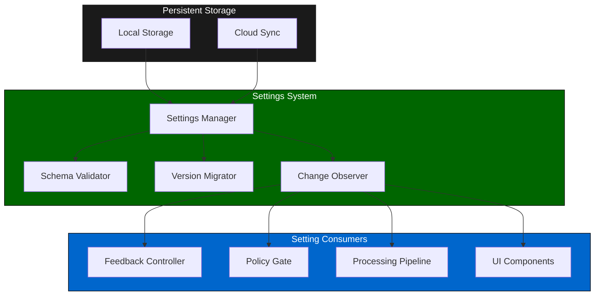
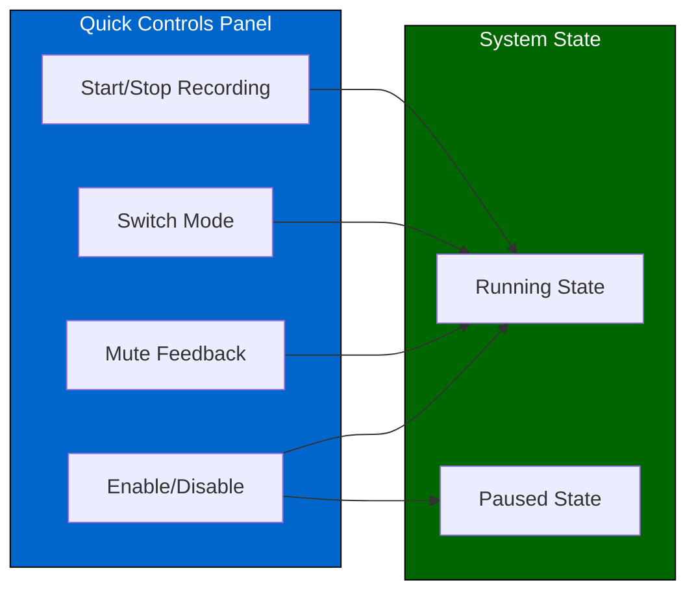
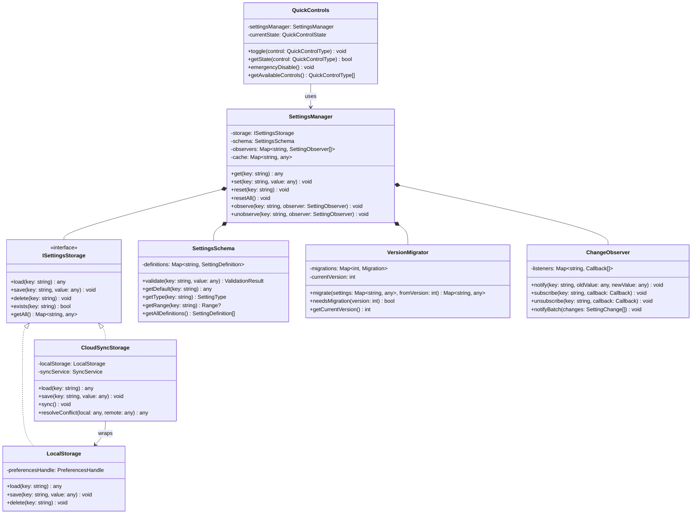
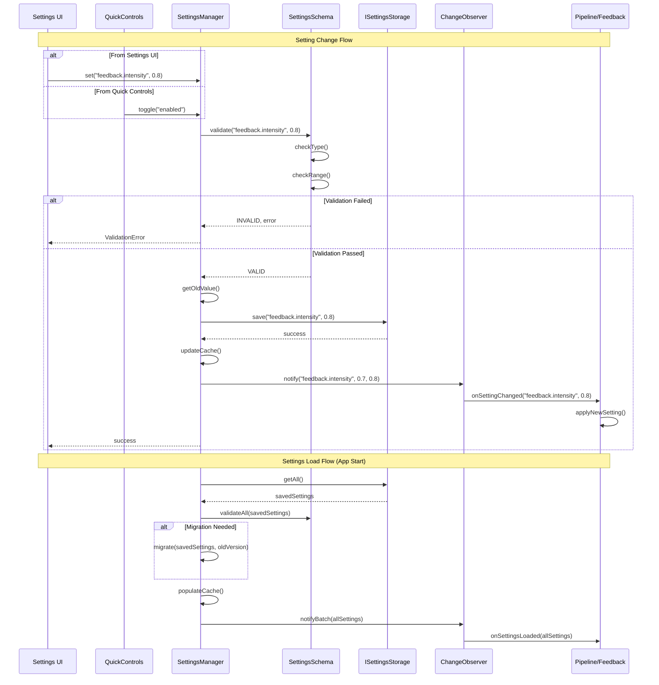
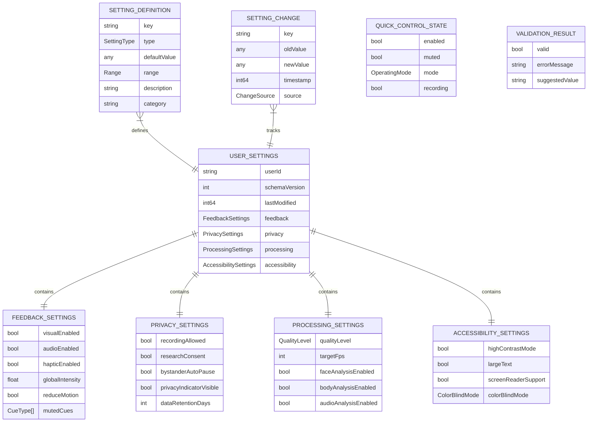

# 4.9 User Settings

## Overview

The user settings module manages persistent user preferences and runtime controls for the SecondSight application. It provides a unified interface for storing, retrieving, and applying settings across all pipeline components while respecting platform-specific storage mechanisms.

---

## Architecture

---

## Setting Categories

### Feedback Settings

| Setting | Type | Default | Range | Description |
|---------|------|---------|-------|-------------|
| Visual feedback enabled | bool | true | — | Enable visual cue display |
| Audio feedback enabled | bool | false | — | Enable audio cues |
| Haptic feedback enabled | bool | true | — | Enable haptic feedback |
| Global intensity | float | 0.7 | [0.0, 1.0] | Overall feedback strength |
| Reduce motion | bool | false | — | Minimize animations |

### Privacy Settings

| Setting | Type | Default | Range | Description |
|---------|------|---------|-------|-------------|
| Recording allowed | bool | false | — | Allow session recording |
| Research mode consent | bool | false | — | Opt-in for research data |
| Bystander auto-pause | bool | true | — | Pause when others nearby |
| Privacy indicator visible | bool | true | — | Show recording indicator |

### Processing Settings

| Setting | Type | Default | Range | Description |
|---------|------|---------|-------|-------------|
| Quality level | enum | BALANCED | LOW/BALANCED/HIGH | Processing quality |
| Target FPS | int | 30 | [10, 60] | Target frame rate |
| Face analysis enabled | bool | true | — | Enable face processing |
| Body analysis enabled | bool | true | — | Enable body processing |
| Audio analysis enabled | bool | true | — | Enable audio processing |

### Accessibility Settings

| Setting | Type | Default | Range | Description |
|---------|------|---------|-------|-------------|
| High contrast mode | bool | false | — | Increase visual contrast |
| Large text | bool | false | — | Increase text size |
| Screen reader support | bool | false | — | Enable screen reader hints |
| Color blind mode | enum | NONE | NONE/PROTANOPIA/DEUTERANOPIA | Color adjustment |

---

## Quick Controls

Runtime controls that can be quickly toggled without navigating to settings:

---

## Settings Persistence

| Platform | Storage Mechanism | Sync Support |
|----------|-------------------|--------------|
| Quest | SharedPreferences | Meta Account |
| RayBan Meta | Companion App DB | Meta Account |
| Android | SharedPreferences | Google Account |

---

## Latency Budget

| Operation | Target | Maximum |
|-----------|--------|---------|
| Setting read | 0.1ms | 0.5ms |
| Setting write | 1ms | 5ms |
| Setting sync | 100ms | 500ms |
| Observer notification | 0.5ms | 1ms |

---

## Class Diagram

---

## Sequence Diagram

---

## Data Model

---

## References

- [4.8 User Feedback](./4.8-user-feedback.md) — Feedback settings consumer
- [4.10 Operating Modes](./4.10-operating-modes.md) — Mode settings
- [4.12 Privacy & Consent](./4.12-privacy-consent-ux.md) — Privacy settings integration
- [4.7 Policy Gate](./4.7-policy-gate.md) — Policy settings consumer
