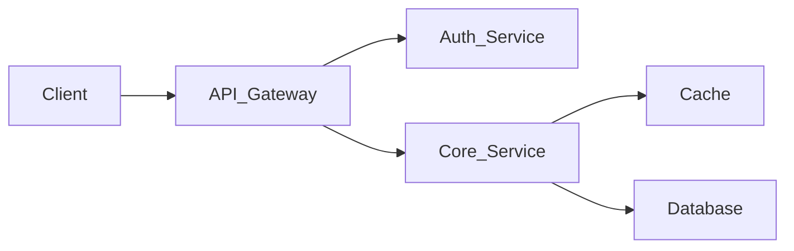
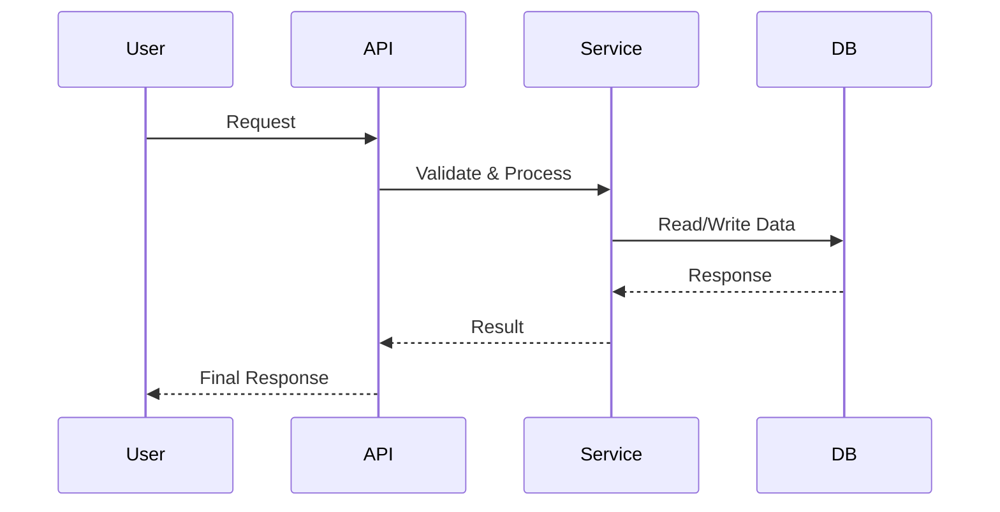

# System Design Project Template

**Project Title:**
`[YOUR PROJECT NAME HERE, e.g., "Real-time Chat Application" or "E-commerce Backend Service"]`

---

## Table of Contents

- [0. Documentation Style & Technical Writing Guidelines](#0-documentation-style--technical-writing-guidelines)
- [1. Understand the Problem & Define Project Scope](#1-understand-the-problem--define-project-scope)
- [2. Propose High-Level Design](#2-propose-high-level-design)
- [3. Low Level Design](#3-low-level-design)
  - [3.1 Low Level Design Goals](#31-low-level-design-goals)
  - [3.2 Detailed Design & Deep Dive](#32-detailed-design--deep-dive)
  - [3.3 Component-Level Design](#33-component-level-design)
  - [3.4 Error Handling & Monitoring](#34-error-handling--monitoring)
  - [3.5 Security & Resilience Deep Dive](#35-security--resilience-deep-dive)
  - [3.6 Privacy Deep Dive](#36-privacy-deep-dive)
  - [3.7 Deployment & Operations](#37-deployment--operations)
  - [3.8 Tech Stack](#38-tech-stack)
- [4. Risks & Mitigation](#4-risks--mitigation)
- [5. Review & Iteration](#5-review--iteration)

---

<!--
  ANCHOR LINKING NOTE:
  Each <details> element has an `id` attribute that matches the Table of Contents link.
  Format: lowercase, hyphens for spaces, remove special characters except hyphens.
  Example: "3.1 Low Level Design Goals" → id="31-low-level-design-goals"
-->

<details id="0-documentation-style--technical-writing-guidelines">
<summary><strong>0. Documentation Style & Technical Writing Guidelines</strong></summary>

This section defines **how** this document should be written and maintained to ensure clarity, consistency, and technical rigor.

### General Writing Style

- Use **clear, concise, and unambiguous language**. Be objective and critical in your writing, do not accept ideas or information at face value. Avoid being verbose unless clearly specified.
- Prefer **bullet points** over long paragraphs
- Highlight **key terms** in **bold**
- Use **tables** for comparisons, trade-offs, and structured data
- Keep sections **self-contained** so they can be read and updated independently
- When possible, keep designs **language-neutral** and prefer **UML diagrams** using Mermaid.

### Diagrams & Visuals

- Use **Mermaid** for architecture diagrams, flows, and sequences. Use high contrast colors and keep text in boxed very short. Add comments down below the diagram, not in the diagram itself.
- Keep diagrams **high-level first**, then add detailed diagrams in later sections
- Always add a **title or short explanation** above each diagram

**Example – High-Level Architecture Diagram (Mermaid):**



**Example – Sequence Diagram (Mermaid):**



### Code & Configuration Blocks

- Use fenced code blocks with language identifiers:
  - `json`, `yaml`, `bash`, `sql`, `proto`, etc.
- Keep examples minimal but realistic
- Avoid pseudo-code when real syntax improves clarity

### Assumptions & Decisions

- Explicitly document:
  - Assumptions
  - Constraints
  - Out-of-scope items
- Every major architectural decision should have a rationale

### Versioning & Iteration

- Treat this document as living documentation
- Add a short changelog if the design evolves significantly
- Clearly mark open questions or TBDs

</details>

---

<details id="1-understand-the-problem--define-project-scope">
<summary><strong>1. Understand the Problem & Define Project Scope</strong></summary>

### Core Problem

What fundamental problem does this system address?

### Functional Requirements

- List all essential features and functionalities the system must provide
- Prioritize features using **P0–P2** ranking:
  - **P0** — Critical (must-have for launch)
  - **P1** — High (important, but can ship without)
  - **P2** — Medium (nice-to-have)
- Describe key user interactions and system behaviors

**Example:**

| ID | Requirement | Priority |
|----|-------------|----------|
| **F1** | User authentication and authorization | P0 |
| **F2** | Real-time notifications | P1 |
| **F3** | Dark mode support | P2 |

**Priority Key:** P0 = Critical | P1 = High | P2 = Medium

### Non-Functional Requirements

- **Scalability:** Expected user base, transaction volume (QPS), data growth, and future expansion strategy
- **Performance:** Target response times, throughput, and latency
- **Availability:** Uptime goals (e.g., 99.99%), disaster recovery, fault tolerance
- **Reliability & Durability:** Data consistency, retries, failure handling
- **Security:** Authentication, authorization, encryption (in transit & at rest)
- **Privacy:** Handling of sensitive data, regulatory compliance (GDPR, CCPA, HIPAA)
- **Maintainability:** Ease of updates, debugging, and operations
- **Cost:** Infrastructure, development, and operational constraints
- *(Add others as needed: testability, portability, usability, etc.)*

### Initial Capacity Estimates

- Peak read/write QPS
- Total data storage
- Network bandwidth requirements
- Early potential bottlenecks

### Scope Agreement

Confirm agreed-upon scope and requirements with all stakeholders.

</details>

---

<details id="2-propose-high-level-design">
<summary><strong>2. Propose High-Level Design</strong></summary>

### API / Interface Design

- Define all external interfaces
- Specify:
  - Endpoints
  - Request/response formats
  - Data types
  - Error codes
- Choose protocols:
  - REST
  - gRPC
  - WebSockets

**Example (REST with Versioning):**

```bash
GET  /api/v1/users/{id}
POST /api/v1/messages
GET  /api/v2/products?category=electronics
PUT  /api/v2/users/{id}/privacy-settings
```

### Overall Architecture Diagram

- Show major components:
  - Load balancers
  - API gateways
  - Services
  - Caches
  - Databases
  - Message queues
- Indicate architectural patterns:
  - Monolith
  - Microservices
  - Event-driven

### Data Model & Storage Strategy

- Conceptual and logical data models
- Database choices:
  - SQL
  - NoSQL (document, key-value, graph, column-family)
- Indexing and partitioning strategies

### Key Design Decisions & Assumptions

- Document important architectural choices
- Explain why alternatives were rejected
- List assumptions that require validation

</details>

---

<details id="3-low-level-design">
<summary><strong>3. Low Level Design</strong></summary>

This section outlines the detailed technical design, covering class diagrams, interface definitions, and technology selections.
Each subsection must conclude with:

- Class diagram
- Sequence diagram
- Complete data model

Avoid including code unless explicitly requested.

<details id="31-low-level-design-goals">
<summary><strong>3.1 Low Level Design Goals</strong></summary>

At the end of Low Level Design, the following deliverables must be complete:

| Deliverable | Description |
|-------------|-------------|
| **Complete Class Diagram** | Full UML class diagram showing all classes, their attributes, methods, and relationships |
| **Interface Definitions** | All abstractions defined as interfaces to enable loose coupling and testability |
| **SOLID Compliance** | Design must adhere to SOLID principles (Single Responsibility, Open/Closed, Liskov Substitution, Interface Segregation, Dependency Inversion). Favor composition over inheritance |
| **OOD Best Practices** | Follow established Object-Oriented Design patterns and principles |
| **Modularity** | Components designed for independent development, testing, and deployment |
| **Flexibility** | Architecture supports extension and modification without breaking existing functionality |
| **Testability** | Design clear interfaces so that components can be mocked |

**Design Principles Checklist:**

- [ ] **Favor interfaces over concrete implementations** — depend on abstractions
- [ ] **Single Responsibility** — each class has one reason to change
- [ ] **Open/Closed** — open for extension, closed for modification
- [ ] **Liskov Substitution** — subtypes must be substitutable for their base types
- [ ] **Interface Segregation** — prefer many specific interfaces over one general-purpose interface
- [ ] **Dependency Inversion** — high-level modules should not depend on low-level modules
- [ ] **Composition over inheritance** — favor object composition for flexibility
- [ ] **Loose coupling** — minimize dependencies between modules
- [ ] **High cohesion** — related functionality grouped together

</details>

<details id="32-detailed-design--deep-dive">
<summary><strong>3.2 Detailed Design & Deep Dive</strong></summary>

### Identify Critical Challenges / Bottlenecks

Examples:

- High write throughput
- Distributed consistency
- Real-time processing latency

### For Each Challenge

#### Problem Statement

Clearly define the technical issue.

#### Alternative Solutions & Trade-offs

| Criterion / Solution | Solution A | Solution B | Solution C |
|---------------------|------------|------------|------------|
| **Pros** | 🟩 Advantage | 🟩 Advantage | 🟩 Advantage |
| **Cons** | 🟥 Major drawback | 🟨 Minor drawback | 🟨 Minor drawback |
| **Performance Impact** | e.g., 200ms latency | e.g., 150ms latency | e.g., 300ms latency |
| **Cost Impact** | High infra cost | Moderate ops cost | Low dev cost |
| **Complexity** | High | Medium | Low |
| **Scalability** | Linear to 10M users | DB-bound | Read-optimized |
| **Maintainability** | Specialized ops | Standard tooling | Harder debugging |

**Color Key:**

- 🟩 Strong positive
- 🟨 Neutral / trade-off
- 🟥 Significant concern

#### Chosen Solution & Rationale

- Final decision
- Data-backed justification
- Reference the comparison table

</details>

<details id="33-component-level-design">
<summary><strong>3.3 Component-Level Design</strong></summary>

- Internal architecture
- Technologies & frameworks
- Algorithms and data flows

</details>

<details id="34-error-handling--monitoring">
<summary><strong>3.4 Error Handling & Monitoring</strong></summary>

- Logging strategy
- Distributed tracing
- Alerting
- Key SLIs/SLOs

</details>

<details id="35-security--resilience-deep-dive">
<summary><strong>3.5 Security & Resilience Deep Dive</strong></summary>

- Encryption
- Access control
- Secret management
- Redundancy and failover
- Disaster recovery

</details>

<details id="36-privacy-deep-dive">
<summary><strong>3.6 Privacy Deep Dive</strong></summary>

- PII handling
- Data minimization
- Anonymization / pseudonymization
- User rights (erasure, portability)

</details>

<details id="37-deployment--operations">
<summary><strong>3.7 Deployment & Operations</strong></summary>

- Deployment strategy:
  - Blue/Green
  - Canary
- CI/CD integration
- Runbooks and on-call procedures

</details>

<details id="38-tech-stack">
<summary><strong>3.8 Tech Stack</strong></summary>

This subsection documents the technologies selected for the project and the rationale behind each choice.

#### Technology Selection Criteria

Before selecting technologies, consider:

- **Team expertise** – Familiarity and learning curve
- **Community & ecosystem** – Library availability, documentation, support
- **Performance** – Throughput, latency, resource efficiency
- **Scalability** – Horizontal/vertical scaling capabilities
- **Maintainability** – Long-term support, upgrade path
- **Cost** – Licensing, infrastructure, operational overhead
- **Integration** – Compatibility with existing systems

#### Technology Stack Overview

| Category | Technology | Purpose | Rationale |
|----------|------------|---------|-----------|
| **Programming Language** | `[e.g., Python 3.11]` | Core backend logic | 🟩 Team expertise, rich ecosystem, rapid development |
| **Programming Language** | `[e.g., TypeScript]` | Frontend development | 🟩 Type safety, better DX, maintainability |
| **Backend Framework** | `[e.g., FastAPI]` | REST API server | 🟩 Async support, auto-docs, high performance |
| **Frontend Framework** | `[e.g., React 18]` | Web UI | 🟩 Component reusability, large ecosystem |
| **Database (Primary)** | `[e.g., PostgreSQL 15]` | Relational data storage | 🟩 ACID compliance, JSON support, proven reliability |
| **Database (Cache)** | `[e.g., Redis]` | Session & query caching | 🟩 Sub-ms latency, pub/sub support |
| **Message Queue** | `[e.g., Apache Kafka]` | Event streaming | 🟩 High throughput, durability, replay capability |
| **Search Engine** | `[e.g., Elasticsearch]` | Full-text search | 🟩 Fast indexing, powerful query DSL |
| **Container Runtime** | `[e.g., Docker]` | Application packaging | 🟩 Portability, reproducible environments |
| **Orchestration** | `[e.g., Kubernetes]` | Container management | 🟩 Auto-scaling, self-healing, declarative config |
| **CI/CD** | `[e.g., GitHub Actions]` | Build & deployment automation | 🟩 Native integration, flexible workflows |
| **Infrastructure as Code** | `[e.g., Terraform]` | Cloud resource provisioning | 🟩 Multi-cloud, state management, modular |
| **Monitoring** | `[e.g., Prometheus + Grafana]` | Metrics & dashboards | 🟩 Industry standard, rich query language |
| **Logging** | `[e.g., ELK Stack]` | Centralized log management | 🟩 Powerful search, visualization |
| **Tracing** | `[e.g., Jaeger]` | Distributed tracing | 🟩 OpenTelemetry compatible, trace visualization |
| **Secret Management** | `[e.g., HashiCorp Vault]` | Secrets & credentials | 🟩 Dynamic secrets, audit logging |
| **API Documentation** | `[e.g., OpenAPI/Swagger]` | API specification | 🟩 Standardized, auto-generated docs |
| **Testing Framework** | `[e.g., pytest / Jest]` | Unit & integration tests | 🟩 Rich plugin ecosystem, parallel execution |

**Color Key:**

- 🟩 Strong fit / primary reason for selection
- 🟨 Acceptable trade-off
- 🟥 Known limitation to monitor

#### Key Technology Decisions

Document significant technology choices that require deeper justification:

##### Decision 1: `[Technology Choice]`

| Aspect | Details |
|--------|---------|
| **Context** | What problem or requirement drove this decision? |
| **Options Considered** | Option A, Option B, Option C |
| **Decision** | Chosen technology and version |
| **Rationale** | Why this option over alternatives |
| **Trade-offs Accepted** | Known limitations or risks |
| **Review Date** | When to revisit this decision |

##### Decision 2: `[Technology Choice]`

*(Repeat the table structure above for each major decision)*

#### Version Pinning & Compatibility Matrix

| Component | Version | Min Compatible | Max Compatible | Notes |
|-----------|---------|----------------|----------------|-------|
| `[e.g., Python]` | 3.11.x | 3.10 | 3.12 | LTS preferred |
| `[e.g., Node.js]` | 20.x | 18.x | 22.x | Even versions only |
| `[e.g., PostgreSQL]` | 15.x | 14 | 16 | Major version upgrades require migration |

#### Future Technology Considerations

- **Planned adoptions:** Technologies to evaluate for future phases
- **Deprecation candidates:** Technologies to phase out
- **Watch list:** Emerging technologies to monitor

</details>

---

<details id="4-risks--mitigation">
<summary><strong>4. Risks & Mitigation</strong></summary>

### Identify Potential Risks

- Technical
- Operational
- Organizational
- Scope-related

### Mitigation Strategies

- Redundancy
- Proofs of concept
- Training
- Process controls

### Contingency Plans

Fallback strategies if mitigations fail.

</details>

---

<details id="5-review--iteration">
<summary><strong>5. Review & Iteration</strong></summary>

### Design Validation

- Validate against all functional and non-functional requirements
- Identify gaps and inconsistencies

### Summary of Key Decisions

Concise recap of architectural choices and their impact.

### Feedback Integration

Incorporate peer, architectural, and stakeholder feedback.

### Next Steps

- Implementation planning
- Testing strategy
- Deployment roadmap

</details>
